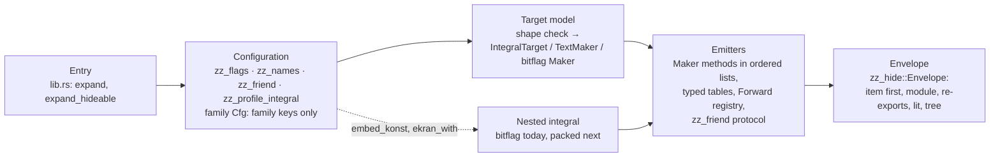
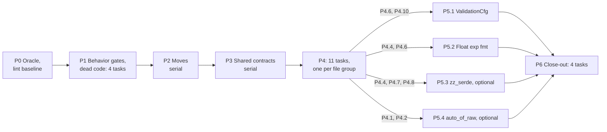

# Refactoring plan: structure `src/` around generation

This plan restructures the release code in `src/`. Tests (`src/tests/` and
`typekin_testing/`) are out of scope until the non-test refactor is done (§7): a
step that breaks one gives it the minimal mechanical fix (an import path, a
renamed crate-private item, an expected token string) and nothing more. The plan
enforces the existing architecture and conventions further: shared machinery
lives in `zz_*` files, each macro family lives in its own file plus suffix-named
siblings, names are types, and the module tree stays flat. The work is
generalization and breaking large functions and files into smaller parts. It
changes no architecture and adds no directories.

Basis: `13703fb`. Seven read-only slices, one per appendix, re-checked the first
version of this plan (written at `965b7a8`) against it; one compiled a scratch
copy to confirm the `zz_values` dead list. Line counts come from `13703fb`.
`17c032f` changes only the plans, and §3's measurements were rerun there. Code
is referenced by item name. [INFERENCE] marks claims derived from reading code
but not compiled or run.

## Execution policy

This plan is a living document. Change it when execution evidence contradicts
it.

Change autonomously (log it, don't ask):

- reorder, split, merge, or drop tasks
- add tasks needed to satisfy existing acceptance criteria
- change parallelization: serialize tasks that turn out coupled, parallelize
  ones that turn out independent
- change implementation approach inside a task

Stop and ask before:

- changing contracts/interfaces/schemas from earlier phases
- changing scope (dropping a requirement or adding a feature)
- adding dependencies
- anything that invalidates completed work

Re-evaluate the remaining plan when:

- a subagent reports a wrong assumption or a block
- verify fails in a way not attributable to a single task
- a task needs files outside its ownership or is much larger than expected
- every phase ends (always)

Before each phase: re-read the plan and the Deviations log, and confirm the
next phase still makes sense given what was learned. Revise it first if not.

If a change affects more than one remaining phase, stop and present the
revised plan for approval.

When changing the plan: edit tasks in place and mark them [changed]/[dropped],
with no silent rewrites. Append to ## Deviations: what changed, the evidence,
and the impact on remaining phases. Keep the todo list in sync.

## What changed since the first version

| First version                                                                        | At `13703fb`                                                                                                                                                            |
| ------------------------------------------------------------------------------------ | ----------------------------------------------------------------------------------------------------------------------------------------------------------------------- |
| Add `Capability`; type flags, `konst_*` names, profiles, functions                   | Landed in `2f0ccb7` (`Capability`, `IntegralFlag`/`TextFlag`/`BitFlag`, `Konsts::of_in`, `Key`, `ProfileKind`, `FnName`). The remaining work is retyped on these enums. |
| Land the `without = fn_*` work first                                                 | Landed in `2f0ccb7` (`zz_lib::Forward`/`Removals`)                                                                                                                      |
| Bugs: `without = friend`, bitflag `-> Inspector`, the `r#Type` panic                 | Fixed in `404be48`                                                                                                                                                      |
| Domain: comparison grammar, shared normalizer and emitter skeletons                  | `13703fb` replaced the grammar with set expressions. Appendix G is re-planned; the skeletons are dropped (§4.4, P4.10).                                                 |
| Split `integral.rs` last                                                             | Split first (P2), together with the other pure moves                                                                                                                    |
| Token-identical output, checked with `cargo expand` and throwaway token-string tests | An `expandem` snapshot of typekin's own expansions in which trailing commas don't count, plus identical diagnostics; `just gate` runs both for every task (§3)          |
| Keep `zz_profile` in `zz_*` by injecting the integral grammar                        | Rename it `zz_profile_integral.rs`: integral-only machinery                                                                                                             |
| Open decisions on do-nothing capabilities and on bitflag without `integral = [..]`   | Decided (§6.1, §6.3); new future work (§7)                                                                                                                              |
| Trim `mk_flags!`                                                                     | Replace it with hand-written flag enums and a bitset (§4.3, B.3)                                                                                                        |
| Generated names: not covered                                                         | Every generated name a user can see comes from one names table per family, ready for renaming (§4.3, Appendix H)                                                        |
| Phases as parallel lanes joined by one-line seams                                    | Sequential phases of parallel tasks that own disjoint files; every cross-file contract lands in the serial P3 (§4)                                                      |

## 1. What makes the code hard to manage

- **The size sits in a few places.** `integral.rs` is 6,856 of the 22,268
  release lines. 43 functions are 80 lines or longer. The largest are
  `TextMaker::ekran` (486), `bitflag::Maker::ekran_vl_impl` (382),
  `core_int_forwards` (300), `ekran_serde` (281), `integral::ekran` (244) and
  `check_prove_item` (226). Most of these are one long `quote!` or a row of
  same-shape blocks, not logic.
- **Three families assemble the output by hand.** integral, bitflag and text
  each repeat `hide_in`, the embedded tree, the literal macro and the `const _`
  scope. There are four identical `catching` wrappers, four copies of the
  `derive`/`derive_const` choice and three of `repr(transparent)`.
- **Flag bookkeeping is per family.** Integral keeps an `IntSettings` per
  profile plus four `root_*` maps swapped with `mem::take`; text and bitflag
  each keep their own `konst_flags` and `seen_flags`. `DuplicateFlagPolicy`
  changes no outcome.
- **Shared code lives in a family file, and one dependency is hidden.**
  - `friendship.rs`'s inline `mod cfg` holds `Friend`, `Capability`, `Protocol`
    and `emit_protocol`, which integral, text, bitflag, constructor and
    `zz_profile` use. A `mod` declared in a non-root module also breaks
    AGENTS.md's flat-module rule.
  - `zz_profile` imports `integral` and `friendship`, but its name doesn't say
    that it serves integral only. It is the only `zz_*` file that depends on a
    family file.
- **Emitters are hand-copied.**
  - About 15 operator-impl templates sit in 9 functions, about 550 lines.
  - There are 5 identical fmt impls, 9 copies of `target.construct(…Self…)`, and
    the bit-access block 4 times.
  - `Ctx` has 25 fields, and 66 emitters take `ctx: &Ctx`, although there is
    exactly one `Ctx::new` and the argument is always `&self.ctx`.
- **Some logic still compares strings.** `is_blind_trust_capability` recognizes
  `Unsafe` and `FlagUnsafe` by trait name; `conditional_make` is keyed by a
  type-name `String`; the domain groups by a string key with a magic `""` and
  re-parses it with `split(',')`; `ValidationCfg::closure` signals ineligibility
  with ``starts_with('`')``; the int domain function names are listed about six
  times.
- **Most generated names are fixed.** Users can name the `friends` traits, the
  constructor, bitflag's value type, literal macros and `hide_in` modules. The
  integral protocol traits (`Seal`, `Make`, `Math`, …), bitflag's `FlagSeal` and
  `FlagBit`, `conv_*`, the facet `{Op}Rhs` traits and the generated methods are
  spelled inline in the emitters, and the capability keyword a user writes
  (`-> Math`) doubles as the emitted trait name.
- **Domain:** three-valued logic is written three times, and four grouping loops
  are copies of each other.
- **Dead code:**
  - `mk_flags!` (250 lines) generates structs of bools; `parse_from`,
    `seen_flags`, the generated `get` and the String fields (no setter since
    `2f0ccb7`) are dead.
  - Items hidden by `zz_values`' `#![allow(unused, dead_code)]`, such as
    `RangeEnding`.
  - `DuplicateFlagPolicy`, an unreachable `friends` diagnostic, bitflag's
    `Result<Option<_>>` that never fails, and text's always-empty
    `bonst`/`destruct`.

## 2. Target shape: one pipeline, one owner per stage



Three rules to add to AGENTS.md so this stays enforced:

- `zz_` marks machinery, never a macro entry point. A shared `zz_*` file never
  imports a family module; a `zz_*` file that serves one family ends with that
  family's name (`zz_profile_integral`) and imports only that family. True after
  P2; P2.3 adds it.
- An emitter is a `&self` method that returns one generated trait or impl group,
  with its flag check as an early return. The orchestrators (`ekran_impls`,
  `ekran_items`, text/bitflag `ekran`) are only ordered lists of calls, and that
  order is part of the public output. P6.1 adds it, once P4 has made every
  emitter gate early.
- [changed] Every generated name an emitter builds from parts, and every name
  a user can choose, comes from the family's names table
  (`let seal = names.get(IntegralName::SealTrait);`), and no logic compares
  generated names. Names written literally inside `quote!` stay literal (D4(d),
  §7). P3.2 adds it.

The refactor is done when:

- each stage has one owner, and every `zz_*` file is either shared or named
  after the one family it serves;
- the planned features land locally (§5): `Within` is capability-policy rows
  plus one constructor emitter, and `packed` reuses `expand`, `Envelope`,
  `FlagSettings` and `embed_konst` instead of copying bitflag's pipeline;
- [changed] renaming a generated name built from parts or already choosable is
  a parser change: the emitters read those names from the names table
  (literal `quote!` names stay literal, D4(d));
- no logic function is longer than about 100 lines: `just fn-lengths` lists only
  data tables (`FnName::name`) and single straight `quote!` impls
  (`ekran_ty_impl`, `ekran_iter`).

## 3. How each task is checked

- **Every refactor task is pure:** the same expansion snapshot (trailing commas
  aside), the same typekin diagnostics (message and span) and the same accepted
  syntax. Behavior changes are tasks of their own (P1.1, P6.2 to P6.4), one
  commit per fix, each with its own regression test (§6).
- **Recipes.** P0.1 adds these recipes to the root `justfile`, which exports
  `RUSTFLAGS = -Zmacro-backtrace`. None of them runs the `fmt` recipe, which
  formats `README.md`; that is also why `examples-check` runs the example
  recipes one by one instead of through `just expandem`.

```just
# The expansion snapshot: typekin's own expansions of every testing-crate
# file with a typekin attribute, trailing commas stripped.
[group("z")]
snapshot out:
  rm -rf '{{ out }}'
  mkdir -p '{{ out }}'
  grep -l '#\[typekin::' typekin_testing/src/*.rs \
    | xargs -P 6 -I{} sh -c 'expandem "$1" "typekin::**" > "$2/${1##*/}"' _ {} '{{ out }}'
  perl -0pi -e 's/,(\s*[)\]}])/$1/g' '{{ out }}'/*

# A fresh snapshot, diffed against the shared base.
[group("z")]
snapshot-check name: (snapshot "/tmp/typekin-snap/" + name)
  diff -r /tmp/typekin-snap/base '/tmp/typekin-snap/{{ name }}'

# Regenerates every `_exp.rs`; fails when one changes.
[group("z")]
examples-check:
  just --summary | tr ' ' '\n' | grep -- '-expand$' | grep -v '^z' \
    | xargs -P 6 -n 1 just
  cargo +nightly fmt
  git diff --exit-code -- examples/

# Format, lint, typekin's own tests and the fast consumer tests.
[group("z")]
verify:
  cargo +nightly fmt -- --check
  cargo +nightly fmt --manifest-path typekin_testing/Cargo.toml -- --check
  cargo +nightly clippy --locked --lib --tests -- -D warnings
  cargo +nightly test --locked
  cargo +nightly test --locked --manifest-path typekin_testing/Cargo.toml --features test_fast

# A refactor task: `verify`, and neither the snapshot nor an example changes.
[group("z")]
gate name: verify (snapshot-check name) examples-check

# A phase's exit, on the merged result.
[group("z")]
gate-phase name: (gate name)
  cargo +nightly test --locked --manifest-path typekin_testing/Cargo.toml --features test_slow
  cargo +nightly test --locked --lib --features nightly
  for example in my_u32_non_const my_u32_stable_const my_tcp my_text my_flag my_f64 my_unit my_f32_point; do env -u RUSTFLAGS cargo +stable run --locked --quiet --example "$example"; done

# Functions in `src/` longer than `max` lines, longest first.
[group("z")]
fn-lengths max='100':
  #!/usr/bin/env bash
  set -euo pipefail
  awk -v max='{{ max }}' '
    FNR == 1 { open = 0 }
    !open && /^ *(pub(\([a-z]+\))? )?(const )?fn [A-Za-z_0-9]+/ && !/;$/ {
      match($0, /^ */); start = FNR; open = 1
      name = $0
      sub(/^ *(pub(\([a-z]+\))? )?(const )?fn /, "", name)
      sub(/[(<].*/, "", name)
      closer = sprintf("%" RLENGTH "s}", "")
      next
    }
    open && $0 == closer {
      if (FNR - start + 1 > max) print FILENAME ":" start ": " name " " FNR - start + 1
      open = 0
    }
  ' src/*.rs | sort -t ' ' -k 3 -n -r
```

- **Snapshot.** `expandem` expands only the macros it is given, here
  `typekin::**`, and leaves Rust's, serde's and every other macro as written. So
  the snapshot holds exactly what typekin generates, and nothing else; as
  AGENTS.md says, prefer it to `cargo expand`. `snapshot-check NAME` writes
  `/tmp/typekin-snap/NAME`, so tasks in parallel worktrees don't collide, and
  diffs it against the shared `/tmp/typekin-snap/base`. P0.1 takes the base. It
  is retaken after P1 and after P6, the phases that change output on purpose; P2
  to P5 never change it.
- **Measured** at `17c032f` in a fresh worktree, with the recipes above:
  - The snapshot covers the 26 testing-crate files that mention a typekin
    attribute, every family and the serde impls included: 519,282 lines in 41 s
    with six parallel jobs, 36 s warm. Two runs are byte-identical, and turning
    one `#[inline(always)]` in `text.rs` into `#[inline]` makes `snapshot-check`
    fail with a 76-line diff.
  - `examples-check` takes 15 s and leaves every `_exp.rs` unchanged.
  - `cargo +nightly test --locked` passes 906 tests, `test_fast` 801 and
    `test_slow` 900. `clippy --lib --tests` reports 8 warnings; with P0.1's fix
    applied, `just gate` passes in 71 s and `just gate-phase` in 80 s, warm.
  - `just fn-lengths 79` lists §1's 43 functions with their sizes.
- **What the snapshot leaves out:**
  - `expandem` doesn't expand items declared inside function bodies (the 7
    declarations inside `test_integral.rs` test bodies), and the fixture-crate
    sources in `fx_compile_fail`, `fx_compile_pass`, `fx_no_std` and
    `fx_pointer_width_compile` are strings. The tests and `test_slow` cover
    those.
  - Trailing commas are stripped on purpose. A diff that is only spacing is fine
    too (`diff -rw`).
  - Spans aren't printed, so interpolate user-supplied tokens instead of
    rebuilding them, and give a rebuilt identifier the span it had. Everything
    else is visible: item and attribute order, identifiers, `<..>` arguments,
    doc attributes, parentheses and `return` blocks.
- **Gates.** `verify` runs typekin's own diagnostics (`src/tests/`) and
  `test_fast`; `gate` adds the unchanged snapshot and examples; `gate-phase`
  adds `test_slow` (fixture crates and assembly), the crate's `nightly` feature
  and AGENTS.md's stable smoke runs. A behavior task runs
  `just verify && just examples-check` and reviews `just snapshot-check <task>`,
  which fails by design, with exactly the differences its acceptance lists.
- **Tests stay out of scope.** A broken test gets its mechanical fix (an import
  path, a renamed crate-private item, an expected token string) in the same
  commit, and only in a test file the task owns (§4). A step whose test fix
  would be more than mechanical is reshaped; the appendices already do that. The
  token-string assertions in `t_proof`, `t_integral`, `t_float`, `t_domain` and
  `t_marker_tree` keep passing untouched, and these test-facing signatures stay:
  the family `ekran(Cfg, Item)`, `ekran_with`, `Cfg: Parse` and the
  `Cfg::parse_*` constructors the tests call, `StoragePlan::{primitive, new}`,
  `TextMaker::new`, `marker_tree::expand`, `expand_embedded`,
  `inner_visibility`, `Closure`, `Tri` and `ValidationCfg::resolved`.
- **Commits:** moves and edits go in separate commits. Review a move with
  `git show --color-moved=dimmed-zebra --color-moved-ws=allow-indentation-change`.

## 4. Phases and tasks

Phases run in order. Each starts from the merged result of the one before and
ends when `just gate-phase <phase>` passes on the merge. Inside a phase, tasks
run in parallel, each on its own branch and git worktree from the phase base.

- **Ownership.** A task edits only the files under its **Owns** and creates only
  the new files named there. In a parallel phase no file has two owners, and
  every file without an owner is frozen, so integrating the phase is a series of
  conflict-free merges.
- **Seams.** An item that another task's files use keeps its name and signature
  for the phase; **Keeps** lists them. A change that has to cross a seam belongs
  to the serial P3 or to P5.
- **Tests.** A test file is frozen unless a task owns it, and an owned test file
  takes only §3's mechanical fixes. A task that needs a file it doesn't own
  stops and reports; the plan changes, not the ownership.
- **Serial phases** (P0, P2, P3) have one owner. Their steps run in the listed
  order, each one commit (or a short series, moves and edits apart) that passes
  its gate before the next step starts; their **Owns** lists show what a step
  touches.
- `AGENTS.md` changes only in P2, P3 and P6.1.
- **Verify** must pass before a task merges; **Iterate** names focused tests for
  the edit loop.

The order follows five rules:

1. Make checking cheap first (P0): one `just gate` per task, about a minute
   warm.
2. Land the behavior fixes that the contracts rely on first (P1), so that P2 to
   P5 leave the snapshot unchanged.
3. Delete before moving, and move before editing (P1, P2). P1 takes only code
   that no later task rewrites; other dead code goes with the task that rewrites
   it.
4. Shared contracts come first and alone (P3). Every type, helper, generated
   name and signature that two later tasks share lands there with all of its
   call sites, so nothing sits unused and no parallel task edits shared code.
5. What the planned features need (§5) comes before cosmetic shrinking.



| Phase                           | Mode     | Tasks         | Net lines      | Risk                                           |
| ------------------------------- | -------- | ------------- | -------------- | ---------------------------------------------- |
| P0 Oracle and lint baseline     | serial   | P0.1          | 0              | none                                           |
| P1 Behavior gates and dead code | parallel | P1.1 to P1.4  | −100           | low; P1.1 changes output on purpose            |
| P2 File moves                   | serial   | P2.1 to P2.3  | +300 (imports) | none                                           |
| P3 Shared contracts             | serial   | P3.1 to P3.7  | −400           | low–medium (diagnostic order)                  |
| P4 Per-file restructuring       | parallel | P4.1 to P4.11 | −1,650         | medium (P4.6 and P4.10 sit next to the proofs) |
| P5 Cross-file follow-ups        | parallel | P5.1 to P5.4  | −100           | medium (P5.1 touches soundness)                |
| P6 Close-out                    | parallel | P6.1 to P6.4  | 0              | low; P6.2 to P6.4 change output on purpose     |

The line counts regroup the first version's per-phase estimates [INFERENCE:
summed from the appendices' per-item estimates]. In total that is about −2,000
lines (~9%), less than the first version's −3,000, because the typed names
already landed, the shared domain skeletons are dropped, and the flag enums and
names tables add data.

### 4.0 P0 Oracle and lint baseline (serial)

#### P0.1 Oracle and lint baseline

- **Owns:** `justfile`, `src/lib.rs`, `src/zz_domain.rs`, `src/zz_lib.rs`.
- **Depends on:** nothing.
- **Does:**
  - Adds §3's recipes to the root `justfile`.
  - Clears the 8 warnings of `cargo +nightly clippy --locked --lib --tests`, so
    `verify` can deny warnings: the three `|attr| syn::parse2::<…>(attr)`
    closures in `lib.rs` become the function path, int `type_atom`'s two
    `map(&typed)` become `map(typed)`, and `Node`, `TNode` and `Resolved` get
    `#[allow(clippy::large_enum_variant)]`, like the existing
    `upper_case_acronyms` allows: they are expansion-time trees built once per
    macro call.
  - Takes the snapshot base and records the baseline test counts in the commit
    message.
- **Acceptance:** `verify` passes with `-D warnings`; a second snapshot equals
  the base; `examples/` is unchanged; `just fn-lengths 79` prints §1's 43
  functions.
- **Verify:** `just snapshot /tmp/typekin-snap/base && just gate-phase P0`.

### 4.1 P1 Behavior gates and dead code (parallel)

Base: P0. Exit: merge the four tasks, check the snapshot diff against P1.1's
list, retake the base with `just snapshot /tmp/typekin-snap/base`, then run
`just gate-phase P1`.

#### P1.1 Behavior gates (§6.1, §6.2, §6.3)

- **Owns:** `src/bitflag.rs`, `src/friendship.rs`, `src/tests/t_bitflag.rs`,
  `src/tests/t_integral.rs`, `typekin_testing/src/test_bitflag.rs`,
  `typekin_testing/src/fx_bitflag.rs`, the regenerated `examples/*_exp.rs`.
- **Depends on:** P0.1.
- **Does:** three commits in this order, each with its regression test: §6.1;
  §6.2, which relies on §6.1 leaving the bitflag protocol without an unsafe
  capability; §6.3.
- **Acceptance:**
  - Each regression test fails on its commit's parent: §6.1's rejection in
    `t_bitflag`, §6.2's `unsafe` tokens in `t_integral`, and §6.3's operators
    (both forms implement the same ones for a signed `repr`) in `test_bitflag`.
  - `root_unsafe_friend_grants_no_bit_operations` and `RootUnsafeFlag` become a
    `t_bitflag` rejection test, and `attrs_friends_and_konst` uses `-> Bit`.
  - Against the P0 base, the snapshot differs only by the root-friend traits and
    impls that §6.1 removes and the `Neg`/`_neg` that §6.3 adds to signed
    bitflag values declared without `integral = [..]` [INFERENCE: no
    testing-crate file declares a generic parameter named `Unsafe`, so §6.2
    shows only in its test].
- **Verify:** after each commit, `just verify && just examples-check`, then
  `just snapshot-check P1.1`, which fails with only the differences above.
- **Iterate:**
  `cargo +nightly test --locked --lib -- tests::t_bitflag tests::t_integral` and
  `cargo +nightly test --locked --manifest-path typekin_testing/Cargo.toml --features test_fast -- test_bitflag`.

#### P1.2 `zz_values` dead code (G.5)

- **Owns:** `src/zz_values.rs`, `src/integral.rs`.
- **Depends on:** P0.1.
- **Does:** deletes G.5's dead items and `Operator`'s `Display`/`FromStr`, drops
  the file-wide `#![allow(unused, dead_code)]`, and makes `cast_signed` call
  `N::signed_rust_name` instead of its inline copy.
- **Acceptance:** `zz_values.rs` allows no unused or dead code.
- **Verify:** `just gate P1.2`.

#### P1.3 `parse_inner` (B.7)

- **Owns:** `src/zz_lib.rs`.
- **Depends on:** P0.1.
- **Does:** B.7: `?` instead of the error `match`, `parse_key`, the documented
  callback contract, and no `// TODO cleanup the mess...`. The key grammar and
  the value-span errors stay.
- **Acceptance:** every attribute diagnostic unchanged: `t_runner`,
  `t_integral`, `t_text` and `t_bitflag` pass untouched.
- **Verify:** `just gate P1.3`.

#### P1.4 Small leftovers (A.8)

- **Owns:** `src/zz_lit.rs`, `src/marker_tree.rs`, `src/constructor.rs`.
- **Depends on:** P0.1.
- **Does:** `syn::ext::IdentExt::unraw` replaces the `r#` trims in
  `LitMacro::new` (its messages use `ty.unraw().to_string()`) and
  `marker_tree::Cfg::expand_embedded`; `constructor::Cfg::parse` drops its no-op
  `scope.or(None)`.
- **Acceptance:** `t_lit` and `t_marker_tree` pass untouched.
- **Verify:** `just gate P1.4`.

### 4.2 P2 File moves (serial)

Details: Appendix C.2, G.6, E.5. Every move edits `lib.rs` and `AGENTS.md`, so
the moves run one after another. Blocks move verbatim and keep their order; the
only edits are `pub(crate)` on what crosses files, imports and `mod` lines, with
no re-exports. Each step fixes its own test imports (§3) and adds its files to
AGENTS.md's repository map.

#### P2.1 `zz_friend.rs` (C.2)

- **Owns:** `src/friendship.rs`, new `src/zz_friend.rs`, the importers
  `src/{lib,integral,bitflag,text,constructor,zz_profile}.rs`,
  `src/tests/{t_integral,t_friendship}.rs`, `AGENTS.md`.
- **Depends on:** P1.
- **Does:** moves `Friend`, `Capability`, `CapabilityName`,
  `parse_capabilities`, `ProtocolFriend`, `Construction`, `Protocol`,
  `emit_protocol` and their helpers; the `friends` macro's `Cfg` becomes a
  top-level item of `friendship.rs`.
- **Acceptance:** `friendship.rs` declares no `mod`.
- **Verify:** `just gate P2.1`.

#### P2.2 `zz_domain_int.rs` (G.6)

- **Owns:** `src/zz_domain.rs`, new `src/zz_domain_int.rs`,
  `src/{lib,zz_lib,zz_domain_closure}.rs`, `src/tests/t_domain_closure.rs`,
  `AGENTS.md`.
- **Depends on:** P2.1.
- **Does:** moves the integer half, from the zero probe through emission (about
  1,550 lines); `zz_domain.rs` keeps the grammar doc, the syntax, the parser and
  `Tri` (about 1,000 lines).
- **Verify:** `just gate P2.2`.

#### P2.3 Integral split and `zz_profile_integral.rs` (E.5)

- **Owns:** `src/integral.rs`, new
  `src/integral_{cfg,friend,impls,items,forward,proof}.rs`, `src/zz_profile.rs`
  (renamed `src/zz_profile_integral.rs`), `src/{lib,bitflag}.rs`,
  `src/tests/{t_float,t_hide,t_integral,t_integral_generic,t_lit,t_order,t_proof}.rs`,
  `AGENTS.md`.
- **Depends on:** P2.2.
- **Does:** E.5's split and the rename, as two commits. AGENTS.md also gets §2's
  first rule, which holds from here on [INFERENCE].
- **Acceptance:** each file holds E.5's contents, between about 445 and 1,435
  lines.
- **Verify:** `just gate P2.3`, then `just gate-phase P2`.

### 4.3 P3 Shared contracts (serial)

Every type, helper, generated name and signature that two P4 tasks share lands
here with all of its call sites: it is used the moment it exists, and no P4 task
touches a shared file. The P4 tasks build on these interfaces and may not change
them. The steps run in this order.

#### P3.1 Typed flags (B.3, B.4) [changed]

- **Owns:** new `src/zz_flags.rs`, `src/zz_runner.rs`, `src/zz_lib.rs`,
  `src/integral*.rs`, `src/zz_profile_integral.rs`, `src/float.rs`,
  `src/bitflag.rs`, `src/text.rs`, `src/tests/{t_runner,t_float}.rs`,
  `AGENTS.md`.
- **Depends on:** P2.
- **Does:**
  - B.3 and B.4: `Flag`, `Flags<F>`, `FlagSettings<F>`, `KonstFlags` and
    `FlagGrammar`; hand-written `IntegralFlag`, `TextFlag` and `BitFlag` with
    their `DEFAULT_ON` lists; `Profiles::explicit_flag`; the ~156 flag sites
    migrated. `mk_flags!`, `IntSettings`, `DuplicateFlagPolicy`,
    `parse_explicit_flags`, `ExplicitFlag` and `resolve_konst` go.
  - The flag metadata P4 builds on, with its sites:
    `IntegralFlag::{math, assign}` (D.3), which replaces
    `IntegralFlags::enabled`, and `Cfg::explicit_span` (B.5) at `fn_or_panic` in
    `ekran` and `new_target` and at `range` in `resolve`.
- **Acceptance:** every flag diagnostic unchanged in message, span and order;
  `t_runner` loses exactly `FlagLists` and
  `rejects_flags_enabled_and_disabled_in_the_shared_flag_parser`; AGENTS.md maps
  `zz_flags.rs`.
- **Verify:** `just gate P3.1`.
- **[changed]** Done in `7f20e09` with interim homes for the string flags and
  `IntegralFlag`-level lists (Deviations D3).

#### P3.2 Generated-name tables (H) [changed]

- **Owns:** new `src/zz_names.rs`, `src/integral*.rs`, `src/float.rs`,
  `src/bitflag.rs`, `src/text.rs`, `src/friendship.rs`, `src/constructor.rs`,
  `src/zz_lit.rs`, `src/zz_hide.rs`, `src/zz_lib.rs`, `AGENTS.md`.
- **Depends on:** P3.1.
- **Does:** H.2's `NameKey`, `Names<K>` and `ResolvedNames<K>`; the inventory of
  every `format_ident!`, `fresh_ident` and `Ident::new` that spells a public
  name; the key enums `IntegralName`, `BitflagName`, `TextName`, `FriendsName`
  and `ConstructorName`, each beside its family's flag enum; the names users can
  already set, stored as choices; `Forward::new` naming its function through the
  table; every emitter of every family reading its names from the table (H.4).
  `conversion_name` (C.7) becomes the default of the `Conversion` keys, and the
  `friends` macro computes its names once (C.5).
- **Acceptance:** outside `zz_names.rs` and the `default_name`s, no
  `format_ident!` or `fresh_ident` spells a public name, and no logic compares
  one; AGENTS.md maps `zz_names.rs` and has §2's names rule.
- **Verify:** `just gate P3.2`.
- **[changed]** Done in `93137fe` with an owner-aware `NameKey` and the key
  set D4 lists. The literal-macro and `hide_in` module names still come from
  `format_ident!` in `zz_lit`/`zz_hide`, so the acceptance is completed by
  P3.6 [changed]. Names written literally inside `quote!` were outside this
  inventory: D4(d), awaiting approval.

#### P3.3 Friend capability model (C.2, C.3, C.7) [changed]

- **Owns:** `src/zz_friend.rs`, `src/friendship.rs`, `src/integral_cfg.rs`,
  `src/zz_profile_integral.rs`, `src/integral_friend.rs`,
  `src/integral_items.rs`, `src/text.rs`, `src/bitflag.rs`.
- **Depends on:** P3.2.
- **Does:** C.2's `CapabilityPolicy` tables (`INTEGRAL`, `FLOAT`, `FACET`,
  `TEXT`, `BITFLAG_ROOT`) and `FACET_OPERATORS`, one parse site per commit, each
  keeping its check position and pass order;
  `Capability::{implies, is_operator}`; C.7's `upsert_friend`, `any_friend_has`
  and `Friend::is_check_only` with their sites; C.3's typed protocol, whose
  `ProtocolCapability` takes integral's trait names from today's `trait_of`
  until P3.4.
- **Acceptance:** every capability diagnostic unchanged; `parse_with_valid`,
  `parse_with_expansion`, `reject_bit_capability`, `is_operator_capability`,
  `is_blind_trust_capability`, `Construction.make` and
  `Construction.blind_trust_capability` are gone.
- **Verify:** `just gate P3.3`.
- **[changed]** Done in `58268d6` as one commit; `BITFLAG_ROOT` keeps P1.1's
  targeted message through `rejects` rows, and `validate_facet` already reads
  `FACET_OPERATORS` (D5).

#### P3.4 Integral emitter contract (D.4, C.6, E.4) [changed]

- **Owns:** `src/integral*.rs`, `src/float.rs`, `src/zz_values.rs`.
- **Depends on:** P3.3.
- **Does:**
  - Every emitter drops its `ctx: &Ctx` parameter and reads `self.ctx` (66
    emitters).
  - C.6's `FriendTraits`, built from the names table, replaces the 8 friend
    fields of `Ctx` and `trait_of`; `with_global_operators`, `with_self_math`
    and `with_self_bit` become `Maker` methods, and `Maker::rhs_where` replaces
    `Ctx::rhs_where_clause` (D.4).
  - `conditional_make` is keyed by `Num`, which derives `Ord` (C.6).
  - `construct_self(raw)` at its 9 sites, and `proven_constructor`, which merges
    `result_constructor` and `core_int_constructor` (E.4).
  - Orchestrator slices: `ekran_impls` calls `impls_head` (`as_ref`, `from_str`,
    serde) and `impls_body` (`into` through `partial_ord`) in
    `integral_impls.rs`, with `make_core_int`, `make_core_float` and
    `make_forwards` between them and `make_fmt_exp` and `make_iterator_folds`
    after them; `ekran_items` calls `item_fns` (`integral_items.rs`) and
    `forward_items` (`integral_forward.rs`, around today's
    `make_items_core_int`). D.1's order is unchanged.
- **Acceptance:** no emitter takes a `Ctx`, and `Ctx` holds no friend field.
- **Verify:** `just gate P3.4`.
- **[changed]** `FriendTraits` lives beside `Ctx` in `integral.rs` with
  `seal`, `conversion`, `conversion_path`, `of`, `bound` and
  `seal_with_arguments`, and `trait_of` is gone (D6).

#### P3.5 Shared emitter helpers and operator metadata (D.3, D.4, E.3, F.7)

- **Owns:** `src/zz_lib.rs`, `src/zz_values.rs`, `src/zz_profile_integral.rs`,
  `src/integral_{friend,impls,items,proof}.rs`, `src/bitflag.rs`, `src/text.rs`.
- **Depends on:** P3.4.
- **Does:** `Konst::bound(is_const, bound)` at its 7 uses (D.4);
  `validated_result(condition, ok, err)` at its 7 sites (F.7);
  `Operator::symbol` and `ArithmeticOp::symbol`, used by `Arithmetic::make_expr`
  and `make_operator_expr` (D.4); `Operator::assign_konst`, used by
  `make_assign`'s local match and xor's arrays (D.3); `ArithmeticOp::operator`,
  used by `arithmetic_proof` (E.3).
- **Acceptance:** each helper serves every site listed for it.
- **Verify:** `just gate P3.5`.

#### P3.6 Entry and output envelope (A.2 to A.4) [changed]

- **Owns:** `src/lib.rs`, `src/zz_hide.rs`, `src/zz_lib.rs`, `src/integral.rs`,
  `src/bitflag.rs`, `src/text.rs`, `src/marker_tree.rs`, `src/friendship.rs`,
  `src/constructor.rs`.
- **Depends on:** P3.5.
- **Does:** the extended `Hideable`, `Envelope` and `HideCfg`; `expand` and
  `expand_hideable`, with the four `catching` wrappers deleted and
  `friendship::ekran` and `constructor::ekran` returning `syn::Result`;
  `lint_scope`/`ScopeLint`, `Konst::derive`, `repr_transparent` and `reexport`
  at all of their sites (A.3); `integral::ekran`, `bitflag::ekran` and
  `TextMaker::ekran` migrated as A.2 describes. Their family-local splits wait
  for P4.2, P4.7 and P4.8.
- **Acceptance:** diagnostic order unchanged (`t_hide`, `t_integral`, `t_text`,
  `t_text_shape`, `t_bitflag` and `t_marker_tree` pass untouched); `wrap`,
  `reject_super_strings` and `rewrite_field_visibility` are private to
  `zz_hide`.
- **Verify:** `just gate P3.6`.
- **[changed]** Also completes P3.2's acceptance: the `hide_in` module name and
  the literal-macro name come from names-table keys owned by the machinery
  that spells them, `zz_hide::ModuleName` and `zz_lit::LitMacroName`, with
  `hide_in = name` and `lit_name` as choices (D4(c), D7). `Envelope::prepare`
  takes `Option<&impl EmbeddedTree>` (a `zz_hide` trait that
  `marker_tree::Cfg` implements) instead of `marker_tree::Cfg` (D7). P3.6 also
  owns `src/zz_lit.rs` for this.

#### P3.7 Embedding API (B.6, A.6) [changed]

- **Owns:** `src/integral_cfg.rs`, `src/integral.rs`, `src/bitflag.rs`.
- **Depends on:** P3.6; §6.3 (P1.1).
- **Does:** `Cfg::embed_konst` replaces `apply_konst`, `explicit_konst_flag` and
  `set_konst_flag`; bitflag's one nested path becomes `parse_integral`;
  `Cfg::settle` serves `ekran` and `ekran_with`, which takes `raw` from
  `storage.raw`; bitflag passes `StoragePlan::primitive(self.repr)`. The
  "unknown numeric type" and "unknown integral type" paths go.
- **Acceptance:** `ekran_with`'s signature and the "own konst config of bitflag"
  diagnostic unchanged.
- **Verify:** `just gate P3.7`, then `just gate-phase P3`.
- **[changed]** `Maker::new_target` also takes `num` from `storage.raw`, which
  removes its own "unknown numeric type" path (D8).

### 4.4 P4 Per-file restructuring (parallel)

Base: P3. Eleven tasks own disjoint files. The rest of `src/` (`lib.rs`,
`constructor.rs`, `zz_conv.rs`, `zz_flags.rs`, `zz_hide.rs`, `zz_lib.rs`,
`zz_lit.rs`, `zz_names.rs`, `zz_runner.rs`) and every test file not listed are
frozen. Each task's acceptance also includes that `just fn-lengths` lists no
function of its files beyond the data tables and straight `quote!` impls §2
exempts. Exit: `just gate-phase P4`.

#### P4.1 Integral configuration (B.5, C.7)

- **Owns:** `src/integral_cfg.rs`, `src/zz_profile_integral.rs`.
- **Depends on:** P3.
- **Does:** B.5: `resolve` in five steps; `deny_flags` and `first_explicit_on`;
  the missing flag lists on `IntegralFlag`; `Profile::preset_off` driving
  `apply` and `resets_flag`; `SlotSource` and `insert_level_slots` over
  `FACET_OPERATORS` (C.7); the `validate_facet` split; `CfgSite`.
- **Keeps:** every `Cfg` item other files call (`konst_for`, `explicit_flag`,
  `explicit_span`, `settle`, `embed_konst`, `facets_present`, the `parse_*`
  constructors, …) and `Arithmetic::{make_expr, make_operator_expr}`.
- **Acceptance:** every configuration diagnostic unchanged, first error
  included; `profile_apply_*` and the `too_many_arguments` allow are gone.
- **Verify:** `just gate P4.1`.
- **Iterate:**
  `cargo +nightly test --locked --lib -- tests::t_integral tests::t_float tests::t_order`.

#### P4.2 Integral entry and target (A.6)

- **Owns:** `src/integral.rs`.
- **Depends on:** P3.
- **Does:** A.6's steps 1 to 3 and 5 to 8 (step 4 landed in P3.7, step 9 in
  P3.6), with `value_type`'s `f16`/`f128` names as a module `const` pair;
  `IntegralTarget::new` split into `phantom_for`, `const_marker` and
  `generic_names`, using `unraw`.
- **Keeps:** `ekran`, `ekran_with`, `StoragePlan::{primitive, new}`, every
  `IntegralTarget`, `StoragePlan`, `Ctx` and `Maker` item the sibling files use,
  and P3.4's slice calls.
- **Acceptance:** `integral::ekran` reads as A.6's ordered steps; diagnostics
  unchanged.
- **Verify:** `just gate P4.2`.
- **Iterate:**
  `cargo +nightly test --locked --lib -- tests::t_integral tests::t_integral_generic tests::t_hide`.

#### P4.3 Integral friendship emitters (C.6)

- **Owns:** `src/integral_friend.rs`.
- **Depends on:** P3.
- **Does:** C.6 beyond P3.4: `protocol_capabilities`, `emitted_capabilities`,
  `protocol_friend` and `protocol_construction` under `ekran_friendship`;
  `fix_friendship` with `BUILTIN_RULES`; the `make_empty_friend_checks` and
  `make_facet_dispatch` splits.
- **Keeps:** `make_empty_friend_checks`, `fix_friendship` and
  `ekran_friendship`, and their call order in `Maker::new_target`.
- **Acceptance:** `fix_friendship`'s error order (float lossy check, Self
  `Math`, Self `Bit`) unchanged.
- **Verify:** `just gate P4.3`.
- **Iterate:**
  `cargo +nightly test --locked --lib -- tests::t_integral tests::t_float`.
- **[changed]** (P3 review) `trait_of` is gone and the eight friend fields
  live in `FriendTraits` (D6); the `{Op}Rhs` names come from
  `self.ctx.names.get(IntegralName::RhsTrait(op))`, so `facet_rhs_trait`
  wraps that call instead of `fresh_ident`.

#### P4.4 Integral operator impls (D.3, D.4)

- **Owns:** `src/integral_impls.rs`.
- **Depends on:** P3.
- **Does:** D.3's `make_op_impl` with `OpRhs`, `OpForm` and the shift table,
  called by `make_math_shifts`, `make_assign_shifts`, `make_assign`,
  `make_math_binary` and `make_math_xor`; D.4's `make_fmt_traits` for the five
  integral traits, `make_range`, `make_partial_ord`'s table, the optional
  `make_cast_impls`, and `make_eq`'s comment; `bounds_for` becomes
  `seal_bound(is_konst)`.
- **Keeps:** `impls_head` and `impls_body`; `make_fmt_traits` is `pub(crate)`
  for P5.2.
- **Acceptance:** D.3's 14 operator templates are gone and its visible details
  hold; `t_proof`'s token assertions pass untouched.
- **Verify:** `just gate P4.4`.
- **Iterate:**
  `cargo +nightly test --locked --lib -- tests::t_proof tests::t_integral`.

#### P4.5 Integral items (E.4)

- **Owns:** `src/integral_items.rs`.
- **Depends on:** P3.
- **Does:** E.4's bit-access table, lossy-cast helpers, `FN_MATH_HELPERS` with
  `validating_helper` (on `Operator::symbol`), the `make_fn_make` split with
  `has_friend_with`, early-return gating, and `make_map` reading
  `self.ctx.validation`; `item_fns` may become `ITEM_EMITTERS`.
- **Keeps:** `item_fns`, `ekran_bit_access_items`, `float_cmp`.
- **Acceptance:** item order unchanged: halves, bytes, words, dwords, qwords;
  add through shl, then not, then neg.
- **Verify:** `just gate P4.5`.
- **Iterate:**
  `cargo +nightly test --locked --lib -- tests::t_integral tests::t_proof`.
- **[changed]** (P3 review) Bit-access names come from
  `IntegralName::{BitPart, LowHalf, HighHalf}` since P3.2 (D4), so E.4's
  `BIT_PARTS` lists the part types only (`[N::U008, N::U016, N::U032,
  N::U064]`) and the `byte`/`word`/`dword`/`qword` prefixes stay in
  `IntegralName::default_name`; `has_friend_with` wraps `any_friend_has`.

#### P4.6 Forwards, proofs and float (E.2, E.3, E.4)

- **Owns:** `src/integral_forward.rs`, `src/integral_proof.rs`, `src/float.rs`.
- **Depends on:** P3.
- **Does:** E.2's `CORE_INT_FORWARDS` with `core_forward`, `forward_generated`
  and the `Param` descriptor shared with float; E.3's `check_prove_item` in
  seven phases with `ProveOp`, `PROVE_OPERATORS` and `validated_closed`; E.4's
  `make_result_helpers` and `make_option_helpers` under `forward_items` (reading
  `self.ctx.validation`), the `core_float_forwards` split, `core_konst` and
  `closed_or_validated`; optionally, the float folds keyed on
  `IntegralFlag::{Sum, Product}`. One task, because E.2's table replaces the
  `CORE_INT_METHODS` that `check_prove_item` reads, and `Param`, `core_konst`
  and `closed_or_validated` span the forward file and `float.rs`.
- **Keeps:** `check_prove`, `make_core_int`, `make_forwards`, `forward_items`,
  `make_core_float`, `make_fmt_exp`, `make_iterator_folds`, and the proof
  helpers that the impls, items and friend files call (`proof_doc`,
  `same_type_helper`, `operator_proof`, `arithmetic_proof`, `proven`,
  `proofs_available`, `not_proven`, `neg_proven`, `closed_result`).
- **Acceptance:** `prove` diagnostics unchanged and in order; emission never
  consults `check_prove`; `_proven` keeps its `debug_assert!`; the exhaustive
  `u8`/`i8` sweeps pass untouched.
- **Verify:** `just gate P4.6`.
- **Iterate:**
  `cargo +nightly test --locked --lib -- tests::t_proof tests::t_float tests::t_domain_closure`.

#### P4.7 Bitflag (F.1 to F.5, C.8, A.2)

- **Owns:** `src/bitflag.rs`.
- **Depends on:** P3.
- **Does:** F.1's single override point in `Maker::new` with `ValueText`; F.2's
  precomputed `seal`, `fn_conv`, `raw`, `unsigned` and `FlagKonst`, without
  `konst_for_nightly`; F.4's `SerdeRepr` and shared format and parse bodies;
  F.3's six method groups and F.4's four serde parts; F.5's
  `ty_bit_operator_impls`; C.8's `ekran_friendship` returning `TokenStream`;
  A.2's `derive_attributes`, `reject_non_unit_variants` and `lit_macro`.
- **Keeps:** `ekran(Cfg, ItemEnum)`, `Cfg: Parse`, `resolve_repr`.
- **Acceptance:** all three serde modes unchanged in the snapshot
  (`fx_bitflag.rs`); diagnostic order unchanged.
- **Verify:** `just gate P4.7`.
- **Iterate:** `cargo +nightly test --locked --lib -- tests::t_bitflag` and
  `cargo +nightly test --locked --manifest-path typekin_testing/Cargo.toml --features test_fast -- test_bitflag`.
- **[changed]** (P3 review) C.8's "the declared list maps
  `BITFLAG_ROOT.accepts`" no longer applies: the declared and per-friend
  capability names already come from `BitflagName` (D5). F.2's `seal` and
  `fn_conv` read `self.names`; `bitflag::Cfg::konst_for` is already gone
  (P3.7), `konst_for_nightly` remains for F.2 to remove.

#### P4.8 Text (F.6)

- **Owns:** `src/text.rs`.
- **Depends on:** P3.
- **Does:** F.6: `TextMaker::ekran` as about ten emitters and an ordered list;
  `ty_string` as a field; `alloc_path`; the `mutate` and `access` builders; the
  always-empty `bonst`/`destruct` gone; `TextValidation`; the `make_friendship`
  split.
- **Keeps:** `ekran`, `Cfg: Parse`, `TextMaker::new`.
- **Acceptance:** diagnostics unchanged.
- **Verify:** `just gate P4.8`.
- **Iterate:**
  `cargo +nightly test --locked --lib -- tests::t_text tests::t_text_shape`.

#### P4.9 Marker tree (A.7)

- **Owns:** `src/marker_tree.rs`.
- **Depends on:** P3.
- **Does:** A.7's `validate_root`, `Placement` and single-push `collect`.
- **Keeps:** `expand`, and `Cfg::expand_embedded` with its tokens.
- **Acceptance:** the five root diagnostics unchanged in message and span.
- **Verify:** `just gate P4.9`.
- **Iterate:** `cargo +nightly test --locked --lib -- tests::t_marker_tree`.
- **[changed]** (P3 review) The five root checks now sit in the free
  `marker_tree::expand` (P3.6 inlined `Cfg::expand`); `validate_root` moves
  them out of it. A.7's `unraw` bullet landed in P1.4.

#### P4.10 Domain (G.2 to G.5)

- **Owns:** `src/zz_domain.rs`, `src/zz_domain_int.rs`,
  `src/zz_domain_float.rs`, `src/zz_domain_closure.rs`, `src/zz_values.rs`,
  `src/tests/t_domain.rs`, `src/tests/t_domain_closure.rs`.
- **Depends on:** P3.
- **Does:** G.5's `impl Int` helpers and `N::unsigned`; G.2's `kleene`,
  `group_in_order`, `collapse` and `listing`; G.3's splits; G.4's `OperandKey`,
  `Operand::is_subject` and the `from_fn` re-normalization. It leaves
  `lens_value`, `lens_or_bits`, `predicate_at_zero`, `lens_at_zero_untyped` and
  int `eval`'s leaves to WITHIN W1, and `ValidationCfg` to P5.1.
- **Keeps:** `Closure`, `Tri`, every domain item that `zz_lib` and the integral
  files use, and `zz_values`' existing items.
- **Acceptance:** G.7's soundness gate: one `per_width` tree feeds the zero
  probe, the emitter and `intervals`; closure code moves verbatim; the
  exhaustive `u8`/`i8` sweeps and the sampled float query tests pass untouched;
  `INT_FUNCTIONS` is byte-identical.
- **Verify:** `just gate P4.10`.
- **Iterate:**
  `cargo +nightly test --locked --lib -- tests::t_domain tests::t_domain_closure tests::t_float`.

#### P4.11 `friends` macro and protocol emission (C.4, C.5)

- **Owns:** `src/friendship.rs`, `src/zz_friend.rs`.
- **Depends on:** P3.
- **Does:** C.4's `emit_protocol` split; the rest of C.5: `resolve_scope`
  through `constructor::Scope::wrap`, `expand` without its always-`Some`
  parameters, the unreachable capability check and `include_constructor`,
  `Friend.make_conv` dropped and `capability_conversions` moved into
  `friendship::Cfg`, `outer_path` and `is_primitive_or_string`.
- **Keeps:** the rest of the `zz_friend` API: `Friend`'s other fields,
  `Capability`, the policies, `Protocol` and `emit_protocol`.
- **Acceptance:** diagnostics unchanged; `my_friendship_exp.rs` and
  `my_friendships_exp.rs` unchanged.
- **Verify:** `just gate P4.11`.
- **Iterate:** `cargo +nightly test --locked --lib -- tests::t_friendship`.

### 4.5 P5 Cross-file follow-ups (parallel)

Each task crosses a P4 seam, so it waits for the P4 tasks that own both sides.
It may start as soon as those are merged: every file it owns is either frozen in
P4 or owned by one of them. P5.3 and P5.4 are optional. Exit:
`just gate-phase P5`.

#### P5.1 `ValidationCfg` and proofs (G.4)

- **Owns:** `src/zz_lib.rs`, `src/integral_proof.rs`.
- **Depends on:** P4.6, P4.10.
- **Does:** G.4's last step: `impl Resolved { emit, neg_closed, abs_closed }`;
  `ValidationCfg::closure` and its ``starts_with('`')`` sentinel deleted;
  `resolved()` without `#[cfg(test)]`; `proven` and `check_prove_item` call
  `resolved()` directly, and `check_prove_item` emits the "`valid` callbacks are
  opaque" message itself.
- **Acceptance:** `prove` diagnostics unchanged; G.7's soundness gate.
- **Verify:** `just gate P5.1`.
- **Iterate:**
  `cargo +nightly test --locked --lib -- tests::t_proof tests::t_domain_closure`.

#### P5.2 Float exponent formatting (D.4)

- **Owns:** `src/float.rs`.
- **Depends on:** P4.4, P4.6.
- **Does:** `make_fmt_exp` calls `make_fmt_traits` with `FmtExpLower` and
  `FmtExpUpper`, still after `partial_ord`.
- **Verify:** `just gate P5.2`.

#### P5.3 Optional: `zz_serde::SerdeImpl` (F.7) [dropped]

- **Owns:** new `src/zz_serde.rs`, `src/lib.rs`, `src/integral_impls.rs`,
  `src/text.rs`, `src/bitflag.rs`.
- **Depends on:** P4.4, P4.7, P4.8.
- **Does:** F.7's shared `Serialize`/`Deserialize` skeleton.
- **Acceptance:** fewer lines than before; otherwise the task is dropped.
- **Verify:** `just gate P5.3`.
- **[dropped]** Measured +13 lines at best (D10), so its acceptance drops it.

#### P5.4 Optional: `auto_of_raw` in `resolve_facet_layer` (B.5)

- **Owns:** `src/integral.rs`, `src/integral_cfg.rs`.
- **Depends on:** P4.1, P4.2.
- **Does:** moves the `auto_of_raw` fix-up from `Maker::new_target` into
  `resolve_facet_layer`, after the snapshot.
- **Verify:** `just gate P5.4`.

### 4.6 P6 Close-out (parallel)

Base: P5. P6.2 to P6.4 change output on purpose (§6.4). Exit: review their
snapshot diffs, retake the base, then run `just gate-phase P6`.

#### P6.1 AGENTS.md rules and map

- **Owns:** `AGENTS.md`.
- **Depends on:** P5.
- **Does:** adds §2's emitter rule. [changed] P5.3 was dropped (D10), so the
  repository map gets no `zz_serde.rs`.
- **Acceptance:** [changed] §2's done criteria hold as narrowed by D4(d):
  `just fn-lengths` lists only data tables and single straight `quote!` impls,
  every `zz_*` file is shared or named after its one family, and every
  generated name built from parts or user-choosable comes from a names table.
- **Verify:** `just fn-lengths && just gate P6.1`.

#### P6.2 Bitflag fixes (§6.4)

- **Owns:** `src/bitflag.rs`, `src/tests/t_bitflag.rs`,
  `typekin_testing/src/test_bitflag.rs`, `typekin_testing/src/fx_bitflag.rs`.
- **Depends on:** P5.
- **Does:** two commits, each with its regression test: the root `hide_in`
  reaches the nested integral, and a generic enum is rejected with a targeted
  diagnostic.
- **Acceptance:** each regression test fails on its commit's parent; the
  snapshot differs only by the nested blind-trust constructor's visibility under
  root `hide_in = none`; `examples/` unchanged.
- **Verify:** `just verify && just examples-check`, then
  `just snapshot-check P6.2` with only that difference.
- **[changed]** No existing fixture used bitflag with root `hide_in = none`,
  so the snapshot difference is the new regression fixture's expansion, whose
  nested `_blind_trust` is `pub(self)` (D11).

#### P6.3 Constructor diagnostic (§6.4)

- **Owns:** `src/constructor.rs`, `src/tests/t_friendship.rs`.
- **Depends on:** P5.
- **Does:** a missing `scope` reports a `scope` message instead of "missing
  required `mod` argument", with a regression test in `t_friendship`.
- **Verify:** `just gate P6.3`; diagnostics are not in the snapshot.

#### P6.4 Proof docs (§6.4)

- **Owns:** `src/integral_impls.rs`, `src/tests/t_proof.rs`, the regenerated
  `examples/*_exp.rs`.
- **Depends on:** P5.
- **Does:** xor's friend `BitXorAssign`, `Shr` and `ShrAssign` carry the proof
  doc when their helper is proven: rows of D.3's generator; regression test in
  `t_proof`.
- **Acceptance:** the snapshot differs only by added proof-doc lines.
- **Verify:** `just verify && just examples-check`, then
  `just snapshot-check P6.4` with only that difference.

## 5. Relation to `PLAN_WITHIN.md` and `PLAN_PACKED.md`

Both plans cite `462d0c3` and paths that no longer exist (`zz_value_type.rs`,
line numbers in `integral.rs`); re-anchor them after the refactor.

| Feature step                     | Lands in                                                         | Prepared by                                                                                                  |
| -------------------------------- | ---------------------------------------------------------------- | ------------------------------------------------------------------------------------------------------------ |
| WITHIN W1 exact evaluator        | `zz_domain_int.rs`                                               | P2.2's move; P4.10 leaves `lens_value`/`lens_or_bits` to it                                                  |
| WITHIN W2, W3 normal forms       | `zz_domain_within.rs`                                            | P4.10's `OperandKey` (before W2) and `impl Int` helpers                                                      |
| WITHIN W4 source constants       | `integral_items.rs` beside `make_fn_make_try`, `integral_cfg.rs` | P2.3's split                                                                                                 |
| WITHIN W5 `Within` capability    | `zz_friend.rs` policy rows                                       | P3.3's policy tables; the bitflag root accepts only `Bit` since P1.1                                         |
| WITHIN W6 `_within` construction | `integral_items.rs`, `integral_friend.rs`                        | P3.3's typed `Construction`, P4.5's `make_fn_make` split and `has_friend_with`; before W6, or W6 redoes them |
| PACKED K1 entry and parsing      | `packed.rs`, `lib.rs`                                            | P3.6's `expand` and `Envelope`, P3.1's `FlagSettings<PackedFlag>`                                            |
| PACKED K2 nested integral        | `packed.rs`                                                      | P3.7's `embed_konst`; `packed` must call `resolve()`, as bitflag does since P1.1                             |
| PACKED K5 serde                  | integral `make_serde` through `ekran_with`                       | nothing extra                                                                                                |

- WITHIN plans a `src/zz_domain/within.rs`, which AGENTS.md's flat-module rule
  forbids; it must be `src/zz_domain_within.rs`.
- PACKED wants to switch off friend generation in its nested `integral::Cfg`,
  but `404be48` deleted the `friend` flag, and `ekran_friendship` always
  declares `Unsafe` and the Self `Rel`. PACKED needs a new switch; after P4.3 it
  is one condition in `BUILTIN_RULES` and `protocol_capabilities` [INFERENCE].
  It is not part of the refactor.
- Order: P0 to P3 before PACKED K1 (P3.1, P3.6 and P3.7 are its interfaces), P3
  before WITHIN W5, P4.5 before W6, and P4.10's `OperandKey` before W2. W1 can
  land any time after P2. Feature work runs between phases, not inside one:
  every phase freezes the files it doesn't assign.

## 6. Behavior changes (separate commits, outside the refactor)

Each lands as its own commit with its own regression test; only these commits
may change the snapshot. Fixed since the first version, in `404be48`:
`without = friend` (the flag is gone, and `make` requires the primitive's `Make`
friend), bitflag `-> Inspector` (root friends are validated) and the `r#Type`
panic (`snake_case_of` strips `r#`).

### 6.1 Bitflag root friends accept only `Bit` (P1.1)

- The rule: a capability that does nothing because what it grants is generated
  anyway stays accepted; a capability that is accepted while its code is
  deliberately not generated is rejected.
- Bitflag root `Make`, `Math`, `Cmp` and `unsafe` are of the second kind. They
  only add impls of `FlagMake`, `FlagMath`, `FlagCmp` and `FlagUnsafe`, private
  marker traits declared inside the `const _` block, and no generated item uses
  them as a bound; only `FlagBit` bounds the enum's bit operators (checked in
  `my_flag_exp.rs`). `test_bitflag`'s
  `root_unsafe_friend_grants_no_bit_operations` even pins that a root `unsafe`
  grants nothing. Reject them at the capability with a message that points value
  capabilities to `integral = [friend = …]`.
- The protocol then declares only `FlagSeal` and `FlagBit`, the built-in enum
  and value friends keep only `Bit`, and `is_blind_trust_capability` loses its
  `FlagUnsafe` arm. That also fixes a `friends` capability named `FlagUnsafe`,
  which today becomes an `unsafe trait` [INFERENCE]. Nothing outside the
  `const _` block can name the removed traits.
- Tests: `t_bitflag`'s `attrs_friends_and_konst` switches from `-> Cmp` to
  `-> Bit`, and `RootUnsafeFlag` with its consumer test becomes a rejection test
  in `t_bitflag`.
- Text `Rel` (Self only) is of the first kind and stays accepted: text always
  generates `PartialEq`, `Eq`, `PartialOrd` and `Ord` for Self, so
  `_(Self) -> Rel` restates what exists.

### 6.2 A generic parameter named `Unsafe` (P1.1)

It renames the trait to `__TypekinUnsafe`, which `is_blind_trust_capability`
doesn't recognize: the trait and its impls lose `unsafe`, while `make` still
calls `_blind_trust` [INFERENCE]. Fix: `emit_protocol` takes `unsafe` from
`Construction::blind_trust_capability`, the name integral actually emitted,
instead of from the spelling; bitflag passes no `Construction` and, after §6.1,
has no unsafe capability, and the `friends` macro keeps deciding by its keyword.
It lands before P3.3's typed protocol, which would otherwise change the output.

### 6.3 Bitflag without `integral = [..]` resolves like `integral = []` (P1.1)

- Today the form without `integral = [..]` never calls the nested `resolve()`.
  Checked with `expandem` on a throwaway crate: for a signed `repr` the only
  difference is `Neg` and its `_neg` helper (13 lines); for an unsigned `repr`
  both forms expand identically.
- Fix: both forms take the same nested parse and resolution, so P3.7 extracts
  one path and `packed` inherits it. Regression test (`test_bitflag`): both
  forms implement the same operators, for a signed and an unsigned `repr`.
- Until §7's `Neg` rejection lands, signed bitflags without `integral = [..]`
  gain `Neg`. Ship both in one release.

### 6.4 Other open bugs (P6.2 to P6.4)

- **Bitflag doesn't pass the root `hide_in` to its nested integral,** so with
  root `hide_in = none`, `_blind_trust` is `pub(super)` instead of `pub(self)`
  [INFERENCE]. P6.2.
- **Bitflag doesn't reject generic enums.** P6.2.
- **Constructor** reports "missing required `mod` argument" when `scope` is
  missing. P6.3.
- **Proof docs:** xor's friend `BitXorAssign` has no proof doc while the other
  operators have one, and `Shr`/`ShrAssign` never carry it, although `_shr` can
  be proven. P6.4. Xor-assign's `ty_out.is_self()` gate is not a bug: xor has no
  assign flag, so the gate does what `resolve` does to `ASSIGN_FLAGS` when
  `produce` returns a non-`Self` type.

## 7. Future work

- **Tests.** `src/tests/` and `typekin_testing/` need the same investigation,
  planning and refactoring, but only once P0 to P6 are done. Until then they get
  mechanical fixes only (§3).
- **Renaming generated names.** User syntax that fills the names table (for
  example `names = [SealTrait = Hider]`), with its rules: an explicit name that
  collides with a generic parameter or with another chosen name is a targeted
  error, not a silent `__Typekin…` rename. After P3.2 this is parsing only.
  [changed] Names written literally inside `quote!` (`try_make`, `raw`,
  `bits`, `into_inner`, …) first move into the tables, as keys of their
  family, before user syntax can rename them (D4(d)).
- **Reject `Neg` on bitflag values.** Keep the two `integral` forms identical
  (§6.3), and reject `Neg` explicitly: the value type gets no `Neg` by default,
  and `math_neg`/`fn_math_neg` in `integral = [..]` fail with a targeted
  diagnostic. `Neg` doesn't fit a flag set:
  - Two's-complement negation has no set meaning: `-A` with `A = 0b01` in `i8`
    sets every bit, known and unknown.
  - The meaningful complement is `Not`; bitflag defines its own and clears the
    nested `math_not`.
  - The value type's other arithmetic (`Add` … `Rem`) exists only for explicit
    `Math` friends, so `Neg` is the only arithmetic a bitflag gets without
    asking.

## Deviations

Logged as execution proceeds; each entry names what changed, the evidence,
and the impact on remaining phases.

- **D1 (all phases, environment).** Task worktrees live under
  `/tmp/typekin-wt/<task>`: the repository's parent directory is not
  writable. Commits use the repository's existing author identity through
  `git -c`, because no git identity is configured. Impact: none.
- **D2 (P1.1).** The `unsafe` capability ident now carries the keyword's span
  instead of the call site, so §6.1's rejection points at `unsafe`. The
  testing crate's `Flags` fixture (`-> [Bit, unsafe]`) and `t_bitflag`'s
  `accept_flag_friend_and_integral_friend` (`-> Cmp`) switched to `-> Bit`,
  because §6.1 rejects their old capabilities. Impact: none.
- **D3 (P3.1).** `value_name`/`suffix` became plain `bitflag::Cfg` fields and
  the `fn_make`/`fp_or_panic` defaults were spelled inline until P3.2 tabled
  them. `RESTRICTED_MATH_FLAGS` and `ASSIGN_FLAGS` moved onto `IntegralFlag`
  (`restricted_math_flags()` dropped), `Flags::default()` is the family's
  `DEFAULT_ON`, and the `IntegralFlags` alias lives in `integral_cfg.rs`
  because a shared `zz_*` file may not import a family. Impact: P4.1 adds
  its lists beside them on `IntegralFlag`, as B.5 plans.
- **D4 (P3.2).** Evidence: implementing H against the code.
  - (a) `NameKey` has an associated `Owner` type and an owner-aware
    `default_span`: the `friends` conversion default derives from the
    relation's last path segment, and the bitflag value type keeps the
    enum ident's span that `format_ident!` gave it.
  - (b) Keys cover the public names emitters built with `format_ident!`,
    `fresh_ident` or `Ident::new`, plus `_or_panic` and `_blind_trust` (H.2):
    `IntegralName` also has `OfFn`, `Into(Num)`, `TryInto(Num)`,
    `BitPart(N, usize)`, `LowHalf(N)` and `HighHalf(N)`. Private `pub(self)`
    helpers (`_add`, `_{op}_wrapping`, `_not`, `_neg`, `_bitxor`,
    `_{helper}_proven`), impl-local generics, hygiene names, primitive types
    and `core` trait/method names are not keys.
  - (c) The literal-macro name (`zz_lit`) and the `hide_in` module name
    (`zz_hide`) still use `format_ident!`, so P3.2's acceptance is not met
    yet. P3.6 [changed] completes it. Impact: P3 only; the P4 briefs carry
    the resulting `Envelope` contract.
  - (d) Names written literally inside `quote!` (`try_make`, `raw`, `bits`,
    `into_inner`, …) were outside P3.2's inventory, so §2's done criterion
    "renaming any generated name is a parser change" does not hold for them.
    Decision (user, approved): narrow the criterion; literal names stay
    literal and moving them into the tables joins §7's renaming work. §2's
    rule and done criterion and P6.1's acceptance are edited in place.
  - (e) Bitflag's `value_name`/`suffix` become a `BitflagName::Value` choice
    in `Maker::new`, where the enum ident is known.
  - (f) The `friends` macro's capability trait names, including the
    constructor's `Make`, stay user grammar, not keys.
- **D5 (P3.3).** One commit instead of one per parse site: removing
  `parse_with_valid` couples the sites. `BITFLAG_ROOT` accepts `Make`,
  `Math`, `Bit`, `Cmp` and `Unsafe` and rejects all but `Bit` through rows
  ordered `Unsafe`, `Cmp`, `Make`, `Math`, because `accepts: [Bit]` would turn
  P1.1's targeted message into "unknown capability". Added
  `CapabilityPolicy::reject` (the float facet check at its old position) and
  `Friend::capability`. `validate_facet` reads `FACET_OPERATORS` already,
  since an unused constant fails `-D warnings`; the slot loops stay with
  P4.1. Impact: P4.7's C.8 "the declared list maps `BITFLAG_ROOT.accepts`"
  no longer applies (the declared list and per-friend names come from
  `BitflagName` since P3.2/P3.3); P4.7 is revised at P3's phase review.
- **D6 (P3.4).** `FriendTraits` lives beside `Ctx` in `integral.rs` with
  `seal`, `conversion`, `conversion_path`, `of`, `bound` and
  `seal_with_arguments`, which emitters read instead of `trait_of` (gone);
  `IntegralName::of_capability` was removed as unused. Impact: P4.3 builds
  on these accessors.
- **D7 (P3.6).** The module and literal-macro names became single-key tables
  in `zz_hide` (`ModuleName`) and `zz_lit` (`LitMacroName`) rather than
  `Module`/`LitMacro` variants of three family tables: both names are
  spelled once, in shared machinery that may not import a family enum, and
  the families already pass the user's choice. `Envelope::prepare` takes a
  `zz_hide::EmbeddedTree` that `marker_tree::Cfg` implements, because §2's
  rule forbids `zz_hide` importing the tree family. Evidence: §2's import
  rule and the single spelling sites. Impact: P4.2, P4.7 and P4.8 keep using
  `Envelope`, `lint_scope`, `Konst::derive` and `repr_transparent` as P3.6
  left them; nothing else changes.
- **D8 (P3.7, P3 review).** `Maker::new_target` held a third copy of the
  "unknown numeric type" path (`Num::of(el)`); it now reads `storage.raw`,
  which every caller builds from the same type. `bitflag::Cfg::konst_for`
  became unused once `embed_konst` took the outer `KonstFlags`, and was
  removed. P3's review re-read P4 and P5 against D1–D8: P4.3, P4.5, P4.7 and
  P4.9 are [changed] in place to start from P3's actual state (names table,
  `FriendTraits`, `BitflagName`, the free `marker_tree::expand`); ownership,
  parallelization and P5 are unchanged. Impact: P4 only.
- **D9 (P4, P4 review).** All eleven tasks landed (merge `6d26538`); the
  merged snapshot equals the base and `just fn-lengths` lists only the exempt
  `FnName::name` and `ekran_iter`. In-task approach changes: P4.11 keeps
  `self` conversions by reading each entry's conversion path at parse time
  (`friendship::Declared`), because `Friend.conv` drops `self`; P4.10 builds
  the `INT_FUNCTIONS` text at runtime from `listing` (same bytes; a `const`
  can't call it) and replaces `Tri::{not, and, or}` with `kleene` over
  `Option<bool>`; P4.8 stores `valid = []` as `TextValidation::None` (today's
  behavior); P4.7 splits set algebra into two groups and `ekran_ty_impls` into
  five emitters to meet the length rule; P4.6's table, phase functions and docs
  grow its three files by ~330 lines (the §4 line estimates are not an
  acceptance criterion). Environment: `expandem` occasionally emits an
  unexpanded file under eleven parallel builds, which fails `examples-check`
  (a false failure, never a false pass); rerun on failure, and the merged gate
  is authoritative. The review re-read P5 and P6 against D1–D9: their owned
  files, seams (`make_fmt_traits`, `closure_failure`'s sentinel, D.3's rows)
  and parallelization still hold; nothing changes. Impact: none.
- **D10 (P5, P5 review).** P5.1, P5.2 and P5.4 landed (merge `e05eb6b`); the
  merged snapshot equals the base. P5.3 is dropped by its own acceptance: the
  shared serde skeleton saved 54 caller lines but cost at least 66 in
  `zz_serde.rs` (5,049 → 5,062 lines at best; F.7's −60 was an [INFERENCE]).
  P5.1's `check_prove_item` treats a missing integer domain as
  `unreachable!`, as G.4 predicted: an integer wrapper with validation and no
  callbacks always resolves (a domain, or `non_zero` alone). The review re-read
  P6 against D1–D10: P6.1 loses its `zz_serde.rs` clause; owned files and
  parallelization hold. Impact: P6.1 only.
- **D11 (P6).** P6.1 was done by the orchestrator (one AGENTS.md rule, which
  also names the `just fn-lengths` criterion). P6.2 confirmed §6.4's
  [INFERENCE] with `expandem` (only with `with_blind_trust`; an `unsafe`
  friend alone already gets `pub(self)`); no existing fixture covered root
  `hide_in = none`, so the snapshot gained the new fixture (2,047 lines, its
  nested `_blind_trust` `pub(self)`) instead of changing a line. The generic
  check runs after the `repr` checks. P6.3's parser has no case where `mod`
  is the missing argument, so only the message changed. P6.4: `Shl` is never
  proven, so only `Shr`/`ShrAssign` gained docs (60 lines); xor's friend
  `BitXorAssign` now uses `binary_op`'s doc, but no accepted domain proves
  xor for any raw right-hand side, so that change has no test. The merged
  snapshot only adds lines (2,107, none removed) and became the new base.

---

The appendices hold the implementation detail behind each task, and a heading's
parenthesis names its task: proposed signatures, the details a refactor must
preserve, and the call sites that migrate. Signatures are sketches in compact
form, not rustfmt output.

## Appendix A. Entry and output envelope

### A.1 What each family does today (HEAD `13703fb`)

| Step                       | integral (+ float, profiles)                                            | bitflag                                                                                                                                            | text                                       | tree                                                  | friends, constructor                                |
| -------------------------- | ----------------------------------------------------------------------- | -------------------------------------------------------------------------------------------------------------------------------------------------- | ------------------------------------------ | ----------------------------------------------------- | --------------------------------------------------- |
| Entry parse                | `expand_hideable` (3 callers: `integral`, `float`, `profiled_integral`) | `expand_hideable`                                                                                                                                  | `expand_hideable`                          | `parse_macro_input!`                                  | `parse_macro_input!`                                |
| `catching` wrapper         | `integral::integral`                                                    | `bitflag::bitflag`                                                                                                                                 | `text::text`                               | `marker_tree::marker_tree` → `expand` → `Cfg::expand` | inline in `ekran`                                   |
| Item shape                 | hand-written: tuple, one field, two messages                            | unit variants only                                                                                                                                 | hand-written: one `String` field           | five `syn::Error::new` root checks                    | `zz_lib::get_concrete_type`                         |
| Generics                   | allowed, needs a private field                                          | **not checked**                                                                                                                                    | rejected                                   | rejected                                              | rejected                                            |
| `hide_in`                  | yes, plus hidden-only `get_raw`/`fn_or_panic` checks                    | yes (root only; nested `int.hide_in` stays `Default`)                                                                                              | yes                                        | —                                                     | —                                                   |
| `reject_super_strings`     | item + field attributes                                                 | item + variant attributes                                                                                                                          | item + field attributes                    | —                                                     | —                                                   |
| `rewrite_field_visibility` | in the hidden block, before the storage rewrite                         | —                                                                                                                                                  | after the tree                             | —                                                     | —                                                   |
| Embedded tree              | `tree.expand_embedded(&item.ident, &item.vis)` copy                     | same copy                                                                                                                                          | same copy                                  | own `Cfg::expand`                                     | —                                                   |
| Literal macro              | definition after const markers, guard after manual `Clone`              | definition + guard after the stream; error without a value type                                                                                    | none                                       | —                                                     | —                                                   |
| `inner_visibility`         | after the literal macro, before `Maker`                                 | at the end, hidden branch only                                                                                                                     | after the tree                             | —                                                     | —                                                   |
| Derive and repr            | `repr(transparent)`, Copy, Clone (`derive_const` on nightly)            | Clone (`derive_const`), comparisons (`derive_const`), Copy, Hash, Debug, `repr(uN)`; value type: Clone (`derive_const`), Copy, `repr(transparent)` | `repr(transparent)`, plain `derive(Clone)` | —                                                     | —                                                   |
| `const _` lints            | `dead_code`, `unused_qualifications`, `clippy::unnecessary_cast`        | same three, in `Maker::ekran`                                                                                                                      | first two                                  | —                                                     | `Scope::wrap` / friendship's own module/const match |
| Extra exports              | literal macro                                                           | value type (`pub`), literal macro                                                                                                                  | —                                          | in `expand_embedded`                                  | —                                                   |
| Output order               | declaration, tree, implementation; hidden: `wrap`, tree                 | same                                                                                                                                               | same                                       | root, nodes                                           | item, protocol                                      |

`friendship::ekran` and `constructor::ekran` return `proc_macro::TokenStream`
(they call `catching` themselves); every other `ekran` returns
`syn::Result<TokenStream>`. `integral::ekran` is 244 lines.

None of `Envelope`, `lint_scope`, `Konst::derive`, `repr_transparent`,
`reexport`, `tuple_shape` exists yet. `zz_lib`'s item-shape/`repr` helpers are
`get_concrete_type` and `find_repr_n` only.

### A.2 `zz_hide::Envelope` (P3.6)

Today `Hideable: Parse` has `ident` and `visibility_mut` (used by
`expand_hideable` and `reparse`). Extend it rather than add a second trait:

```rust
pub(crate) trait Hideable: Parse + ToTokens {
    fn ident(&self) -> &Ident;
    fn visibility_mut(&mut self) -> &mut Visibility;
    /// Own plus field/variant attributes, for `reject_super_strings`.
    fn attributes(&self) -> impl Iterator<Item = &Attribute>;
    /// Struct: `rewrite_field_visibility`; enum: no-op.
    fn rewrite_nested_visibility(&mut self);
}

pub(crate) struct Envelope {
    module: Option<Ident>,          // `hide_in.module_for(ident)`
    declared: Visibility,
    exports: Vec<(Visibility, Ident)>, // after the item's own, in order
    tree: Option<TokenStream>,
}

impl Envelope {
    pub(crate) fn new(hide_in: &HideIn, item: &impl Hideable,
        declared: &Visibility) -> Self;
    pub(crate) fn is_hidden(&self) -> bool;
    pub(crate) fn declared(&self) -> &Visibility;
    /// Hidden: `reject_super_strings`, `rewrite_nested_visibility`.
    /// Always: `tree.expand_embedded(ident, declared)`.
    pub(crate) fn prepare(&mut self, item: &mut impl Hideable,
        tree: Option<&marker_tree::Cfg>) -> syn::Result<()>;
    pub(crate) fn export(&mut self, visibility: Visibility, name: Ident);
    /// `lit.definition(declared, hidden)`; registers `(declared, lit.name())`.
    pub(crate) fn lit_definition(&mut self, lit: &LitMacro) -> TokenStream;
    /// Unhidden: `#attributes #item #tree #implementation`.
    /// Hidden: item vis := `inner_visibility(declared)`;
    /// `wrap(module, [(declared, ident), exports..], #attributes #item,
    /// implementation)` then `#tree`.
    pub(crate) fn finish(self, attributes: TokenStream, item: impl Hideable,
        implementation: TokenStream) -> TokenStream;
}
```

- Taking the tree into `prepare` removes the three `expand_embedded` copies
  without touching `marker_tree::Cfg::expand_embedded` (t_marker_tree calls it
  and asserts on its token string). Diagnostic order holds: in all three
  families nothing that can fail sits between `reject_super_strings` and the
  tree, and the tree precedes the literal macro and `Maker` [INFERENCE].
- `wrap`, `reject_super_strings`, `rewrite_field_visibility` become private to
  `zz_hide`. `inner_visibility` stays `pub(crate)` (t_hide imports it).

Migration:

- **`integral::ekran`:** the hidden-only `get_raw`/`fn_or_panic` checks stay
  before `prepare` (gated on `envelope.is_hidden()`); `prepare` replaces the
  hidden block; the `item.vis = inner_visibility(..)` line and the final
  `match &hidden` go.
  `finish(quote!{#repr #derive_copy #derive_clone}, item, implementation)`.
- **`bitflag::ekran`** (item becomes `mut`): `prepare` after the unit-variant
  check. If `make_value`, `export(pub, value)` before `lit_definition`, keeping
  item, value, literal macro. The bitflag literal currently gets `&item.vis`,
  i.e. the declared visibility: same as `declared()`. The guard stays beside the
  definition in `implementation`. The remaining body of the free
  `bitflag::ekran` splits into three helpers:
  `fn derive_attributes(cfg: &Cfg) -> TokenStream` (the five derive blocks,
  using `Konst::derive`),
  `fn reject_non_unit_variants(item: &ItemEnum) -> syn::Result<()>` (stays after
  repr resolution and before `prepare`, so the error order is unchanged) and
  `fn lit_macro(maker: &Maker, declared: &Visibility, makes_value: bool) -> syn::Result<Option<LitMacro>>`.
- **`TextMaker::ekran`:** `prepare` replaces the reject + tree + rewrite
  sequence (the tree reads only ident and declared visibility).
- **`packed` (PLAN_PACKED §5):** fits unchanged [INFERENCE]: a named-field
  `ItemStruct` goes through `prepare` (field visibilities re-anchored before
  packed reads them for getters), `export(vis, values_name)` replaces the
  hand-built export list §5.2 cites, `finish` takes the rewritten struct and the
  `ekran_with` output. `Envelope` needs no packed-specific hook.

Tokens: the unhidden branch equals each family's declaration, tree,
implementation sequence; text's extra blank lines in `quote!` are not tokens. In
the hidden branch `inner_visibility` moves into `finish`; no `Maker` reads the
item's visibility (integral's `Maker` never gets the item; text's reads
`self.item` only for the hidden check and the clone) [INFERENCE].

### A.3 Small shared emitters (P3.6; `zz_lib`, names as types)

```rust
#[derive(Clone, Copy)]
pub(crate) enum ScopeLint { DeadCode, UnusedQualifications, UnnecessaryCast }
pub(crate) const NUMERIC_LINTS: &[ScopeLint] = &[DeadCode, UnusedQualifications, UnnecessaryCast];
pub(crate) const TEXT_LINTS: &[ScopeLint] = &[DeadCode, UnusedQualifications];
/// One `#[allow(..)]` per lint, in order, on `const _: () = { items };`.
pub(crate) fn lint_scope(lints: &[ScopeLint], items: TokenStream) -> TokenStream;

impl Konst {
    /// `#[derive_const(traits)]` when `self == Nightly`, else `#[derive(traits)]`.
    pub(crate) fn derive(self, traits: TokenStream) -> TokenStream;
}
pub(crate) fn repr_transparent(enabled: bool) -> Option<TokenStream>;

// zz_hide: `#[allow(unused_imports)] #vis use #module::#name;`
pub(crate) fn reexport(visibility: &impl ToTokens, module: &Ident, name: &Ident)
    -> TokenStream;
```

- `lint_scope`: `integral::ekran`, `bitflag::Maker::ekran`, `TextMaker::ekran`.
- `Konst::derive`: `integral::ekran` (`Clone`), `bitflag::ekran` (`Clone`;
  `Eq, PartialEq, Ord, PartialOrd`), `bitflag::Maker::ekran_vl` (`Clone`, keyed
  on `cfg.int.konst`, the others on the root `konst`; keep each receiver).
  Text's `Clone` stays a plain `derive`.
- `repr_transparent`: integral, `ekran_vl`, text (3 copies).
- `reexport`: `zz_hide::wrap` and `marker_tree::EmittedNode::emit_export`
  (`Visibility` vs `&Visibility`: `impl ToTokens`).

### A.4 `lib.rs` entry (P3.6)

```rust
fn expand<C: Parse + UnwindSafe, I: Parse + UnwindSafe>(
    attr: proc_macro::TokenStream,
    item: proc_macro::TokenStream,
    ekran: fn(C, I) -> syn::Result<TokenStream2>,
) -> proc_macro::TokenStream;      // parse_macro_input!, then catching

fn expand_hideable<C: HideCfg + UnwindSafe, I: Hideable + UnwindSafe>(
    attr: proc_macro::TokenStream,
    item: proc_macro::TokenStream,
    parse_attr: impl Fn(TokenStream2) -> syn::Result<C>,
    ekran: impl FnOnce(C, I) -> syn::Result<TokenStream2> + UnwindSafe,
) -> proc_macro::TokenStream;      // today's body; calls catching itself

// zz_hide
pub(crate) trait HideCfg { fn hide_in(&self) -> &HideIn; }
```

- `HideCfg` for `integral::Cfg`, `bitflag::Cfg`, `text::Cfg` removes the five
  `|attr| &attr.hide_in` closures. `parse_attr` stays: `float` and
  `profiled_integral` pass custom parsers.
- Delete `integral::integral`, `bitflag::bitflag`, `text::text`,
  `marker_tree::marker_tree`. Keep the free `marker_tree::expand` (t_marker_tree
  imports it) and inline `Cfg::expand` into it instead.
- `friendship::ekran(Cfg, Item) -> syn::Result<TokenStream>` (body = today's
  closure) and `constructor::ekran` likewise; both go through `expand`. No test
  calls either.
- `profile_kind`/`float_field` are fine at HEAD: `ProfileKind` is typed, `F::of`
  is the parse boundary, `parse_kind_with_profile` takes `ProfileKind`. Keep
  them in `lib.rs`; keep the item-kind error before the attribute parse.
- Parse errors stay outside `catching`, as today. `UnwindSafe` bounds hold for
  today's closures, so they hold here [INFERENCE; compiler confirms].

### A.5 Shape helper (dropped)

```rust
// zz_lib
pub(crate) enum TupleShape<'a> {
    One(&'a syn::Field), Unit, Named(&'a syn::FieldsNamed),
    Count(&'a syn::FieldsUnnamed),
}
pub(crate) fn tuple_shape(fields: &syn::Fields) -> TupleShape<'_>;
```

- integral: `Unit`/`Named` fail at `item.ident`; `Count` at the second field, or
  the ident when empty. text: `Unit` at the ident; `Named`/`Count` at the fields
  (same span as today's `&Fields`; t_text_shape checks it).
- Integral's second `match` ending in `unreachable!` becomes
  `let Fields::Unnamed(fields) = &mut item.fields else { unreachable!() }` kept
  once, inside `rewrite_value_field` (A.6).
- Dropped: the two callers map every arm differently, and they belong to
  different P4 tasks (P4.2, P4.8), so `tuple_shape` would be a seam for no gain.
  A.6 keeps `value_field` local, and text keeps its own match.

### A.6 Splitting `integral::ekran`, `ekran_with`, `IntegralTarget::new` (P4.2)

`integral::ekran` after A.2:

1. `fn declaration_attributes(cfg: &Cfg, target: &IntegralTarget) -> TokenStream`
   (repr, `derive(Copy)`, `Konst::derive(Clone)`).
2. `fn value_field(item: &ItemStruct) -> syn::Result<&Field>` (A.5 mapping).
3. `fn value_type(kind: Kind, field: &Field) -> syn::Result<(Num, Ident)>`; its
   `f16`/`f128` string compare becomes a module `const` pair or an `F`-adjacent
   table per AGENTS "names are types" (diagnostic-only branch).
4. `Cfg::settle(&mut self, raw: Num) -> syn::Result<()>` (P3.7):
   `validation.resolve`, then `settle_neg`; also used by `ekran_with`.
5. `fn value_privacy(cfg: &mut Cfg, target, storage, field_vis) -> syn::Result<()>`.
6. `fn hidden_access_checks(cfg: &Cfg) -> syn::Result<()>`, then
   `Envelope::prepare`.
7. `fn rewrite_value_field(item: &mut ItemStruct, target, storage)`.
8. `fn manual_copy_clone(cfg: &Cfg, target: &IntegralTarget) -> TokenStream`.
9. Literal macro via `Envelope::lit_definition`, `Maker`, `lint_scope`, `finish`
   (P3.6).

In P3.7, `ekran_with(ty, el, cfg, storage)` keeps its signature (t_integral,
t_float, bitflag, PLAN_PACKED call it) but takes `raw` from `storage.raw` and
calls `settle`, dropping its "unknown numeric type" path. Bitflag's
`Maker::ekran` re-derives `N::of(self.el.to_string())` although `self.repr: N`
exists: pass `StoragePlan::primitive(self.repr)` and drop "unknown integral
type".

`IntegralTarget::new` splits into
`fn phantom_for(&mut self, index: usize, p: &GenericParam) -> TokenStream`,
`fn const_marker(&mut self, index: usize, p: &ConstParam) -> TokenStream` and
`fn generic_names(g: &Generics) -> BTreeSet<String>` (user identifiers, not a
name family). Its `trim_start_matches("r#")` becomes `self.ident.unraw()`.

### A.7 Marker tree (P4.9)

- `fn validate_root(root: &ItemTrait) -> syn::Result<()>` with
  `root.ident.fail(..)`: same span and messages as the five `syn::Error::new`.
- `enum Placement { Standalone, Embedded }` replaces `public: bool` in
  `emit_definitions`/`emit_branch`/`emit_leaf`/`emit_visibility`.
- `Node::collect` pushes once with `branch: self.children.is_some()`, then
  recurses; parents still precede children.
- `expand_embedded`: `owner.unraw()` replaces the `r#` trim; signature and
  tokens stay (t_marker_tree asserts on them).

### A.8 Placement notes

- `IntegralTarget`/`TargetSelf` stay integral-only (users: integral, float).
- `float.rs`'s `Lifetime::new("'__typekin_item", Span::call_site())` vs
  `fresh_lifetime`: changes hygiene/name, not a refactor step.
- `r#` trims (P1.4): `zz_lit::LitMacro::new` (needs the unraw text for messages:
  `ty.unraw().to_string()`), `marker_tree::Cfg::expand_embedded`,
  `IntegralTarget::new` (P4.2). `snake_case_of` already strips `r#` (404be48).

## Appendix B. Configuration and flags

Checked at `13703fb`. Flags, `konst_*` names, attribute keys, profiles and
capabilities are typed (`IntegralFlag`/`TextFlag`/`BitFlag`, `Konsts::of_in`,
`Key`, `ProfileKind`, `Capability`); what remains is the bookkeeping around
them.

### B.1 Keys per family

| Key                         | integral root                          | bitflag `integral = [..]` | bitflag root                                 | text                                | profile body  | facet body                                        |
| --------------------------- | -------------------------------------- | ------------------------- | -------------------------------------------- | ----------------------------------- | ------------- | ------------------------------------------------- |
| `konst`                     | `Konst`                                | error (call site)         | `Konst`                                      | `Konst`                             | unknown       | unknown                                           |
| `error`                     | `parse_unit_error`                     | same                      | unknown                                      | `parse_unit_error`                  | unknown       | unknown                                           |
| `with`, `without`           | root level                             | same                      | `BitFlags` while parsing                     | `TextFlags` while parsing           | profile level | through the profile                               |
| `konst_*`                   | `INTEGRAL`, with span                  | same                      | `INTEGRAL`, no span                          | `TEXT`, no span                     | as integral   | error (wrapper-wide)                              |
| `fn_*` removals             | recorded                               | same                      | unknown flag                                 | recorded                            | recorded      | error (wrapper-wide)                              |
| `valid`, `domain`           | `ValidationCfg::parse_attr`            | same                      | unknown                                      | callbacks / `LitStr` set, exclusive | unknown       | unknown                                           |
| `friend`                    | integral policy                        | same                      | `[Make, Math, Bit, Cmp, Unsafe]`, no default | text policy                         | unknown       | integral policy, `Kind::Int`, no `Math` expansion |
| `tree`, `hide_in`           | yes                                    | error (call site)         | yes                                          | yes                                 | unknown       | unknown                                           |
| `math`                      | yes (kind error on ints)               | yes (kind error)          | unknown                                      | unknown                             | unknown       | unknown                                           |
| `facet`, `produce`          | yes                                    | parsed, then error        | unknown                                      | unknown                             | unknown       | `produce` only                                    |
| `profile`                   | yes; fixed profiles: error (call site) | parsed, then error        | unknown                                      | unknown                             | unknown       | unknown                                           |
| `precedes`                  | fixed profiles only                    | unknown                   | unknown                                      | unknown                             | circular only | circular: parsed, then error; else unknown        |
| `get_raw`, `lit_*`, `prove` | yes                                    | yes                       | unknown                                      | unknown                             | unknown       | unknown                                           |
| family keys                 | —                                      | —                         | `repr`, `suffix`, `value_name`, `integral`   | `std`                               | —             | —                                                 |

- "unknown" is "unknown attribute" at the value span (`parse_inner`). A repeated
  key is "duplicated arg" at the key span. Inside `with`/`without`: "duplicated
  flags" at the second ident, "flag specified in both `with` and `without`" at
  the second setting, "unknown flag" at the name.
- Four errors use `Span::call_site()`: "constness is specified in multiple
  places", "… does not support tree", "hide_in belongs on the bitflag root …",
  "profile is selected by this macro". `Key` is typed now, but the callback gets
  no key span; keep the call site in the refactor (a span fix is a behavior
  change).

### B.2 Resolution order today

1. Parse (`parse_attrs`): root settings in `root_*`, profile settings in each
   profile's `IntSettings`.
2. `Cfg::resolve` (99 lines):
   1. `check_kind_settings` (explicit flags through `explicit_flag`).
   2. `non_zero` policy, `validation.require_non_zero`.
   3. `IntegralFlags::default()`, kind defaults (ints: `math_neg`,
      `fn_math_neg`; floats: `apply_float_defaults`).
   4. Each profile: preset (`apply`), flags, konst flags, removals.
   5. Root flags, root removals, root konst flags.
   6. Float totality, circular ordering, `range`, `produce` turning assign ops
      off.
   7. `default_facet` snapshot, `resolve_facets` (148 lines),
      `wrapping_storage`.
3. After `resolve`: bitflag runs its nested checks and `apply_konst`;
   `Maker::new` adds a friend and clears `math_not`; `ekran` runs
   `validation.resolve` and edits `display`/`from_str`/`serde`. Integral `ekran`
   runs `validation.resolve`, `settle_neg`, `visible_value`,
   `require_private_totality`, the `hide_in` checks; `Maker::new_target` runs
   the `auto_of_raw` fix-up and the nonzero/`fn_or_panic` check.

Without `integral = [..]`, bitflag never calls `resolve()`, so its nested `Cfg`
keeps `IntegralFlags::default()` instead of the kind defaults: `math_neg` and
`fn_math_neg` stay off. With `integral = []` they are on, and `settle_neg` keeps
them on for a signed `repr` [INFERENCE: not expanded]. That is a behavior
question for a separate commit, not this refactor.

### B.3 `zz_flags.rs`: typed flag settings (P3.1)

A new flat file, because it serves three families (and `packed`). `Konst`,
`Konsts`, `Forward` and `Removals` stay in `zz_lib`: AGENTS.md cites
`zz_lib::Forward`, and moving `Konsts` would change imports in every family and
three test files for no gain. `mk_flags!` goes (B.4); the flag enums are
hand-written and the flags themselves become a bitset.

```rust
/// A family's flag enum, hand-written with its name table (the `FnName`
/// convention); `of` is the parse boundary.
pub(crate) trait Flag: Copy + Ord + 'static {
    /// Every variant, in declaration order.
    const ITEMS: &'static [Self];
    fn name(self) -> &'static str;
    fn of(name: &str) -> Option<Self>;
    /// `self as u32`: the position in `ITEMS`, below 128.
    fn index(self) -> u32;
}

/// A set of one family's flags: fixed order, `Copy`, no allocation.
#[derive(Clone, Copy, Eq, PartialEq)]
pub(crate) struct Flags<F> { bits: u128, flag: PhantomData<F> }
impl<F: Flag> Flags<F> {
    /// `Flags::of(IntegralFlag::DEFAULT_ON)`, …
    pub(crate) fn of(on: &[F]) -> Self;
    pub(crate) fn has(self, flag: F) -> bool;
    pub(crate) fn set(&mut self, flag: F, on: bool);
    /// Presets and `deny_flags`.
    pub(crate) fn clear(&mut self, flags: &[F]);
    /// In `ITEMS` order; `Debug` prints the names.
    pub(crate) fn iter(self) -> impl Iterator<Item = F>;
}
/// Keeps the name the rest of the plan uses; inherent methods such as
/// `enabled(Operator)` live on this instantiation.
pub(crate) type IntegralFlags = Flags<IntegralFlag>;

/// What a family accepts in `with`/`without` besides its own flags.
pub(crate) struct FlagGrammar {
    pub(crate) konsts: &'static [Konsts],
    /// `without = fn_{name}` removes a generated forward.
    pub(crate) removals: bool,
}
// integral: `FlagGrammar { konsts: Konsts::INTEGRAL, removals: true }`
// text:     `FlagGrammar { konsts: Konsts::TEXT, removals: true }`
// bitflag:  `FlagGrammar { konsts: Konsts::INTEGRAL, removals: false }`

/// One `with`/`without` name, typed once.
#[derive(Clone, Copy, Eq, Ord, PartialEq, PartialOrd)]
enum Setting<F> { Konst(Konsts), Flag(F), Removal(FnName) }

/// Resolved or explicit `konst_*` settings.
#[derive(Clone, Default)]
pub(crate) struct KonstFlags(BTreeMap<Konsts, (bool, Span)>);
impl KonstFlags {
    pub(crate) fn get(&self, flag: Konsts) -> Option<(bool, Span)>;
    /// Replaces `zz_lib::resolve_konst`.
    pub(crate) fn konst_for(&self, flags: &[Konsts],
        fallback: impl FnOnce() -> bool) -> bool;
    pub(crate) fn first_span(&self) -> Option<Span>;
    fn extend(&mut self, that: &Self);
}

/// The explicit `with`/`without` settings of one configuration level.
#[derive(Clone, Default)]
pub(crate) struct FlagSettings<F> {
    flags: BTreeMap<F, (bool, Span)>,
    konsts: KonstFlags,
    removals: Removals,
}
impl<F: Flag> FlagSettings<F> {
    /// One `with` (`value = true`) or `without` list.
    pub(crate) fn parse(&mut self, input: ParseStream, value: bool,
        grammar: &FlagGrammar) -> syn::Result<()>;
    pub(crate) fn flag(&self, flag: F) -> Option<(bool, Span)>;
    /// In name order (`validate_facet` reports the first by name).
    pub(crate) fn flags_by_name(&self) -> Vec<(F, bool, Span)>;
    pub(crate) fn konsts(&self) -> &KonstFlags;
    pub(crate) fn removals(&self) -> &Removals;
    pub(crate) fn apply(&self, flags: &mut Flags<F>);
    /// Layers this level: flags, removals, konst flags.
    pub(crate) fn layer(&self, flags: &mut Flags<F>,
        konsts: &mut KonstFlags, removals: &mut Removals);
}
```

- Each enum carries a `const` block asserting `ITEMS[i] as u32 == i` and
  `ITEMS.len() == LAST as usize + 1`, so the compiler catches a variant missing
  from `ITEMS`, as `mk_flags!`'s single list does today; `name` is an exhaustive
  `match`.
- Defaults are one list per family: `IntegralFlag::DEFAULT_ON` (74 of 89),
  `TextFlag::DEFAULT_ON` (5 of 7), `BitFlag::DEFAULT_ON` (7 of 12). `Cfg` starts
  from `Flags::of(DEFAULT_ON)`; the kind defaults, presets and root settings
  then layer in `resolve` in today's order (B.2).
- The flag-list constants of B.5 become `&[IntegralFlag]` constants on
  `IntegralFlag`.

`parse`, per identifier of `one_or_list::<Ident>`:

1. Classify: `Konsts::of_in(name, grammar.konsts)`, else `F::of(name)`, else
   (with `grammar.removals`) `fn_` + `FnName::of`, else "unknown flag" at the
   ident. Same order as the three `parse_flags` closures today.
2. Previous value of that setting in this level (`flags`, `konsts`, or
   `removals`, which only ever hold `false`): a different value fails with "flag
   specified in both …"; the same value fails with "duplicated flags".
3. A removal with `value = true` fails with "`fn_x` only removes …"; otherwise
   store.

Step 2 needs no `seen` map and no list-local set. Today's `seen` holds exactly
the names that passed classification, so it equals the union of the three maps.
And because `parse_inner` rejects a second `with` (or `without`) key in one
level ("duplicated arg"), a previous setting with the same value can only come
from the same list. Today's error at the second ident is unchanged.

`DuplicateFlagPolicy` changes no outcome (traced by reading): a name repeated in
one list fails at its second occurrence under both policies. Its first
occurrence reached `seen` only if it was not in the other list, so `AnyList`'s
"both" check passes and its own "duplicated flags" fires, exactly where
`WithinList` fires. Unknown names fail on their first occurrence under both.
Classify-before-check doesn't move an error either, because classification has
no side effect and unknown names never reach `seen` today.

`IntegralFlags::is_value_field` changes no outcome either (B.4), so the old
`reserved` grammar field is dropped.

Migration (all in P3.1):

- **integral:** `root_flags`, `root_konst_flags`, `root_removals` and
  `root_seen_flags` become `root: FlagSettings<IntegralFlag>`. `konst_flags`
  becomes `KonstFlags`. Delete `IntSettings`, `parse_flags_into`, `parse_flags`
  (the `mem::take` round trip) and `apply_flag_settings`. `resolve` step 4 is
  `profile.apply(..); profile.settings().layer(..)`, then step 5 is
  `self.root.layer(..)`.
- **explicit settings:** `Profiles::explicit_flag(flag)` takes over the
  `resets_flag` loop from `Cfg::explicit_flag`, which becomes
  `self.root.flag(flag).or_else(|| self.profile.explicit_flag(flag))`.
  `FacetCfg::explicit_flag` becomes `self.profile.explicit_flag(flag)` (and
  loses its `// TODO untangle from integral`). That is equivalent because a
  facet holds exactly one profile (`Profiles::one` in `FacetCfg::parse`), and a
  profile's reset comes before its own settings.
- **profile:** the five profile structs hold
  `settings: FlagSettings<IntegralFlag>`. `Profile::parse_attr` calls
  `settings_mut().parse(rest, value, &GRAMMAR)`. `int_settings()` becomes
  `settings()`.
- **text:** `konst_flags`, `seen_flags` and the `removals` field become
  `settings: FlagSettings<TextFlag>`. After `parse_inner`, run
  `this.settings.apply(&mut this.flags)`; no parse arm reads `flags`.
  `konst_for` keeps its signature and reads `settings.konsts()`. Emitters read
  `cfg.removals` → `cfg.settings.removals()`.
- **bitflag:** `konst_flags` and `seen_flags` become
  `settings: FlagSettings<BitFlag>`. Apply right after `parse_inner`, before the
  serde-mode check that reads `this.bit`.
- **zz_lib:** delete `parse_explicit_flags`, `ExplicitFlag`,
  `DuplicateFlagPolicy` and `resolve_konst`. `Removals::record(&ExplicitFlag)`
  becomes `insert(FnName, Span)`, and the "only removes" message moves to
  `FlagSettings::parse`.
- **every emitter:** `flags.math_xor` becomes `flags.has(IntegralFlag::MathXor)`
  and `flags.math_not = false` becomes
  `flags.set(IntegralFlag::MathNot, false)`: about 156 sites (127 in integral,
  13 bitflag, 8 text, 8 float) plus 3 in `src/tests`. One mechanical step,
  before P4 splits the files among its tasks. Today's
  `pub field: bool => Variant` lines give the field-to-variant map.

Output stays identical: same check order, same spans, same messages. Text and
bitflag konst values gain spans that only `apply_konst` reads, and it compares
values only.

### B.4 Removing `mk_flags!` (P3.1; 250 lines today)

`2f0ccb7` already removed the `@str`, `@field`, usize and `any` arms. P3.1
deletes the rest together with the three structs it generates (`IntegralFlags`,
`TextFlags`, `BitFlags`):

- `parse_from` and the struct's `seen_flags` field: only `src/tests/t_runner.rs`
  (`FlagLists`) uses them; that test goes with them (§3).
- The generated `get` (never called), the two unreachable `&str` `@define` arms,
  and the malformed fallback `compile_error!("unknown bitflag type: {}", …)`.
- String-field support (`str` collector, `is_value_field`, `str=` default):
  - Integral's `fn_make = "make"` and `fp_or_panic = "Self::_or_panic"` have had
    no setter since `2f0ccb7`. They become the `IntegralName::MakeFn` and
    `OrPanic` defaults of the names table (H), with today's tokens.
  - Bitflag's `value_name` and `suffix` are attribute values, not flags; they
    fill `BitflagName::Value` (H).
  - `is_value_field` changes nothing today: `fn_make` would reach
    `Removals::record`, which finds no `FnName::Make` and returns `Ok(false)`,
    and `fp_or_panic` has no `fn_` prefix. Both still report "unknown flag" at
    the same span.
- `IntegralFlags.non_zero` and `.lit_macro` are never read as bools; they exist
  so the names parse, and their meaning comes from `explicit_flag`. As enum
  variants they need no field at all.

The hand-written enums and name tables add back roughly what the macro and the
field declarations take, so the line count breaks even [INFERENCE]; the gain is
that flags become data.

### B.5 `impl Cfg` in small parts (P4.1)

```rust
pub(crate) fn resolve(&mut self) -> syn::Result<()> {
    self.check_kind_settings()?;
    self.resolve_non_zero();
    self.resolve_layers();          // defaults, kind defaults, profiles, root
    self.settle_flags()?;           // totality, circular, range, produce
    self.resolve_facet_layer()?;    // snapshot, resolve_facets, wrapping
    return Ok(());
}
/// The first of `flags` explicitly turned on.
fn first_explicit_on(&self, flags: &[IntegralFlag])
    -> Option<(IntegralFlag, Span)>;
/// Turns `flags` off; an explicit request for one fails with `message`.
fn deny_flags(&mut self, flags: &[IntegralFlag],
    message: impl Fn(IntegralFlag) -> String) -> syn::Result<()>;
/// The span of an explicit setting of `flag`, else the call site.
fn explicit_span(&self, flag: IntegralFlag) -> Span;
```

- `deny_flags`: `apply_float_totality` (compute the hint once), `settle_neg`,
  `require_private_totality`, circular ordering and `produce`.
  `first_explicit_on`: the two loops in `check_kind_settings`. `explicit_span`:
  `fn_or_panic` in `ekran` and `new_target`, and `range` in `resolve`; it lands
  in P3.1, because two of its sites are in `integral.rs`. Name order is kept, so
  the first error is the same. Circular ordering checks both flags before
  setting either today; on error the `Cfg` is dropped, so interleaving changes
  nothing.
- Flag lists: `INT_ONLY_FLAGS`, `FLOAT_ONLY_FLAGS`, `TOTALITY_FLAGS` (on `Cfg`)
  and `ASSIGN_FLAGS`, `RESTRICTED_MATH_FLAGS` (on `IntegralFlags`) exist. Add
  the inline ones next to them: `NEG` (`MathNeg`, `FnMathNeg`), `ORDERING`
  (`Ord`, `PartialOrd`), `FLOAT_DEFAULT_ON` (7, in `apply_float_defaults`),
  `POINT_OFF` (8, written twice), `FACET_OPERANDS` (10, the `matches!` in
  `validate_facet`). Put all of them on `IntegralFlag` as `&[IntegralFlag]`.

Profile presets as data:

```rust
impl Profile {
    /// Flags the preset turns off; layering the profile also resets
    /// their explicit settings.
    fn preset_off(&self) -> &'static [&'static [IntegralFlag]];
}
```

- Circular and Delta give `[RESTRICTED_MATH_FLAGS, ORDERING]`, Sequential
  `[RESTRICTED_MATH_FLAGS]`, Point `[RESTRICTED_MATH_FLAGS, POINT_OFF]`, Int and
  Wrapping `[]`. These match today's `apply` and `resets_flag` set for set.
- `apply` clears every listed flag and `resets_flag` tests membership. This
  deletes `profile_apply_{circular,sequential,point,restricted_math}`.
- `float_math` stays in `POINT_OFF`: it is set by `apply_float_defaults` and by
  the Point preset, and defaults still run before presets.

Facet slots:

```rust
struct SlotSource<'a> {
    flags: &'a IntegralFlags,
    arithmetic: Arithmetic,
    ty_out: &'a SelfConverter,
    owner: FacetOwner,
}
fn insert_slots(slots: &mut BTreeMap<FacetSlotKey, FacetSlot>,
    source: &SlotSource, operations: &[Operator], rhs: Option<&Path>,
    conversion: Option<&Path>, span: Span) -> syn::Result<()>;
fn insert_level_slots(slots: &mut BTreeMap<FacetSlotKey, FacetSlot>,
    source: &SlotSource, friends: &BTreeSet<Friend>,
    self_math: Option<Span>, self_bit: Option<Span>) -> syn::Result<()>;
```

- These replace the 8 `insert_slots` blocks in `resolve_facets` and the
  `too_many_arguments` allow.
- Order stays: facets by index (friends `Math` then `Bit`, then `self_math`,
  then `self_bit`), then the default facet the same way, with
  `Span::call_site()` for its self slots. Explicit owners reject duplicates; the
  default uses `or_insert`.
- Keep `FacetSlotKey.rhs` a `String`. An `Option<PathIdentity>` would sort
  `None` apart from `"Self"` and reorder `make_facet_dispatch` output
  [INFERENCE].
- Build `Self::raw` once.
- Split `validate_facet` into
  `validate_facet_settings(&FlagSettings<IntegralFlag>)` (konst, removals, flags
  in name order) and `validate_facet_friends`.

Parse sites:

```rust
#[derive(Clone, Copy, Eq, PartialEq)]
enum CfgSite { Root, FixedProfile, Nested }
fn parse_attrs(&mut self, input: ParseStream, site: CfgSite)
    -> syn::Result<()>;
```

Three bool combinations are used: `(true, false, true)` by `Parse` and
`parse_float`, `(true, true, true)` by `parse_kind_with_profile`, and
`(false, false, false)` by `parse_with_konst_unresolved`. Keep those four
constructors as they are, because `t_integral` calls `parse_with_profile`
(`#[cfg(test)]`) and `parse_with_konst_unresolved`.

Optional (P5.4): move the `auto_of_raw` fix-up from `Maker::new_target` into
`resolve_facet_layer`, after the snapshot. `has_validation` (callbacks, domain,
`non_zero`) is final there, and nothing reads `auto_of_raw` in between
[INFERENCE].

### B.6 Embedding an integral configuration (P3.7; bitflag today, `packed` later)

```rust
// bitflag.rs: the 40-line `Key::Integral` arm.
/// Checks in today's order: facets, `produce`, `profile`, `resolve()`,
/// `non_zero`, domain excludes zero, nonzero storage.
fn parse_integral(content: ParseStream) -> syn::Result<integral::Cfg>;

// integral cfg: today's `bitflag::Cfg::apply_konst` loop.
impl Cfg {
    /// Hands constness to the outer family: each `konst_*` flag takes the
    /// outer value; a disagreeing nested explicit setting fails at its span.
    /// Call after `resolve`, which clears the konst flags.
    pub(crate) fn embed_konst(&mut self, konst: Konst, outer: &KonstFlags)
        -> syn::Result<()>;
}
```

- Bitflag calls `self.int.embed_konst(self.konst, self.settings.konsts())?` and
  then sets `const_validation_required` itself, because that requirement is
  specific to bitflag's named values.
- This deletes `explicit_konst_flag` and `set_konst_flag` (`apply_konst` is
  their only caller).
- The message "… own konst config of bitflag" stays as it is.
- `packed` builds `without_konst()`, `resolve()`, `embed_konst(..)`, then its
  flag list on the resolved flags, then `ekran_with`.
- No shared nested-parse API: `packed` rejects integral keys at its own root
  (PLAN_PACKED §3.2).

### B.7 `parse_inner` (P1.3)

`Key` landed: the callback receives a `Key`, and names outside `Key` (and `_`,
`in`) are "unknown attribute" at the value span. Left to do:

```rust
pub(crate) fn parse_inner(stream: ParseStream,
    mut on_attr: impl FnMut(Key, ParseStream) -> syn::Result<bool>,
) -> syn::Result<()> {
    let mut seen = BTreeSet::new();
    while !stream.is_empty() {
        let here = stream.span();
        let key = parse_key(stream)?;
        if key.is_some_and(|key| !seen.insert(key)) {
            return here.fail("duplicated arg");
        }
        stream.parse::<Token![=]>()?;
        if !key.map_or(Ok(false), |key| on_attr(key, stream))? {
            return stream.span().fail("unknown attribute");
        }
        if !stream.is_empty() {
            stream.parse::<Token![,]>()?;
        }
    }
    return Ok(());
}
/// `Key::of` an identifier or `mod`; `None` for `_`, `in`, other names.
fn parse_key(stream: ParseStream) -> syn::Result<Option<Key>>;
```

- Inserting into `seen` before the callback is equivalent, because every error
  returns.
- Document the contract: return `Ok(false)` before consuming input. `FacetCfg`
  records `precedes_span` before delegating, and `Profile::parse_attr` returns
  `false` for `precedes` on a non-circular profile without consuming.
- Delete `// TODO cleanup the mess...`.
- Keep `Ident` parsing (not `parse_any`): `fn = x` must stay "expected
  identifier".
- Keep `_`/`in` as "unknown attribute".

## Appendix C. Friend capabilities

### C.1 Capabilities per site at `13703fb`

| Site               | Default | Accepted and implied                                                                                      | Validated by (message)                                                                                       | Emitted as                                        |
| ------------------ | ------- | --------------------------------------------------------------------------------------------------------- | ------------------------------------------------------------------------------------------------------------ | ------------------------------------------------- |
| integral root      | `Math`  | `Make`; `Math` → `Make`, `Bit`; `Bit`; `Rel`; `unsafe` → `Make`                                           | `parse_with_valid` ("unknown capability"); `fix_friendship` rejects Self `Math`/`Bit`                        | integral `emit_protocol`                          |
| float root         | `Math`  | as integral, but `Math` → `Make` only                                                                     | as integral, then `reject_bit_capability`, `reject_lossy_float_relations`                                    | as integral                                       |
| facet              | `Math`  | parsed with the integral set, no expansion; `unsafe` → `Make`                                             | parse ("unknown capability"); float: `check_kind_settings` (Bit); `validate_facet` ("only `Math` and `Bit`") | facet slots and `{Op}Rhs` traits                  |
| integral built-ins | —       | Self: `Rel` always, `Make` unless validated, `Math`/`Bit` when generic; `el`; safe-cast primitives `Make` | —                                                                                                            | same set as user friends                          |
| text               | none    | `Make` (needs a conversion), `unsafe` → `Make`, `Rel` (Self only)                                         | `text::Cfg::parse_friends`, per friend ("unknown text capability")                                           | `TextMake` and `of`; `Rel` emits nothing          |
| bitflag root       | none    | `Make`, `Math`, `Bit`, `Cmp`, `unsafe` → `Make`                                                           | `parse_with_valid` ("unknown capability", `404be48`)                                                         | `Flag{cap}` impls; only `FlagBit` is ever a bound |
| bitflag built-ins  | —       | enum: `Cmp`, `Bit`, `Make`; value: `Bit`, `Make`; nested `add_friend`                                     | —                                                                                                            | `emit_protocol` / nested integral                 |
| `friends` macro    | none    | any identifier; `unsafe` → `Make`; `Make` always added (constructor)                                      | merge ("friend capabilities overlap …"), relation and conversion checks                                      | `emit_friendship`, `emit_friend`                  |
| `constructor`      | —       | grants `Make`                                                                                             | "constructor friend is not declared by friendship"                                                           | `constructor::expand`                             |

The integral `Unsafe` trait is `fresh_ident("Unsafe")` via the `trait_of`
fallback; `emit_protocol` recognizes it by name in `is_blind_trust_capability`
(`Capability::of(c) == Some(Unsafe) || c == FlagUnsafe`). The same predicate
runs in the `friends` macro on user identifiers.

### C.2 Capability model: what exists, what remains

Landed in `2f0ccb7` inside `friendship.rs`'s inline `pub(crate) mod cfg`:
`enum Capability { Make, Math, Bit, Rel, Cmp, Unsafe }` with `ITEMS`, `name()`,
`of(&Ident)`, `ident()`, `flag_ident()` (`Flag{name}`), and `Friend::has`. The
string consts in integral and text are gone; every site names capabilities
through the enum. `Friend.capabilities` stays `BTreeSet<Ident>` on purpose (doc
on the enum: `friends` accepts any name).

Remaining, all in a new `zz_friend.rs`:

- **Move (P2.1, pure)** `Friend`, `Capability`, `CapabilityName`,
  `parse_capabilities`, `ProtocolFriend`, `Construction`, `Protocol`,
  `emit_protocol` out of `friendship.rs`. The `friends` macro `Cfg` becomes a
  top-level item of `friendship.rs`; the inline `mod cfg` goes. That inline
  module is "a `mod` declared from a non-root module", which AGENTS.md's
  flat-module rule forbids. The rest of C.2 is P3.3.
- **`Capability::implies(self) -> &'static [Capability]`** (`Unsafe => [Make]`),
  called by `parse_with_defaults` in place of its inline `Unsafe ⇒ Make`. It
  stays in `parse_with_defaults`, before any validation, so diagnostics name the
  same capability.
- **`Capability::is_operator`** replaces `Maker::is_operator_capability`.
- **Policy tables** replace
  `parse_with_valid(input, &[Ident], &BTreeSet<Ident>)`,
  `parse_with_expansion(…, &HashMap<Ident, Vec<Ident>>)`, the two hand-written
  valid lists in integral and bitflag, text's capability `match`, and
  `reject_bit_capability`:

```rust
pub(crate) struct CapabilityPolicy {
    pub(crate) accepts: &'static [Capability],
    pub(crate) defaults: &'static [Capability],
    /// Site-specific; universal implications live in `Capability::implies`.
    pub(crate) implies: &'static [(Capability, &'static [Capability])],
    /// Checked after `implies`, over the whole list.
    pub(crate) rejects: &'static [(Capability, &'static str)],
    pub(crate) self_only: &'static [(Capability, &'static str)],
    pub(crate) unknown: &'static str,
}
impl CapabilityPolicy {
    /// Bracket or single; accept pass over all friends, then `implies`, then
    /// `rejects` pass. Duplicates keep the first, as today.
    pub(crate) fn parse_list(&self, input: ParseStream)
        -> syn::Result<BTreeSet<Friend>>;
    /// `accepts` and `self_only`, one friend, `BTreeSet<Ident>` order.
    pub(crate) fn check(&self, friend: &Friend) -> syn::Result<()>;
}
pub(crate) const INTEGRAL: CapabilityPolicy;     // Make Math Bit Rel Unsafe; Math -> Make, Bit
pub(crate) const FLOAT: CapabilityPolicy;        // same accepts; Math -> Make; rejects Bit
pub(crate) const FACET: CapabilityPolicy;        // INTEGRAL.accepts, no implies
pub(crate) const TEXT: CapabilityPolicy;         // Make Rel Unsafe; Rel self-only
pub(crate) const BITFLAG_ROOT: CapabilityPolicy; // Bit only, after §6.1
/// Facet slot capabilities and their operators: drives `validate_facet` and
/// the slot loop (C.7).
pub(crate) const FACET_OPERATORS: [(Capability, fn() -> &'static [Operator]); 2];
```

Messages are diagnostics, so `&'static str` is allowed there. `integral::Kind`
stays in integral: `integral::Cfg::parse_friends` becomes
`match kind { Int => &INTEGRAL, Float => &FLOAT }.parse_list(input)`, and
`zz_profile_integral`'s facet parse calls `FACET.parse_list` (one fewer
`integral::Cfg` use there). Text keeps its own `one_or_list` loop and calls
`TEXT.check(&friend)` per friend before its conversion and duplicate checks.
`bitflag::Cfg::parse_attr` and `bitflag::Maker::ekran_friendship` both read
`BITFLAG_ROOT.accepts` (the list is written twice today).

Order constraints the passes keep: integral/float/bitflag check `unknown` for
every friend before float's `Bit` rejection; facets keep three positions (parse,
`check_kind_settings`, `validate_facet` in `resolve_facets`); text checks per
friend in parse order.

`Within` (PLAN_WITHIN §3, W5) then is data, not code paths [INFERENCE]:
`Capability::Within` in `ITEMS`; `Within => [Make]` in `implies`; `Within` in
`INTEGRAL.accepts`; a `FLOAT.rejects` row ("supports integer wrappers only"); a
`BITFLAG_ROOT.rejects` row ("belongs in the nested `integral = [...]`"); facets
and text reject it through their existing messages because it is not in
`FACET_OPERATORS` or `TEXT.accepts`. W5's three other diagnostics (explicit
conversion, `[Within, unsafe]`, `_(Self)`) need columns no current row uses; add
them with W5, not in the refactor.

### C.3 Typed protocol (P3.3)

`emit_protocol` decides `unsafe`, the `make` method and the blind-trust
constructor by comparing trait names. Make it carry the capability:

```rust
pub(crate) struct ProtocolCapability { pub(crate) capability: Capability, pub(crate) name: Ident }
pub(crate) struct ProtocolFriend {
    pub(crate) ty: Type,
    /// Keyed by trait name: today's impl order, also after `__Typekin…` renames.
    pub(crate) capabilities: BTreeMap<Ident, Capability>,
    pub(crate) conversion: Option<TokenStream>,
    pub(crate) seal_cfg: TokenStream,
    pub(crate) capability_cfgs: BTreeMap<Capability, TokenStream>,
}
pub(crate) struct Construction { pub(crate) blind_trust: TokenStream, pub(crate) or_panic: TokenStream }
// Protocol.capabilities: Vec<ProtocolCapability>
```

- `unsafe` iff `capability == Unsafe`; `make` iff `capability == Make`;
  `_blind_trust` iff the friend holds `Unsafe`. `Construction.make` and
  `.blind_trust_capability` go, and so does `is_blind_trust_capability` (§6.1
  already removed its `FlagUnsafe` arm).
- Bitflag builds `name` with `flag_ident()`; integral with `FriendTraits::of`.
- Today's name check misreads two inputs [INFERENCE]: a generic integral
  parameter named `Unsafe` (the renamed trait loses `unsafe`) and a `friends`
  capability named `FlagUnsafe` (gains it). §6.1 and §6.2 fix both before this
  step, so the typed protocol changes no output.
- W6 (PLAN_WITHIN §5.2) routes `make` to `_within` "when the friend holds
  `Within`": with a typed set that is one more arm of the constructor choice
  instead of another `Construction` ident field.

### C.4 Splitting `emit_protocol` (P4.11, 125 lines)

```rust
struct ProtocolHeader<'a> { konst: Option<TokenStream>, bonst: Option<TokenStream>, generics: (ImplGenerics<'a>, TypeGenerics<'a>, Option<&'a WhereClause>) }
fn emit_seal_declaration(p: &Protocol, h: &ProtocolHeader) -> Option<TokenStream>;
/// The three `#[doc]` lines on the unsafe capability.
fn blind_trust_doc() -> TokenStream;
fn emit_capability_declaration(p: &Protocol, h: &ProtocolHeader, c: &ProtocolCapability) -> TokenStream;
/// Target seal (no cfg) and friend seal impls share one shape.
fn emit_seal_impl(p: &Protocol, h: &ProtocolHeader, ty: &dyn ToTokens, cfg: &TokenStream, body: &TokenStream) -> TokenStream;
fn emit_friend_capability(p: &Protocol, h: &ProtocolHeader, f: &ProtocolFriend, name: &Ident, c: Capability) -> TokenStream;
fn emit_protocol_friend(p: &Protocol, h: &ProtocolHeader, f: &ProtocolFriend) -> TokenStream;
```

Order stays: seal declaration, capability declarations, target seal, then per
friend its seal impl and capability impls.

### C.5 The `friends` macro (P4.11; its names P3.2)

```rust
struct FriendshipNames { relation: TokenStream, value: TokenStream, target: TokenStream, seal: Ident, conversion: Ident, trait_visibility: TokenStream }
/// `Module(friendship.module or scope's module)`, else the scope itself.
fn resolve_scope(cfg: &Cfg, scope: &constructor::Scope) -> constructor::Scope;
fn friendship_names(cfg: &Cfg, target: &Ident, in_module: bool) -> FriendshipNames;
/// `to_{snake}` of the relation's last segment, or `CONVERT`.
fn default_conversion(relation: &Type) -> Ident;
fn outer_path(path: &Path, in_module: bool) -> TokenStream;   // was `parent_path`
fn emit_friendship(cfg: &Cfg, names: &FriendshipNames, constructor: TokenStream, scope: &constructor::Scope) -> TokenStream;
fn expand(item: Item, cfg: Cfg, constructor: constructor::Cfg) -> syn::Result<TokenStream>;
```

- `expand` and `emit_friendship` compute relation, value, target, seal and
  conversion with an exact copy. P3.2's names table computes them once:
  `FriendshipNames`, `friendship_names` and `default_conversion` become its
  `FriendsName` entries and defaults.
- `emit_friendship`'s `match module { None if in_self_scope, None, Some }` is
  `constructor::Scope::wrap`; end with `resolve_scope(..).wrap(items)`.
- Both callers (`ekran`, `expand_with_constructor`) pass `Some` for `expand`'s
  `constructor` and `scope`; `scope` is always `constructor.scope`. Drop both
  `Option`s and the `scope` parameter.
- Because a constructor is always present, `capabilities(true)` always contains
  `Make`: the "friendship requires at least one friend capability" check is
  unreachable, and `include_constructor` is always `true`. Delete the check and
  the parameter [INFERENCE: no test or fixture hits the message].
- Check order stays: relation required, `grant_constructor`, conversion.
- `parent_path`: name the `String`/`Num::of` test `is_primitive_or_string` (its
  `repr == "String"` compares a string in logic; `bool`, `char`, `str`, `Vec<…>`
  still get `super::` inside a module [INFERENCE]). Keep its TODO: fixing it
  changes behavior.
- `Friend.make_conv` duplicates `capability_conversions[Make]` whenever it is
  set; `emit_friend` falls back to it only after the map lookup missed, where it
  is `None` [INFERENCE]. Drop `make_conv`. `capability_conversions` is not
  redundant: it keeps per-capability conversions of merged `friends`
  declarations (`[a(T) -> Make, b(T) -> Math]`). Only the `friends` macro reads
  it; it can move into `friendship::Cfg` as a per-friend map, shrinking the
  shared `Friend`.

### C.6 Integral friendship emitters (P4.3; `FriendTraits` P3.4)

`FriendTraits` replaces the 8 friend fields of `Ctx` (`trait_seal`,
`trait_seal_with_arguments`, `trait_friend_{make,math,bit,rel}`, `fn_conv`,
`fp_friend_conv`) and the `trait_of` fallback `fresh_ident(&c.to_string())`:

```rust
pub(crate) struct FriendTraits {
    seal: Ident,
    make: Ident, math: Ident, bit: Ident, rel: Ident,
    /// Eager `fresh_ident("Unsafe")`; `trait_of` computes it lazily today.
    unsafe_: Ident,
    conversion: Ident,
    arguments: TokenStream,
    /// `<T as Seal…>::conv_…` or `Seal…::conv_…`.
    conversion_path: TokenStream,
}
impl FriendTraits {
    /// `None` for `Cmp` (and later `Within`, which gets no trait).
    pub(crate) fn of(&self, c: Capability) -> Option<&Ident>;
    /// `#trait #arguments`; used by the D operator/comparison impls.
    pub(crate) fn bound(&self, c: Capability) -> TokenStream;
    pub(crate) fn seal_with_arguments(&self) -> TokenStream;
}
```

Every field comes from the integral names table (H): `SealTrait`, `MakeTrait`,
…, `UnsafeTrait`, `Conversion`. The table keeps today's `fresh_ident` collision
rule and `mixed_site` span for the defaults, so the creation order in `Ctx::new`
no longer matters.

`ekran_friendship` (133 lines):

```rust
/// `[(friendzone_friend_make, Make), …, (true, Unsafe)]`, then the facet filter.
fn protocol_capabilities(&self) -> Vec<ProtocolCapability>;
/// Facet filter + `FriendTraits::of`; an exact copy in two places today.
fn emitted_capabilities<'a>(&self, cs: impl Iterator<Item = &'a Ident>) -> BTreeMap<Ident, Capability>;
fn protocol_friend(&self, friend: &Friend) -> Option<ProtocolFriend>;
fn protocol_construction(&self) -> Construction;
```

Result stays `#protocol #dispatch`. The seal impl is gated by `cfg` only when
one capability is left; that one is `Make` (a `conditional_make` entry implies a
newly added `Make`).

`conditional_make: BTreeMap<String, TokenStream>` is keyed by
`source.rust_name()` and looked up by `ident.to_string()`; key it by `Num`
(lookup `Num::of(ident)`; `Num` derives `Ord`). P3.4 does this, because the
field is declared in `integral.rs`.

`fix_friendship` (117 lines):

```rust
fn reject_self_operator_friend(&self, target_friend: &Friend) -> syn::Result<()>;
fn add_safe_cast_make_friends(&mut self);
struct BuiltinRule { capability: Capability, applies: fn(&IntegralFlags, Builtin) -> bool }
/// `is_target`, `is_generic`, `is_validated`.
#[derive(Clone, Copy)] struct Builtin { is_target: bool, is_generic: bool, is_validated: bool }
const BUILTIN_RULES: &[BuiltinRule];   // Make, Math, Rel, Bit, Math(generic self), Bit(generic self)
```

Rules (insertion order is irrelevant, the set sorts): `Make` when not validated
and `self_friend_make`; `Math` when not the target and `self_friend_math_ops`,
or target, generic and `self_math`; `Rel` for the target or with
`self_friend_rel`; `Bit` when not the target and `self_friend_math_bit`, or
target, generic and `self_bit`. Error order: float lossy check, then Self
`Math`, then Self `Bit`.

`make_empty_friend_checks` (105 lines):
`empty_friends(&self) -> Vec<(&Friend, bool)>`,
`empty_friend_check(&self, friend, konst, callback) -> TokenStream`,
`empty_friend_check_name(&self, friends) -> Ident`, and
`Friend::is_check_only()` (`capabilities.is_empty() && conv.is_some()`, copied
twice). It must still run before `fix_friendship` (`Maker::new`), or built-ins
fill the empty sets.

`make_facet_dispatch` (141 lines): `facet_rhs_trait(op) -> Ident` (the `{Op}Rhs`
`fresh_ident` is computed 3 times), `facet_rhs_trait_decl(op)`,
`facet_rhs_impl(key, slot)` (computes `qualify_path(get_raw)` twice on the
`None` path) and `facet_operator_impl(op)`. Keep
`#(#traits)* #(#implementations)* #(#operator_impls)*` and the map iteration
order.

### C.7 Shared friend helpers (P3.3; facet loops P4.1)

```rust
pub(crate) fn upsert_friend(set: &mut BTreeSet<Friend>, key: Friend, edit: impl FnOnce(&mut Friend));
pub(crate) fn any_friend_has(friends: &BTreeSet<Friend>, c: Capability) -> bool;
/// `conv_{snake}`; `snake_case_of` already strips `r#` (`404be48`).
pub(crate) fn conversion_name(ty: &Ident) -> Ident;
```

- `upsert_friend` (`take(..).unwrap_or(..)`, edit, `insert`): integral
  `fix_friendship` (2) and `Cfg::add_friend`, bitflag `fix_friendship` (2);
  `grant_constructor` keeps its "not declared" lookup and then upserts. The
  `friends` merge stays separate (it errors on overlap).
- `any_friend_has`: `has_blind_trust_friend`, text `make_blind_trust`
  (`Unsafe`), text `make_friendship` (`!any(Make)`).
- `conversion_name`: integral `Ctx::new`, bitflag `ekran_ty_impls` and
  `ekran_friendship`. It lands in P3.2 as the default of the `Conversion` name
  keys.
- Facet slots: the four `if friend.has(Math|Bit) { insert_slots(..) }` blocks
  and the two `self_math`/`self_bit` pairs in `resolve_facets` become loops over
  `FACET_OPERATORS` (`Math` first); `validate_facet`'s capability check reads
  the same table (same message).
- Rendering of a friend conversion stays per family: integral
  `friend_conversion_expression` (`{ let relation: R = v; relation }`, primitive
  `as`, `qualify_path`) differs from bitflag's
  (`let relation: R = self; return relation;`, no qualification).

### C.8 Bitflag friendship (P4.7)

`ekran_friendship` returns `TokenStream`, not the impossible
`syn::Result<Option<_>>` (`Ok(Some(..))` → `collect` → `flatten`). Per-friend
names use `Capability::of(c).flag_ident()` (validated, so `expect`) instead of
`format_ident!("Flag{}", c)`; the declared list maps `BITFLAG_ROOT.accepts`,
which is `[Bit]` after §6.1. `FlagSeal` and `conv_*` come from the precomputed
bitflag `Maker` fields (F.2).

### C.9 Remaining smells

- Implied capabilities get `Span::call_site()`; a facet with `-> unsafe` reports
  the facet error on the implied `Make`, which sorts first [INFERENCE].
- Duplicates: integral, float, facets and bitflag root silently keep the first;
  text errors; `friends` merges; constructor friend lists dedup silently.
- The 10 friend flags in `IntegralFlags` (`self_friend_*`, `friend_seal`,
  `friendzone_*`) are a capability × site matrix; `BUILTIN_RULES` and
  `protocol_capabilities` read them by field.

## Appendix D. Operator and trait impls

Location after P2.3: the `// Impls` block of `integral.rs` moves to
`integral_impls.rs`; everything below lives there unless named otherwise. D.3
and D.4 are P4.4, except where a bullet names P3.4, P3.5 or P5.2. Order, idents,
attributes, `<..>` arguments and doc attributes are snapshot-visible (§3);
trailing commas and spacing are not.

### D.1 Output order of `ekran_impls`

Unchanged at `13703fb`; item order is visible in the snapshot, so it stays:

1. `as_ref`, `from_str`, serde, `core_int`, `core_float`, forwards, `into`,
   `try_into`
2. `shr`, `shl`, `assign_shr`, `assign_shl`
3. `assign(BitAnd)`, `assign` for the 5 math ops, `assign(BitOr)`
4. `range`, `debug`, `hash`, `eq`, `ord`, `assertions`
5. the 5 arithmetic ops, `bitwise(BitAnd)`, `bitwise(BitOr)`, `xor`, `not`,
   `neg`
6. `display`, the 4 fmt traits, `partial_eq`, `partial_ord`, `fmt_exp`, folds

### D.2 Who builds which operator impl

| Emitter                          | Operands        | Right-hand side                                    | Facets present | Konst flags                                   | Bounds                | Helper                      |
| -------------------------------- | --------------- | -------------------------------------------------- | -------------- | --------------------------------------------- | --------------------- | --------------------------- |
| `make_math_shr`, `make_math_shl` | owned           | `usize` `rhs`                                      | still emitted  | `[Shr, Math]`, `[Shl, Math]`                  | none                  | `arithmetic_method_name`    |
| `make_assign_shr`, `_shl`        | `&mut self`     | `usize` `that`                                     | still emitted  | `[ShrAssign, Shr, Assign, Math]`, Shl         | none                  | `arithmetic_method_name`    |
| `make_assign` (7 ops)            | `&mut self`     | Self (if `with_self_*`) and friend                 | suppressed     | `[XAssign, op, Assign, family]` (local match) | `Math`/`Bit` + seal   | math or `_{method}`         |
| `make_math_arithmetic` (5)       | owned           | Self (if `with_self_math`) and friend              | suppressed     | `is_konst_flags()`                            | `Math` + seal         | `arithmetic_method_name`    |
| `make_math_bitwise` (2)          | owned           | Self (if `with_self_bit`) and friend               | suppressed     | `is_konst_flags()`                            | `Bit` + seal          | `_{method}`                 |
| `make_math_xor`                  | owned, `&mut`   | Self and friend; assign only if `ty_out.is_self()` | suppressed     | `[Xor, Bit]`, `[XorAssign, Xor, Assign, Bit]` | `Bit` + seal          | `_bitxor`                   |
| `make_math_unary` (Not, Neg)     | owned           | none                                               | still emitted  | passed in                                     | none                  | `_{method}`                 |
| `make_facet_dispatch`            | hidden trait fn | slot                                               | only these     | `is_konst_flags()`                            | `{Op}Rhs`             | inline `make_operator_expr` |
| `make_partial_eq`, `_ord`        | `&self`, `&rhs` | friend                                             | still emitted  | `[PartialEq, Comparison]`, Ord                | `Rel` + seal + `Copy` | —                           |
| float folds                      | owned and `&'a` | iterator                                           | —              | none                                          | none                  | `_result_or_panic`          |

`make_facet_dispatch` is emitted from `ekran` (friendship block), not
`ekran_impls`. No arithmetic or bit operator emits `&Ty` impls; references
appear only in the comparisons and float's `Sum<&'a Ty>`/`Product<&'a Ty>`. The
bitflag operators are F/P4.7 (`ty_bit_operator_impls`).

### D.3 One binary-operator generator (P4.4)

Replaces `make_math_shr`, `make_math_shl`, `make_assign_shr`, `make_assign_shl`,
the bodies of `make_assign`, `make_math_arithmetic`, `make_math_bitwise` and
`make_math_xor`: 14 of the 15 operator templates, about 550 lines today, to
about 250 [INFERENCE].

```rust
#[derive(Clone, Copy)]
enum OpRhs {
    /// `Trait for Ty #where_clause`, `rhs: Self`, operand `ctx.rhs_raw`.
    Same,
    /// `Trait<T> for Ty where T: {friend bound} + {seal bound}`;
    /// prelude `let it = {friend conv}(rhs);`, operand `it`.
    Friend(Capability),
    /// `Trait<usize> for Ty`; parameter `rhs` (value) or `that` (assign).
    Amount,
}

#[derive(Clone, Copy)]
enum OpForm { Value, Assign }

struct OpImpl {
    trait_name: Ident, // `Add`, `AddAssign`, `Shr`, `BitXorAssign`, …
    method: Ident,     // `add`, `add_assign`, …
    is_konst: bool,    // `konst_for(flags)`, also picks the helper
    helper: Ident,     // resolved: `_add`, `_add_wrapping`, `_bitor_proven`, …
    doc: TokenStream,  // `proof_doc(..)` or empty
}

fn make_op_impl(&self, it: &OpImpl, rhs: OpRhs, form: OpForm) -> TokenStream;
```

Value form:
`#konst impl … { type Output = #output; #doc #[inline(always)] fn #method(self, #param: #param_ty) -> Self::Output { #prelude return #result; } }`
with `#result = output.convert(self.#helper(#operand))`. Assign form: no
`type Output`; body `#prelude *self = self.#helper(#operand);`. `Friend(c)`
takes its bound from `FriendTraits::bound(c)` (C.6) and the seal bound from
`Konst::bound(is_konst, seal)` (D.4).

Metadata, all typed:

- `zz_values` (P3.5): `Operator::assign_konst(self) -> Konsts` (`AddAssign`, …,
  `XorAssign`); the four assign flags are
  `[op.assign_konst(), op.is_konst_flags()[0], Konsts::Assign, op.is_konst_flags()[1]]`,
  today's order. Replaces `make_assign`'s local match and xor's literal arrays.
- `integral_cfg.rs` (P3.1), beside the hand-written `IntegralFlag`:
  `IntegralFlag::math(Operator) -> Self` and
  `IntegralFlag::assign(Operator) -> Option<Self>` (`None` for `BitXor`, which
  has no assign flag). `enabled(op)` becomes `self.has(IntegralFlag::math(op))`;
  `make_assign` uses `has(assign(op)?)`.
- Shifts: a two-row table keyed by `ArithmeticOp`:
  `(ArithmeticOp, IntegralFlag math, IntegralFlag assign, Konsts op)` with
  `(Shr, MathShr, AssignShr, Konsts::Shr)` then Shl; trait and method idents
  from `ArithmeticOp::name()` (emission text only). Two loops keep
  `shr, shl, assign_shr, assign_shl`.
- Family: `operator.arithmetic_op()` decides math vs bit as today
  (`Capability::Math`/`Bit`, `with_self_math`/`with_self_bit`,
  `arithmetic_method_name` vs `_{method}`); no new metadata.

Callers, same positions as today:

- `make_math_shifts()`, `make_assign_shifts()`: `Amount`, empty doc.
- `make_assign(op)`: `Same` (if `with_self`), then `Friend`, assign form.
- `make_math_binary(op)` replaces `make_math_arithmetic` and
  `make_math_bitwise`.
- `make_math_xor()`: Self value, Self assign (if `ty_out.is_self()`), friend
  value, friend assign (if `ty_out.is_self()`, empty doc).

Visible details the generator must keep: `type Output` before `#doc` before
`#[inline(always)]`; parameter `that` for shift-assign; no proof doc on shifts,
shift-assign and xor's friend assign; no `<..>` for `Same`; the `let it = …;`
binding for `Friend`; xor's interleaving; all assigns before `make_range`.
`make_math_unary` (Not, Neg) stays: no right-hand side, already shared.

Asymmetries kept in the refactor and fixed by P6.4 (§6.4): xor's friend
`BitXorAssign` has no proof doc, and `Shr`/`ShrAssign` never carry one although
`arithmetic_proof(Shr)` can prove the `_shr` helper. Xor-assign's
`ty_out.is_self()` gate stays: xor has no assign flag, so the gate does what
`resolve` does to `ASSIGN_FLAGS` under a non-`Self` `produce`.

### D.4 Other shared pieces

- **`Konst::bound(is_const, bound) -> TokenStream`** in `zz_lib`, added in P3.5
  together with all its uses, emitting `#bonst #bound #destruct`. 7 uses:
  integral `bounds_for` (P4.4 renames it `seal_bound(is_konst)`), facet
  `operator_impls`, `make_fn_conv_of`, `make_map` (2, `FnOnce(#el) -> #el`);
  bitflag `bounds_for` closure; text `make_friendship`. Text's
  `RangeBounds`/`FnMut`/`FnOnce` bounds interpolate `TextMaker::ekran`'s
  always-empty `bonst`/`destruct`, which P4.8 deletes (F.6). `emit_protocol`
  uses only `bonst` and stays.
- **fmt table (P4.4; float's half P5.2):**
  `make_fmt_traits(&self, traits: &[(IntegralFlag, &str)])` over
  `[(Display, "Display"), (FmtBinary, "Binary"), (FmtOctal, "Octal"), (FmtHexLower, "LowerHex"), (FmtHexUpper, "UpperHex")]`,
  reading `flags.has(flag)`; replaces `make_display` and the 4 `make_fmt_*` (one
  template). Float's `make_fmt_exp` calls it with `FmtExpLower`/`FmtExpUpper`
  and stays after `partial_ord`. `make_debug` stays separate. Optional: the
  float folds' `(ctx.cfg.flags.sum, "Sum", "sum")` rows key on
  `IntegralFlag::Sum`/`Product` the same way.
- **`Ctx` slimming (P3.4)** (25 fields; 61 integral and 5 float emitters take
  `ctx: &Ctx`, always `&self.ctx` from the single `Ctx::new`):
  - Drop the `ctx` parameter; read `self.ctx`.
  - `with_global_operators`, `with_self_math`, `with_self_bit` become `Maker`
    methods (`!cfg.facets_present()`, flags, `target.has_generics()`).
  - `rhs_where_clause(&self, maker, bounds)` becomes
    `Maker::rhs_where(&self, bounds)`; it only reads `maker.target`.
  - Keep `validation`: `make_from_str` and `make_serde` read it, and `make_map`
    (P4.5) and `make_items_core_int` (P4.6), which rebuild the same tokens,
    switch to it (E.4).
  - `trait_seal`, `trait_seal_with_arguments` (duplicate of the local
    `trait_seal_path`), the 4 `trait_friend_*`, `fn_conv`, `fp_friend_conv` move
    into C's `FriendTraits` (`Ctx::friends`); `trait_of` goes with them.
  - Keep `rhs_raw`, `self_raw`, `self_raw_ref`, `output`: they need
    `StoragePlan` and the target. Result: about 15 fields [INFERENCE].
- **Operator symbols (P3.5):** `ArithmeticOp::symbol()` (`+ - * / % << >>`) and
  `Operator::symbol()` (`+ - * / % & | ^`) in `zz_values`, returning tokens.
  `Arithmetic::make_expr`'s `Primitive` arm (7 rows) and `WrapperWrapping` arm
  (7 copies) become `quote! { lhs #op rhs }` and
  `quote! { (::core::num::Wrapping(lhs) #op #rhs).0 }`; `make_operator_expr`'s
  bit arms (P3.5) and `make_fn_math_{xor,and,or}` (P4.5, E.4) use
  `Operator::symbol`.
- **Keep `make_fn_math_neg` out of `Arithmetic`:** neg's `WrapperWrapping` arm
  is `lhs.wrapping_neg()`, not a `Wrapping` expression, and floats share the
  `Primitive` arm; the panic message's trailing comma no longer matters.
- **`make_range`:** one `let start = self.storage.extract(quote! { start.0 });`
  (4 identical calls today) and one `step_direction(direction)` for forward and
  backward. Method order stays `steps_between`, `forward_checked`,
  `forward_overflowing`, `backward_checked`, `backward_overflowing`.
- **`construct_self(raw)`** (P3.4): 9 sites, 2 here (`make_from_str`,
  `make_serde`), 6 in items, plus `closed_result`.
- **`zz_lib::validated_result(condition, ok, err)`** (F.7): added in P3.5
  together with all 7 sites, among them `make_from_str` and `make_serde` (here)
  and `make_map`'s `try_map` (E); integral `try_make` keeps its inner `return`.
- **`make_partial_ord`:** `lt`, `le`, `gt`, `ge` from a 4-row `(method, symbol)`
  table; the comment stays above `lt`.
- **Optional:** `make_into` and `make_try_into` share
  `make_cast_impls(safe: bool)`; keep the `#cfg` placement.
- **`make_eq`:** replace `// TODO why can't we do derive?` with the reason: a
  derive cannot emit `const impl` under `konst`, and it would bound the generic
  parameters [INFERENCE].

## Appendix E. Inherent items, forwards, proofs and the integral split

Checked at `13703fb`; sizes are line spans at HEAD.

### E.1 How the integral `Maker` is built

`ekran`/`ekran_with` resolve `cfg.validation`, `settle_neg` and the
`StoragePlan`. `Maker::new_target` turns `auto_of_raw` off under validation,
rejects nonzero storage with a custom `_or_panic`, builds the single `Ctx`, and
runs `make_empty_friend_checks()` before `fix_friendship()` (which edits
`cfg.friends` and fills `conditional_make`); only a comment records that order.
`Maker::ekran` runs `check_prove()?`, then emits the empty friend checks,
`ekran_friendship()`, `ekran_impls()?`, `impl { ekran_items() }` and
`#[allow(clippy::unnecessary_cast)] impl { ekran_bit_access_items() }`.
`make_forwards` (inside `ekran_impls`) passes the int, float and float-math
forwards through one `cfg.removals.keep`, so a removal that removes nothing is
checked wrapper-wide; text has its own `keep`.

### E.2 One `core_int` forward table on `FnName` (P4.6)

Today `Forward::new(FnName, emit)` and `Removals(BTreeMap<FnName, Span>)`
(`record` accepts `fn_{name}` only when `FnName::of` knows it; `removes`,
`keep`). `core_int_forwards` (300 lines) builds its forwards from six closures
(`read`, `base`, `query`, `result`, `checked`, `from`), `CORE_INT_METHODS` (63
rows) and hand-written `abs`, `funnel_*`, `carrying_*`, `borrowing_sub`.

```rust
enum Out { U32, OptionU32, Bool, Bytes, Unsigned, Signed, El }
enum FromArg { Value, Bytes }
enum CoreSig {
    Read(Out),                  // `pub const fn n(self) -> out`, any konst
    Base(Out),                  // `pub const fn n(self, base: Self) -> out`
    Query(CoreRhs, Out),        // `pub #konst fn n(self[, rhs]) -> out`
    Method(CoreShape, CoreRhs), // validated result: today's `CoreMethod`
    From(FromArg),              // `pub #konst fn n(value | bytes) -> Self`
    /// `abs`, `funnel_*`, `carrying_*`, `borrowing_sub`.
    Custom(fn(&Maker, &Option<TokenStream>, &Ident) -> TokenStream),
}
enum Sign { Any, Signed, Unsigned }
enum Gate { Always, NightlyKonst }
struct CoreForward {
    name: FnName,
    sig: CoreSig,
    sign: Sign,
    gate: Gate,
    /// The closure-proof question; `None`: never proven.
    proof: Option<(ClosureOp, Policy)>,
}
/// Emission order; `AbsDiff` has a signed and an unsigned row.
const CORE_INT_FORWARDS: &[CoreForward] = &[/* 116 rows */];

// core_int_forwards: CORE_INT_FORWARDS.iter().filter(applies)
//     .map(|it| Forward::new(it.name, |name| self.core_forward_tokens(it, name)))
/// The row for `name` at this sign.
fn core_forward(&self, name: FnName) -> Option<&'static CoreForward>;
/// `core_int` on, sign and gate apply, not removed.
fn forward_generated(&self, name: FnName) -> bool;
```

Emission order (checked): the 30 common rows (`count_ones` … `from_le_bytes`);
the 56 non-`signed_only` `CORE_INT_METHODS` rows, already listed `Checked`,
`Result`, `Overflowing`; signed: `cast_unsigned`, `abs`, the 7 `signed_only`
rows, `unsigned_abs`, `abs_diff` (`Out::Unsigned`), `signum`, `is_positive`,
`is_negative`; unsigned: `cast_signed`, `bit_width`, `funnel_shl`/`funnel_shr`
(gate `cfg.konst == Konst::Nightly`, not `konst_for`), `abs_diff` (`Out::El`),
`is_multiple_of` … `checked_next_multiple_of`, `carrying_add`, `borrowing_sub`,
`carrying_mul`, `carrying_mul_add`.

- The `result` and `checked` closures produce exactly the tokens of
  `core_int_method`'s unproven `Result`/`Checked` arms: they become `Method`
  rows with `proof: None`; `rotate_*` use `CoreRhs::Amount("n")`.
- `Out::Signed` uses `N::signed_rust_name`, which equals the inline
  `match self.repr()` for `cast_signed` on every unsigned `N`.
- Coverage: the examples hit signed (`my_i128`, `my_plain`), unsigned (`my_u32`,
  `my_u16`, …) and nightly `funnel_*` (`my_friend`, `my_u32`); no example
  enables `float_math`, only the `typekin_testing` snapshot does.
- `check_prove_item` uses `core_forward`/`forward_generated` instead of its
  `abs` arm and its `CORE_INT_METHODS` search (E.3).

A parameter descriptor shared with float:

```rust
pub(crate) enum Param {
    Wrapped(&'static str),   // `name: Self`, passed as `#get_raw(name)`
    Plain(&'static str, N),  // `name: ty`, passed as is
}
pub(crate) fn params(params: &[Param], get_raw: &Path) -> (TokenStream, TokenStream);
```

`CoreRhs::signature`, the `CORE_FLOAT_OPS`/`CORE_FLOAT_SELECTIONS` loop and
`STD_MATH`/`NIGHTLY_MATH` use it; `Arg` and the `["a", "b"][index]` names go
into the rows (emitted identifiers, which the names rule allows). Text keeps its
own list. Unchanged: removal parsing (no `FnName` equals a stripped integral
`fn_*` flag; text and bitflag have no `fn_*` flags, so `record` needs no
reserved names), and separate int and float `read`/`from` builders (float adds
`#[must_use]`, and `#[track_caller]` on `from_*`).

### E.3 `check_prove_item` in phases (P4.6, 226 lines)

Diagnostic order: (1) kind guard "closure proofs support integer wrappers only";
(2) name: `IntegralFlag::of` for 11 operator arms, then `FnName::Abs` (signed),
then `CORE_INT_METHODS` rows with `op: Some` and a matching sign, else "unknown
operation `{name}` for `prove`"; (3) "… which is not generated"; (4) right-hand
side: only `CoreRhs::Same` operators take a type, which must be a primitive
integer or a friend, else "takes no right-hand side type"; then the expression
text; (5) "needs a domain", then "needs the generated `_or_panic`"; (6)
structural shortcut: `neg_closed` for the `-` operator, `abs_closed` for plain
`abs` only; (7) `cfg.validation.closure(..)`: `Ineligible` (two forms),
`Refuted`, `Unknown`.

```rust
#[derive(Clone, Copy)]
enum ProveOp { Binary(Operator), Shr, Neg, Not }
impl ProveOp {
    /// Shared by `operator_proof_with`, `arithmetic_proof`, `neg_proven`,
    /// `not_proven` and `prove`.
    fn closure(self, arithmetic: Policy) -> (ClosureOp, Policy, CoreRhs);
}
/// The flag that generates each `prove` operator, and its symbol.
const PROVE_OPERATORS: [(IntegralFlag, ProveOp, &str); 11] = [
    (IntegralFlag::MathAdd, ProveOp::Binary(Operator::Add), "+"),
    // … Sub, Mul, Div, Rem, And, Or, Xor
    (IntegralFlag::MathShr, ProveOp::Shr, ">>"),
    (IntegralFlag::MathNeg, ProveOp::Neg, "-"),
    (IntegralFlag::MathNot, ProveOp::Not, "!"),
];
struct ProveTarget {
    op: ClosureOp, policy: Policy, rhs: CoreRhs,
    enabled: bool,                  // `flags.has(flag)` / `forward_generated`
    symbol: Option<&'static str>,   // operators only
    structural: Option<Structural>, // `Neg` | `Abs`
}
fn prove_target(&self, name: &Ident) -> Option<ProveTarget>;
fn prove_rhs(&self, item: &ProveItem, target: &ProveTarget) -> syn::Result<(Rhs, String)>;
fn prove_expression(ty: &Ident, name: &Ident, target: &ProveTarget, rhs: &str) -> String;
fn check_prove_prerequisites(&self, item: &ProveItem) -> syn::Result<()>;
fn closure_failure(item: &ProveItem, expression: &str, symbol: Option<&str>,
    domain: &str, closure: Closure) -> syn::Result<()>;
```

- `ArithmeticOp::operator(self) -> Option<Operator>` in `zz_values` (beside
  `Operator::arithmetic_op`) replaces the inverse match in `arithmetic_proof`
  (P3.5).
- `validated_closed(structural, op, policy)` =
  `has_validation && fn_or_panic && (structural || proven(op, Rhs::Unary, policy))`
  replaces the inline gates in `neg_proven` and the `abs` row (proof and doc).
- `closure_failure` matches today's ``starts_with('`')`` sentinel; P5.1 replaces
  it with the typed reason.
- Soundness: emission never consults `check_prove` (errors only), so the split
  can't change which `_proven` paths exist; one `ProveOp::closure` makes `prove`
  check the question the emitter asks.

### E.4 Item tables and splits (P4.5, P4.6)

Bit access, lossy casts, the math helpers, `make_fn_make`, gating and `make_map`
are P4.5; `make_items_core_int`, `core_float_forwards`, `core_konst` and
`closed_or_validated` are P4.6; `construct_self` and `proven_constructor` are
P3.4.

```rust
/// Bit access (157 lines): parts after the halves, in output order.
const BIT_PARTS: [(N, &str); 4] =
    [(N::U008, "byte"), (N::U016, "word"), (N::U032, "dword"), (N::U064, "qword")];
fn bit_access_parts(&self, part: N, prefix: &str) -> TokenStream;
/// `lo{b}`/`hi{b}` from the `BIT_PARTS` row of half the width; none for usize.
fn bit_access_halves(&self) -> TokenStream;
```

The mask stays a hex literal (`0xFF` … `0xFFFFFFFFFFFFFFFF`, via
`LitInt::new(&format!("0x{}", "F".repeat(bits / 4)), Span::call_site())`), the
index stays `usize` (prints `0usize`), the order is halves, bytes, words,
dwords, qwords, and the commented `// N::USIZ => {}` arm goes.

```rust
/// Lossy casts (95 lines): all five bodies share the tail.
/// `#prelude return if #condition { Ok(t) } else { Err(()) };`
fn cast_result(prelude: TokenStream, condition: TokenStream) -> TokenStream;
fn lossy_int_to_int_body(repr: N, it: N, source: &Ident, target: &Ident) -> TokenStream;
fn lossy_float_to_float_body(source: &Ident, target: &Ident) -> TokenStream;
/// Sibling of `float_to_int_bodies`; reuses `upper_bounds`.
fn int_to_float_bodies(repr: N, float: F, source: &Ident, target: &Ident)
    -> Vec<(TokenStream, TokenStream)>;
```

Keep `r < #hi` (float to int) and `t < #hi` (int to float) as they are.

```rust
/// The 10 `make_fn_math_*` wrappers, in emission order; Shr/Shl take `usize`.
enum MathHelper { Arithmetic(ArithmeticOp), Bitwise(Operator) }
const FN_MATH_HELPERS: [(IntegralFlag, MathHelper); 10] = [
    (IntegralFlag::FnMathAdd, MathHelper::Arithmetic(ArithmeticOp::Add)), // … Rem
    (IntegralFlag::FnMathXor, MathHelper::Bitwise(Operator::BitXor)),     // … And, Or
    (IntegralFlag::FnMathShr, MathHelper::Arithmetic(ArithmeticOp::Shr)),
    (IntegralFlag::FnMathShl, MathHelper::Arithmetic(ArithmeticOp::Shl)),
];
/// `pub(self) #konst fn #name(&self[, rhs: #rhs]) -> Self
///  { let lhs = #get_raw(*self); let it = #expression; return #result; }`
fn validating_helper(&self, konst: &Option<TokenStream>, name: &Ident,
    rhs: Option<&TokenStream>, expression: &TokenStream, result: &TokenStream)
    -> TokenStream;
```

`ekran_arithmetic_helper`, `make_fn_math_bitwise` and `make_fn_math_unary` build
that one shape and differ only in trailing commas (`rhs: #el` vs
`rhs: #rhs_type,`, `&self,`), which the gate allows (`my_u32_exp.rs` prints
`rhs: u32,` for `_add` and `_bitand` alike). `not` and `neg` stay separate
emitters; the order stays add … shl, not, neg.

Splits and helpers:

- `make_fn_make` (99 lines): `make_or_panic`, `make_proven`, `make_blind_trust`,
  in that order; `has_friend_with(Capability) -> bool` replaces
  `has_blind_trust_friend`. W6's `_within` is then one more emitter.
- `make_items_core_int` also serves `core_float`, `float_math`, `sum`,
  `product`: rename it `make_result_helpers` (`_result_or_panic`) and split out
  `make_option_helpers` (`_make`, `_make_proven`).
- `core_float_forwards` (148 lines): `core_float_query_forwards` (queries,
  `classify`), `core_float_bit_forwards` (bits, bytes, `total_cmp`),
  `core_float_op_forwards` (ops, selections), in order.
- `core_konst(&self) -> Option<TokenStream>` (`[CoreInt | CoreFloat, Value]` by
  kind) replaces `float::core_float_konst` and the copies in `core_int_forwards`
  and `make_items_core_int`.
- `closed_or_validated(&self, closed) -> TokenStream` replaces
  `closed_result(..).unwrap_or_else(|| quote! { Self::_result_or_panic(it) })`
  in the int `abs` row and the float `FnName::Abs` arm.
- `proven_constructor(&self, proven, fallback)` merges `result_constructor`
  (`#fp_or_panic`) and `core_int_constructor` (`Self::_result_or_panic`).
- `construct_self` is D.4's; 7 of its 9 sites are here.
- Gating: an early return instead of `let mut stream = …; if flag { … }` (most
  item emitters). With `ctx` dropped (P3.4), `item_fns` may become
  `const ITEM_EMITTERS: &[fn(&Maker) -> TokenStream]`.
- `make_map` and `make_items_core_int` recompute
  `cfg.validation.emit(&quote! { value })`, which `Ctx.validation` holds
  [INFERENCE: `cfg.validation` doesn't change after `Ctx::new`];
  `make_fn_make_try` and `make_fn_make` emit it over `it` and keep their own.

### E.5 Splitting `integral.rs` into siblings (P2.3, moves only)

Blocks move verbatim, in their current order, into `impl Maker` (or item) blocks
of sibling files declared from `lib.rs`, like `float.rs`. Sizes at HEAD (6,856
lines), plus 30–50 import lines each:

| File                     | Contents                                                                                                                                                                                                                                                   | ~Lines |
| ------------------------ | ---------------------------------------------------------------------------------------------------------------------------------------------------------------------------------------------------------------------------------------------------------- | ------ |
| `integral.rs`            | `pointer_width_cfg`, `integral`, `ekran`, `ekran_with`, `IntegralTarget`, `TargetSelf`, `StoragePlan`, `Ctx`, `struct Maker`, `new_target`, `repr`, `cast_targets`, `arithmetic_method_name`, `ekran_items`, `ekran_impls`, `ekran`                        | 1,240  |
| `integral_cfg.rs`        | `IntSettings`, `NonZeroPolicy`, `Kind`, `Cfg`, `impl Cfg`, `Debug`/`Parse for Cfg`, `impl IntegralFlags`, `mk_flags!`                                                                                                                                      | 1,240  |
| `integral_friend.rs`     | `// Friendship` (`make_empty_friend_checks`, `fix_friendship`, `reject_lossy_float_relations`, `make_facet_dispatch`, `ekran_friendship`), `is_operator_capability`, `friend_conversion_expression`, `trait_of`                                            | 600    |
| `integral_impls.rs`      | `// Impls` minus the forwards and `not_proven`/`neg_proven`, plus `bounds_for`                                                                                                                                                                             | 1,435  |
| `integral_items.rs`      | `make_fn_conv_of` … `upper_bounds`, `ekran_arithmetic_helper`, `make_fn_math_*`, `make_precedes`, `make_fn_op_*`, `float_cmp`, `make_fn_make_try`, `has_blind_trust_friend`, `make_fn_make`, `ekran_bit_access_items`                                      | 1,200  |
| `integral_forward.rs`    | `make_core_int`, `core_int_forwards`, `make_forwards`, `core_int_forward`, `core_int_method`, `core_int_constructor`, `make_items_core_int`, `CoreShape`, `CoreMethod`, `core`, `signed`, `CORE_INT_METHODS`, `CoreRhs`                                    | 690    |
| `integral_proof.rs`      | `not_proven`, `neg_proven`, `closed_result`, `proofs_available`, `proven`, `closure_policy`, `operator_proof*`, `arithmetic_proof`, `result_constructor`, `same_type_helper`, `proof_doc`, `core_int_proven`, `check_prove*`, `OperatorProof`, `ProveItem` | 445    |
| `zz_profile_integral.rs` | `zz_profile.rs`, renamed whole                                                                                                                                                                                                                             | 712    |

Forced `pub(crate)` (siblings are crate-root modules; checked by call-site
scan):

- `integral.rs`: `pointer_width_cfg`; `IntegralTarget.ident` and `has_generics`,
  `ty`, `external_generics`, `qualify_path`, `external_type`, `operator_output`,
  `is_target`, `fresh_lifetime`, `layout_assertion`, `construct`,
  `construct_blind_trust`;
  `StoragePlan::{extract, extract_ref, layout_assertions}`;
  `Ctx::rhs_where_clause` and all 20 private `Ctx` fields; `Maker.storage`,
  `Maker.conditional_make`;
  `Maker::{repr, cast_targets, arithmetic_method_name}`.
- Every emitter the orchestrators call (about 60, `check_prove` included).
- Proof: `not_proven`, `neg_proven`, `proofs_available`, `proven`,
  `operator_proof`, `operator_proof_with` (friend), `arithmetic_proof`,
  `result_constructor`, `same_type_helper`, `proof_doc`, `core_int_proven`,
  `OperatorProof` and its fields (`closed_result` already is).
- Forward: `CoreRhs` + `closure`, `CoreMethod` + fields, `CoreShape`,
  `CORE_INT_METHODS` (read by `check_prove_item`; E.2/E.3 narrow this to
  `core_forward`/`forward_generated`). Items: `float_cmp` (`make_ord`). Cfg:
  `explicit_flag` (`ekran`, `new_target`).
- Stay private: `bounds_for`, `trait_of`, `friend_conversion_expression`,
  `is_operator_capability`, `empty_friend_checks`.

Imports: `lib.rs` (`integral::Cfg` ×3, `integral::Kind` ×3 → `integral_cfg`;
`mod` lines; `zz_profile::ProfileKind` → `zz_profile_integral`), `bitflag.rs`
(`integral::Cfg` ×3, `NonZeroPolicy` → `integral_cfg`; `ekran_with`,
`StoragePlan` stay), `zz_profile_integral.rs` (`Cfg`, `IntSettings`,
`IntegralFlag`, `IntegralFlags`, `Kind` from `integral_cfg`); `float.rs`
unchanged. AGENTS.md's repository map gets the new files; no re-exports.

`zz_profile.rs` → `zz_profile_integral.rs`: it holds only integral grammar
(profiles, facets, `Arithmetic`), its importers are `integral*.rs` and `lib.rs`,
and it imports `integral_cfg`. The suffix names the family it serves; the `zz_`
prefix keeps marking it as machinery, not a macro entry point, so nobody looks
there for the fixed-profile macros (`int`, `circular`, …).

Where `PLAN_WITHIN.md` code lands:

- W4: the hidden `__TYPEKIN_WITHIN_V1_*` items and `__typekin_within_v1_raw` in
  `integral_items.rs` beside `make_fn_make_try`; `within_source` and the table
  constness inputs (`konst_for(&[Konsts::TryMake])`, `helper_konst`) in
  `integral_cfg.rs`; form tokens on the domain side, as `zz_domain_within.rs`
  (its `src/zz_domain/within.rs` breaks the flat-module rule).
- W6: `make_within` after `make_blind_trust` in `integral_items.rs`, gated by
  `has_friend_with(Capability::Within)`; the conversion branch
  (`friend_conversion_expression`) and the trait filter (`ekran_friendship`) in
  `integral_friend.rs`; the proof statements in `ekran`'s `const _` block
  (`integral.rs`, after P3.6 and P4.2).
- `PLAN_PACKED.md`'s `packed.rs` imports `integral_cfg::Cfg` and
  `integral::{ekran_with, StoragePlan}`; nothing here is redone.

## Appendix F. Bitflag, text and serde

Checked at `13703fb`. The marker tree is in A.7. Gate: §3 (the `typekin_testing`
expansion snapshot covers bitflag serde in all three modes through
`fx_bitflag.rs`, `SerdeText`, and `SerdeIntegral`; the examples cover `my_flag`
and `my_text`).

### F.1 Bitflag flow (P4.7, like F.2 to F.5)

`bitflag::ekran` (free fn; its derive, variant-shape and literal-macro helpers
are in A.2: P3.6 and P4.7) builds `Maker::new(ty, repr, cfg, items)`.
`Maker::new` sets `cfg.int.flags.math_not = false` and runs `fix_friendship`.
`Maker::ekran` resolves the nested domain (`Num::Int(repr)`,
`MathProvider::Core`) and rejects one that excludes zero, emits `#vl` and the
bitflag impls, reads `int.flags.{display, from_str}`, clears
`int.flags.{display, from_str}` (and `serde` when `bit.serde`), then calls
`integral::ekran_with(vl, el, cfg.int, StoragePlan::primitive(raw))`. `#vl` is
emitted first; everything else goes into one `const _`.

The clearing doesn't depend on the order of the emitters: `ekran_text_impls`
gets the two values as arguments, and `ekran_serde` reads only `bit.*`. The only
constraint is "read before clear, clear before `ekran_with`". Nothing between
`Maker::new` and `Maker::ekran` reads these flags (`bitflag::ekran` only calls
`lit_macro()`/`lit_requested()`, which read `fn_try_make`, the explicit
`LitMacro` flag and konst). So move all nested-integral overrides into
`Maker::new`, where `math_not` is already cleared:

```rust
/// Value text impls that bitflag emits itself; the nested integral never does.
struct ValueText {
    display: bool, // int `display` || bit `display`
    from_str: bool, // int `from_str` (also gates `FromStr for #ty`)
}

// Maker::new, after building `this`, before `fix_friendship`:
let flags = &mut this.cfg.int.flags;
this.value_text = ValueText {
    display: flags.display || this.cfg.bit.display,
    from_str: flags.from_str,
};
for flag in [IntegralFlag::MathNot, IntegralFlag::Display, IntegralFlag::FromStr] {
    flags.set(flag, false);
}
if this.cfg.serde.is_some() {
    flags.set(IntegralFlag::Serde, false);
}
```

Keep the domain check inline at the top of `Maker::ekran`. It must stay after
`lit_macro()?` in `bitflag::ekran`, which preserves the order of the two
diagnostics. [INFERENCE] `Box<Cfg>` allows the disjoint `int`/`bit` borrows; if
it doesn't, read `bit.display` first.

`ekran_with(vl, el, …)` gets `StoragePlan::primitive(self.repr)` since P3.7,
which dropped the `N::of(self.el.to_string())` round trip.

### F.2 Precomputed bitflag context

Fields set in `Maker::new` (everything they need is resolved at parse time,
because `embed_konst` (P3.7) runs at the end of `Parse`):

```rust
seal: Ident,      // names table (H): BitflagName::SealTrait, today `FlagSeal`
fn_conv: Ident,   // names table (H): BitflagName::Conversion, `conv_{snake}`
raw: TokenStream, // cfg.int.get_raw, or `#vl::raw`
unsigned: Ident,  // repr.unsigned_rust_name()
konst: FlagKonst,
value_text: ValueText,

struct FlagKonst {
    value: Option<TokenStream>,      // [Value, Bit]: vl_impl, ty_delegate, ty_impl
    not: Option<TokenStream>,        // [Not, Bit]: vl_impls, ty_impls
    conversion: Option<TokenStream>, // [Conversion]: vl_impl, ty_impl
    iterator: Option<TokenStream>,   // [Iterator]: vl_impl, ty_impl, iter
}
```

- Duplicates at HEAD: `seal` and `fn_conv` in `ekran_ty_impls` and
  `ekran_friendship`; `raw` in `ekran_vl_impl` and `ekran_iter`; `unsigned` in
  `ekran_text_impls` and `ekran_serde`;
  `Konst::konst(int.konst_for(&[Value, Bit]))` 3 times, `[Not, Bit]` twice.
- Remove `bitflag::Cfg::konst_for_nightly`. Its only callers are `Conversion`
  and `Iterator` in `ekran_vl_impl`/`ekran_ty_impl`. Neither flag is in
  `Konsts::is_stable`, and `apply_konst` writes an explicit int flag for every
  `Konsts::INTEGRAL` flag (both are in it) with the value of
  `bitflag::Cfg::konst_for([flag])`. That value is
  `explicit.unwrap_or(konst == Nightly)` for a non-stable flag. So
  `cfg.int.konst_for(&[flag])` gives the same result [INFERENCE: from reading
  `resolve_konst`, `Konst::enables`, `apply_konst`]. After this,
  `bitflag::Cfg::konst_for` serves only the `embed_konst` call (P3.7).
- Compute `cfg.int.validation.emit(&quote! { bits })` once in `Maker::ekran`,
  after resolution, and pass it to `ekran_text_impls` and `ekran_serde` (today
  each builds it).
- Rename `let self1 = &self.cfg.int;` in `ekran_vl_impl`.

### F.3 `ekran_vl_impl` (382 lines) in six groups

There is one `impl #vl` block, so the groups are joined inside it in output
order. The named consts come first, then:

1. Construction: `bits`, `from_bits_retain`, `empty`, `all`, `all_named`,
   `all_known`, `all_unknown`.
2. Known/unknown bits: `known_bits` … `truncate_into_known_bits`.
3. Names: `from_name` (conversion konst), `into_flag`.
4. Iteration: `iter_known_flags`, `iter` (iterator konst), `iter_names`,
   `iter_defined_names`, `iter_equal_names` (not const).
5. Queries: `is_empty` … `contains_any`.
6. Set algebra: `truncated` … `complement`.

```rust
fn ekran_vl_impl(&self) -> TokenStream; // impl #vl { #named #construction … #algebra }
fn vl_named_values(&self) -> TokenStream;
fn vl_construction_fns(&self) -> TokenStream;
fn vl_known_bits_fns(&self) -> TokenStream;
fn vl_name_fns(&self) -> TokenStream;
fn vl_iteration_fns(&self) -> TokenStream;
fn vl_query_fns(&self) -> TokenStream;
fn vl_set_algebra_fns(&self) -> TokenStream;
/// `from_bits_retain`'s body: `try_make`-or-panic with validation,
/// `Self::_or_panic(bits)` without.
fn vl_from_bits_body(&self) -> TokenStream;
```

Don't add a helper for the value/mutator pairs. They aren't adjacent in the
output, and their attribute sets differ (`#[must_use]` only on the value form).

### F.4 `ekran_text_impls` (135), `ekran_serde` (281) and the shared bodies

`ekran_serde` today: the mode chain (written twice, for `serializer` and
`deserializer`), `SerdeFlagValue` and its `Display` (an exact copy of the
`Display for #vl` body), `SerdeFlagVisitor` (by name), `SerdeFlagValueVisitor`
(its `visit_str` copies the `FromStr for #vl` body with different errors), then
`Serialize`/`Deserialize` for `#ty` and for `#vl`.

```rust
/// Derived in `bitflag::Cfg::parse` where the mutual-exclusion check runs;
/// replaces `this.bit.serde = true`. `None`: no serde.
pub(crate) serde: Option<SerdeRepr>, // on bitflag::Cfg

enum SerdeRepr {
    Auto,  // `with = serde` or `serde_with_auto`
    Name,  // `serde_with_name`
    Value, // `serde_with_value`
}
impl SerdeRepr {
    /// `true`, `false`, or `#receiver.is_human_readable()`.
    fn as_name(self, receiver: &Ident) -> TokenStream;
}

/// Shared by `Display for #vl` (`self.bits()`) and `SerdeFlagValue`
/// (`self.0.bits()`).
fn flag_format_body(&self, bits: TokenStream) -> TokenStream;
/// Shared by `FromStr for #vl` and `SerdeFlagValueVisitor::visit_str`;
/// ends in `validated_result(validation, ok, fail("invalid value"))`.
fn flag_parse_body(
    &self,
    validation: &TokenStream,
    fail: impl Fn(&'static str) -> TokenStream,
    ok: TokenStream,
) -> TokenStream;
fn vl_display_impl(&self) -> Option<TokenStream>; // value_text.display
fn from_str_impls(&self, validation: &TokenStream) -> Option<TokenStream>;
fn serde_flag_value(&self) -> TokenStream;
fn serde_visitors(&self, validation: &TokenStream) -> TokenStream;
fn serde_ty_impls(&self, repr: SerdeRepr) -> TokenStream;
fn serde_vl_impls(&self, repr: SerdeRepr, validation: &TokenStream) -> TokenStream;
```

- Derive `SerdeRepr` the same way as the current flags: exactly one mode set
  gives that mode, even with `without = serde`; none set with `bit.serde` gives
  `Auto`. Keep "bitflag serde representation flags are mutually exclusive" at
  `input.span()`. The four `BitFlags` fields stay as the parse table (they are
  `BitFlag` names), but only `Parse` reads them.
- Payloads to keep: `FromStr` always fails with `Err(())`. The visitor uses
  `E::custom` with "empty flag", "invalid hexadecimal flag bits" (both hex
  errors), "unknown flag name" and "invalid value". `Deserialize for #ty` (raw)
  uses "raw value is not a declared flag", and `Deserialize for #vl` (raw)
  "invalid value".
- On success, `FromStr` returns `Self(bits)` and the visitor `#vl(bits)`; both
  are visible in the snapshot.
- Attributes: `Display for #vl` and both `FromStr` impls have `#[inline]`. The
  serde `Display`, the visitors and the four serde impls have none.

### F.5 Other bitflag emitters

- `ekran_ty_impls` (191). Output order: `Display` (bit `display`), `Shr`, `Shl`,
  the bit operators, `PartialEq<#vl>`, `PartialOrd<#vl>`, `Not` (always). The
  three operator blocks become one loop, which moved here from D.4:

  ```rust
  /// `#vl`'s set method behind each bit operator on the enum.
  fn set_method(op: Operator) -> Ident; // intersection, union, symmetric_difference
  fn ty_bit_operator_impls(&self) -> TokenStream {
      // for op in Operator::bit_items() where int.flags.has(IntegralFlag::math(op)):
      //   is_konst = int.konst_for(&op.is_konst_flags())   // [And|Or|Xor, Bit]
      //   bounds   = Konst::bound(is_konst, seal)          // P3.5, D.4
      //   impl<T> ::core::ops::#op.name()<T> for #ty where T: FlagBit + #bounds, {
      //       … fn #op.method_name()(self, rhs: T) … { let rhs = #seal::#fn_conv(rhs);
      //       return self.into_value().#set_method(op)(#vl::from_bits_retain(rhs)); } }
  }
  ```

  `Operator::BIT`'s order (`BitAnd`, `BitOr`, `BitXor`) is today's output order.
  Keep the literal `T` and the `let rhs` binding. Keep `Shr`/`Shl` as two
  blocks; a 2-row table isn't worth a type. The `Display for #ty` formatter
  ident is `f`, not `formatter`.
- `ekran_ty_impl` (101) and `ekran_iter` (110): leave them as they are, apart
  from reading `self.konst`/`self.raw`. Their bodies are straight `quote!`
  blocks, and their snapshot-visible quirks (`core::iter::Iterator` without the
  leading `::` on two impls, `pub struct IterValues`) stay.
- Attribute order is mixed. In `ekran_ty_impl`, `name`, `items`, `from_name`,
  `raw` and `into_value` put the inline attribute before `#[must_use]`
  (`from_name` has `#[inline]`), while `all`, `iter`, `iter_values` and
  `inserted` put `#[must_use]` first, as `ekran_ty_delegate` and `ekran_vl_impl`
  do. A shared method builder would have to take the order as an argument; don't
  write one.

### F.6 Text (P4.8)

`TextMaker::ekran` (486 lines) emits, in order: the core impl (`is_valid`,
`try_make`, `try_from_str`, `map`, `into_inner`); `impl #ty { forwards }`;
`Add<&str>`, `AsRef<str>`, `AsRef<[u8]>`, `Borrow<str>`, `Deref`; `Debug`;
`Hash`; `PartialEq`, `Eq`, `PartialOrd`, `Ord`; `From<#ty> for String`; the
infallible `From`s; `Display`; friendship; blind trust; serde. Then the
declaration (`repr`, `derive(Clone)`, item), the `const _`, and the envelope
(P3.6).

```rust
ty_string: TokenStream, // field set in `new`: today built in `ekran` and `make_blind_trust`
/// `::std::#path` or `::alloc::#path`.
fn alloc_path(&self, path: TokenStream) -> TokenStream;
fn make_core(&self, validation: TokenStream) -> TokenStream;
fn make_forwards(&self) -> syn::Result<TokenStream>; // Removals::keep
fn make_str_access(&self) -> TokenStream;
fn make_debug(&self) -> Option<TokenStream>;
fn make_hash(&self) -> Option<TokenStream>;
fn make_comparison(&self) -> TokenStream;
fn make_conversions(&self) -> TokenStream;   // From<#ty> for String + infallible From
fn make_display(&self) -> Option<TokenStream>;
fn make_serde(&self) -> Option<TokenStream>;
```

- Remove `let bonst = TokenStream::new(); let destruct = TokenStream::new();` in
  `ekran`. Both are always empty, and they are interpolated into `map`,
  `try_replace_range` and `try_retain`, so removing them emits the same tokens.
- Forwards (16 `Forward::new(FnName::…)` calls) with two builders:

  ```rust
  // 6 uses: TryPush, TryPushStr, TryInsert, TryInsertStr, TryTruncate, TryClear
  let mutate = |name: FnName, parameters: TokenStream, call: TokenStream| {
      return Forward::new(name, |name| quote! {
          #[inline(always)]
          pub fn #name(self #parameters) -> ::core::result::Result<Self, ()> {
              return self.map(|value| value.#call);
          }
      });
  };
  // mutate(FnName::TryPush, quote! { , character: char }, quote! { push(character) })

  // 5 uses: AsStr, AsBytes, Len, IsEmpty, Capacity; the String method is `name`
  let access = |name: FnName, output: TokenStream| {
      return Forward::new(name, |name| quote! {
          #[must_use]
          #[inline(always)]
          pub #access_konst fn #name(&self) -> #output {
              return self.0.#name();
          }
      });
  };
  ```

  `TryReplaceRange` and `TryRetain` (generic, with a `where` clause,
  `mut predicate`), `TryRemove`/`TryPop` (different local names, `removed` and
  `popped`, both visible in the snapshot) and `IntoBytes` (`#konst`, by value)
  stay as written. The tokens of `(self , character : char)` and
  `(self #parameters)` are identical.
- `make_friendship` (79 lines): collect the `Make` friends once and return early
  when there are none (today it filters twice). Split it into
  `make_friend_impl(&self, friend)` and `make_friend_body(&self, friend)`. The
  order follows the `BTreeSet`. Its `T: #bonst #seal #destruct` became
  `Konst::bound` in P3.5.
- Validation:

  ```rust
  enum TextValidation {
      None,
      Callbacks(Vec<Path>),
      Values(Vec<LitStr>), // `domain = {}` stays valid: emits `false`
  }
  ```

  `Parse` rejects `valid` together with `domain` in both orders (at
  `rest.span()`), so the `(Some, Some)` arm of `validation_condition` is
  unreachable. Keep the errors in `Parse`. `has_validation` becomes
  `!matches!(…, None)`; the `Debug for Cfg` fields change with it.

### F.7 Shared: `validated_result` (P3.5), optional `zz_serde.rs` (P5.3)

```rust
// zz_lib.rs (P3.5)
/// `return if #condition { Ok(#ok) } else { Err(#err) };`, fully qualified.
pub(crate) fn validated_result(
    condition: &TokenStream,
    ok: TokenStream,
    err: TokenStream,
) -> TokenStream;
```

There are 7 identical sites, and all of them move in P3.5, when the helper is
added: integral `make_from_str`, `make_serde` and `try_map`; bitflag
`FromStr for #vl`, the value visitor and `Deserialize for #vl`; text `try_make`.
Integral `try_make` has an inner `return` in its `Ok` branch, which the snapshot
shows, so it stays. The `Option` site in `_make` stays too.

Optional, P5.3 (net about −60 lines [INFERENCE]): one serde impl skeleton shared
by integral `make_serde`, text `make_serde` and the four bitflag serde impls:

```rust
// zz_serde.rs
pub(crate) struct SerdeImpl {
    pub(crate) ser_header: TokenStream, // impl #g ::serde::Serialize for #ty #w
    pub(crate) de_header: TokenStream,  // impl #g ::serde::Deserialize<#de> for #ty #w
    pub(crate) serializer: Ident,       // `S`; integral: target.fresh_ident("S")
    pub(crate) deserializer: Ident,     // `D`; integral: target.fresh_ident("D")
    pub(crate) de: TokenStream,         // `'de`; integral: target.fresh_lifetime("de")
    pub(crate) inline: Option<TokenStream>, // `#[inline(always)]`; none for bitflag
}
impl SerdeImpl {
    pub(crate) fn serialize(&self, body: TokenStream) -> TokenStream;
    pub(crate) fn deserialize(&self, body: TokenStream) -> TokenStream;
}
```

`#serializer::Ok` with `serializer = S` gives the same tokens as text's and
bitflag's literal `S::Ok`. Bitflag's mode split, its visitors and every
revalidation stay in the family. The integral half lives in `integral_impls.rs`,
so P5.3 follows P4.4, P4.7 and P4.8. Skip this step if it doesn't come out
smaller.

### F.8 What PLAN_PACKED and PLAN_WITHIN reuse

- Packed serde is integral's `make_serde` reached through `ekran_with`
  (raw-integer wire value, `try_make`-style revalidation). It reuses no bitflag
  serde code. `validated_result` and the optional `SerdeImpl` are inherited for
  free, and nothing here should be reshaped for packed.
- Packed builds its nested `integral::Cfg` the way bitflag does
  (`without_konst()`, `embed_konst`, P3.7) and switches off integral items
  before `ekran_with`. F.1's single override step
  (`flags.set(IntegralFlag::…, false)` in `Maker::new`) is the same mechanism
  with a different `IntegralFlag` list. Packed's §3.2 "disabled" set can copy it
  directly.
- Within: the bitflag root capability list, `[Bit]` since P1.1, lives once in
  `BITFLAG_ROOT` (P3.3), and W5's root-`Within` rejection is a row there, not
  part of F. Text rejects `Within` through `parse_friends`' existing "unknown
  text capability" arm. F changes neither.

## Appendix G. Domain language

Checked at `13703fb`. Since the first version's basis (`965b7a8`), `13703fb`
replaced the comparison grammar with a set expression (no `Cmp`, no `%`, no
`parse_atom`), added rule N8 (`!{c}` at an interval end) to both normalizers,
and rewrote the closure renderer. `2f0ccb7` typed the function names (`FnName`,
`Lens::function`, float `CORE_FUNCTIONS`/`PROVIDER_FUNCTIONS`/ `PREDICATES`,
`listing`).

### G.1 Stages per value kind

| Stage              | Integer (`zz_domain.rs` today)                                                                    | Float (`zz_domain_float.rs`)                                            | Shared today                       |
| ------------------ | ------------------------------------------------------------------------------------------------- | ----------------------------------------------------------------------- | ---------------------------------- |
| Parse              | `Domain: Parse`, `parse_union` … `parse_range`, `Const: Parse`                                    | the same parser                                                         | all of it                          |
| Untyped probe      | `admits_zero_untyped` → `Tri`; `lens_at_zero_untyped`, `predicate_at_zero`                        | `admits_nan_untyped` → `bool`                                           | the recursion shape                |
| Type a lens        | `type_lens(lens, N)`, `predicate_operand_check`                                                   | `type_lens(lens, F, math)`                                              | arity message, key building        |
| Type a constant    | `type_const` → `[Int; WIDTHS]`                                                                    | `float_value` → `f64`                                                   | suffix-mismatch message            |
| Type an atom       | `type_atom` → `TAtom`, `type_node` → `TNode`                                                      | `type_atom` → `FNode` (typed and clamped at once), `type_node`          | empty-range message, the recursion |
| Per-width fold     | `fold`, `fold_atom`, `closed_bound`, `hi_bound`, `clamp(index)`                                   | none (`clamp` has no width)                                             | —                                  |
| Normalize          | `normalize`, `flatten`, `normalize_or`, `merge_union`, `normalize_and`                            | the same names, plus `cmp_lo`                                           | structure only                     |
| Exact evaluation   | `lens_value`, `lens_or_bits`, `eval` (`Option<bool>`), `contains`, `admits_zero`, `excludes_zero` | `apply`, `eval` (`bool`), `predicate`, `query` through `Class::verdict` | Kleene logic, written three times  |
| Structural closure | `symmetric`, `abs_closed`                                                                         | `sign_blind`, `symmetric`, `abs_closed`                                 | the recursion                      |
| Emit               | `ResolvedDomain::emit` (per-width `cfg`), `emit`, `emit_operand`, `subject_tokens`                | `ResolvedFloatDomain::emit`, `emit`, `emit_operand`, `operand_tokens`   | Const/Or/And/Not arms              |
| Closure proof      | `zz_domain_closure` (`intervals`, `Analysis`, `render`)                                           | none                                                                    | —                                  |

Kind differences that decide soundness or emitted tokens:

- An int `Bound.value` is the inclusive value, and `inclusive` only records how
  it is written. A float `Bound.value` is the raw value, and `inclusive` is part
  of its meaning.
- Tie-breaks differ in every comparison: int `merge_union` sorts by value only
  and keeps the left bound on equal values; float ties go by `inclusive`.
- N8 differs: int moves the end past `c`, takes `!{c}`'s tokens, and can yield
  `Const(false)`; float only clears `inclusive`. N5 (`is_finite` dropped under a
  finite subject interval) is float-only and finds the subject by the magic key
  `intersections.get("")`.
- Leaf emission: int writes `==` when the bounds are equal and either side is
  inclusive (taking that side's tokens), float only when both are; an unbounded
  interval emits `true` versus `(!(x).is_nan())`; divisibility compares with `0`
  versus `0.0`.

### G.2 What stays duplicated (P4.10)

The parallel code after parsing: normalizer about 280 (int) and 270 (float)
lines, emitter about 100 each, typing about 330 and 280. [INFERENCE: counted
from item spans.]

- **Normalizer: keep per kind.** A shared `merge_union`/intersect behind a
  bound-order trait would replace about 170 lines with about 120 [INFERENCE],
  and every line it touches is a tie-break that feeds the zero probe and
  therefore `NonZero` storage. Not worth it. Split the long functions in place
  instead (G.3).
- **Emitter: keep per kind.** The shared part is the Const/Or/And/Not arms.
  `t_domain` and `t_float` assert `emit(..).to_string()`, so the emitters must
  stay token-identical anyway.
- **Share what is identical** (in `zz_domain.rs`, `pub(crate)`):

```rust
/// Kleene `||` (`or`) or `&&`; stops at the first deciding verdict.
pub(crate) fn kleene(
    verdicts: impl Iterator<Item = Option<bool>>,
    or: bool,
) -> Option<bool>;
/// Items in first-appearance order; `Ok(key)` holds a group's place.
pub(crate) fn group_in_order<T, K: Ord + Clone>(
    items: Vec<T>,
    key: impl Fn(&T) -> Option<&K>,
) -> (Vec<Result<K, T>>, BTreeMap<K, Vec<T>>);
/// `empty` for no item, the item for one, `list(items)` otherwise.
pub(crate) fn collapse<T>(items: Vec<T>, empty: T, list: fn(Vec<T>) -> T)
    -> T;
/// Moves from `zz_domain_float`; int derives its function list from it.
pub(crate) fn listing(functions: &[FnName]) -> String;
```

- `kleene` replaces float's `kleene`, the inline Or/And arms of int `eval`, and
  `Tri::and`/`Tri::or` (`probe_node` converts through `Option<bool>`). `Tri`
  stays: `t_domain` asserts it. Kleene logic is order-independent, and every
  operand is pure.
- `group_in_order` replaces the four `order`/`groups` loops (int and float
  `normalize_or` and `normalize_and`). `normalize_and` then intersects each
  group in item order, which is today's order. `collapse` replaces the four
  `match result.len()` tails.

### G.3 Function splits (P4.10)

`Const::parse` (142 lines):

```rust
fn parse_int_literal(input: ParseStream, negated: bool)
    -> syn::Result<(ConstKind, TokenStream)>;
fn parse_float_literal(input: ParseStream, negated: bool)
    -> syn::Result<(ConstKind, TokenStream)>;
/// Includes the `::core::…` rewrite of float paths.
fn parse_const_path(input: ParseStream, negated: bool, span: Span)
    -> syn::Result<(ConstKind, TokenStream)>;
fn classify_const_path(path: &syn::Path, negated: bool)
    -> syn::Result<ConstKind>;
fn reject_arithmetic(input: ParseStream) -> syn::Result<()>;
/// "need a constant; write u32::MAX …", shared with `parse_lens`.
fn bare_bound_error(name: &Ident) -> syn::Error;
```

The two `consts` arms (`[ty, "consts", name]` and
`["core" | "std", ty, "consts", name]`) become one or-pattern arm. Every error
keeps its span: `span` is taken before the `-`.

The int `type_lens` (109 lines) as typed data:

```rust
const INT_LENSES: [FnName; 13] = [FnName::Abs, FnName::UnsignedAbs, /* … */];
const INT_PREDICATES: [FnName; 3] =
    [FnName::IsPowerOfTwo, FnName::IsPositive, FnName::IsNegative];
impl LensKind {
    /// `abs` and `unsigned_abs` both read `UnsignedAbs`.
    fn of(function: FnName) -> Option<Self>;
    fn arity(self) -> usize;
    /// `subject.unsigned()`, `N::U032`, or `subject`.
    fn result(self, subject: N) -> N;
}
/// The sign rule, by written name: `abs` on unsigned is "the identity",
/// `unsigned_abs`/`signum` need signed, `isqrt` unsigned.
fn check_sign(lens: &Lens, function: FnName, subject: N) -> syn::Result<()>;
fn type_lens_args(lens: &Lens, subject: N) -> syn::Result<[Vec<Int>; WIDTHS]>;
impl N {
    /// Replaces `unsigned_of`, a round trip through `N::of(&str)`.
    pub(crate) fn unsigned(self) -> N;
}
```

- `INT_FUNCTIONS` becomes `listing(&INT_LENSES)` + `", "` +
  `listing(&INT_PREDICATES)`. The text must match today's literal byte for byte,
  and the order of checks (unknown, sign, arity, arguments, divisor) stays.
- `predicate_operand_check`'s 13-name "needs `in`" arm becomes
  `INT_LENSES.contains(&function)`.
- `check_divisor(divisor, value: Int)` replaces
  `check_divisor(divisor, &values.map(|it| vec![it]))`, which allocates three
  vectors to read `[0][0]`.

`fold_atom` (123 lines):

```rust
/// An upper end: none, below every integer (the atom is empty), or a bound.
enum Edge { Open, Below, At(Bound) }        // replaces Option<Option<Bound>>
fn hi_edge(value: Int, tokens: &TokenStream, inclusive: bool) -> Edge;
fn fold_interval(operand: &Operand, lo: Option<Bound>, hi: Edge, index: usize)
    -> RNode;
fn fold_ne(operand: &Operand, value: Int, tokens: &TokenStream, index: usize)
    -> RNode;
fn fold_divisible(operand: &Operand, divisor: Int, tokens: &TokenStream,
    negated: bool, index: usize) -> RNode;
/// `mul(d)` above the type's maximum: `{0}`, or `{0} | {MIN}` when -MIN == d.
fn beyond_divisor(operand: &Operand, divisor: Int, min: Int) -> RNode;
```

The `quote! { 0 }` and `#ty::MIN` call-site tokens move verbatim.

`normalize_and`, int (140) and float (133), split per kind after
`group_in_order`:

```rust
// int: tie-breaks copied verbatim, keep-left on equal values
fn intersect_ends(ends: &mut Ends, lo: Option<Bound>, hi: Option<Bound>);
/// N8; `None` when an end moves past the type (the AND is `false`).
fn exclude_ends(order: &mut Vec<Result<OperandKey, RNode>>,
    ends: &mut BTreeMap<OperandKey, Ends>) -> Option<()>;
fn redundant_ne(item: &RNode, ends: &BTreeMap<OperandKey, Ends>) -> bool; // N7
// float
fn intersect_ends(ends: &mut Ends, lo: Option<Bound>, hi: Option<Bound>);
fn exclusive_ends(order: &[Result<OperandKey, FNode>],
    ends: &mut BTreeMap<OperandKey, Ends>);                              // N8
fn finite_subject(ends: &BTreeMap<OperandKey, Ends>) -> bool;           // N5
fn redundant(item: &FNode, ends: &BTreeMap<OperandKey, Ends>,
    finite_subject: bool) -> bool;                                       // N7, N5
```

`Ends` is the per-kind `(Operand, Option<Bound>, Option<Bound>)`. The order of
rule application (N4, N8, N5 probe, clamp, N7) stays as it is.

Others:

- Float `type_lens` (88):
  `float_function(lens, subject, math) -> syn::Result<(FnName, Provided)>` (the
  if/else chain) and
  `float_args(lens, function, subject) -> syn::Result<Vec<f64>>`.
- Float `type_atom` (81) and int `type_atom` (75):
  `type_predicate(lens, subject)` and the empty-range check move out.
- `zz_domain_closure::binary` (92): `rem_hull`, `bitand_hull`, `bitor_hull` and
  `bitxor_hull`, with the arms copied verbatim; `binary` keeps the dispatch.

### G.4 Typed names and small fixes (P4.10; `ValidationCfg` P5.1)

```rust
/// What normalization groups by: the value, or one lens application.
#[derive(Clone, Eq, Ord, PartialEq, PartialOrd)]
pub(crate) enum OperandKey {
    Subject,
    Lens(FnName, Vec<String>),       // argument token texts
}
impl OperandKey {
    pub(crate) fn of(function: FnName, args: &[Const]) -> Self;
    /// `rem_euclid(16)`; replaces `zz_domain_closure::lens`.
    pub(crate) fn text(&self) -> String;
}
```

- Both `Operand`s store `key: OperandKey` instead of a `String`. Int builds it
  from `kind.function()`, so `abs` still groups with `unsigned_abs`; float
  builds it from the typed function, which is equal to its written name.
  `Operand::is_subject()` replaces float's `get("")`, int's `lens.is_none()` and
  the closure's `call.is_none()`. `text()` keeps the closure diagnostics
  byte-identical (`" :: "` becomes `"::"`, arguments joined with `", "`).
- `Domain::resolve`: the `!= 0` re-normalization uses `std::array::from_fn` over
  the index instead of a mutable counter. It stays a second `normalize` over the
  folded tree, not an `And` before the fold, so N8 sees the same input.
- `ValidationCfg` (in `zz_lib`):
  - `impl Resolved { emit, neg_closed, abs_closed }` removes three two-arm
    matches.
  - Delete `ValidationCfg::closure` and drop `#[cfg(test)]` from `resolved()`.
    Integral `proven` calls
    `resolved().is_some_and(|it| it.closure(..) == Closure::Proven)`.
    `check_prove_item` emits today's "`valid` callbacks are opaque" message
    itself, at the point where it calls `closure` today.
  - That removes the ``atom.starts_with('`')`` sentinel and the
    `"float domains"`/`"no domain"` strings. Those two are unreachable:
    `proofs_available` and `check_prove_item` require `Num::Int` and validation
    first [INFERENCE].
  - `Closure` keeps its shape, because the exhaustive soundness sweep in
    `t_domain_closure` matches it exhaustively.

### G.5 `zz_values` (P1.2; `impl Int` P4.10)

- **Dead.** With the file-wide `#![allow(unused, dead_code)]` removed,
  `cargo check --lib --tests` (run on a scratch copy) reports exactly:
  - `RangeEnding` (with its `Ord`/`PartialOrd`);
  - `Int::parse_non_negative`, `N::typekin_name`, `N::signed_rust_name`;
  - `N_RUST_NAMES`/`N::rust_names`/`N::len`, `F_RUST_NAMES`/`F::rust_names`.

  `impl Display for Operator` and `impl FromStr for Operator` are unused too:
  the crate and its tests still compile with both deleted. Delete all of these
  and the `allow`, except `N::signed_rust_name`: `cast_signed` copies it inline,
  so P1.2 calls it there instead, and E.2's `Out::Signed` keeps it.
- **Move into `impl Int`:** `pattern`, `to_i128`, `from_i128`, `shr_floor`,
  `mask`, and `not` (renamed `bitwise_not`, because a `not(self)` method trips
  clippy's `should_implement_trait`) move from `zz_domain_closure`. The closure
  code calls them as methods; the bodies are unchanged.
- `pow2_literal` stays (integral float conversions, `t_integral`).

### G.6 Placement: `zz_domain_int.rs` (P2.2, pure move)

- `zz_domain.rs` keeps the module doc (grammar), the syntax types, the parser,
  `Tri`, and the G.2 helpers: about 1,000 lines.
- `zz_domain_int.rs` gets the untyped zero probe (mirroring the float file's
  `admits_nan_untyped`), typing, `Bound`/`RNode`/`ResolvedDomain`,
  `Domain::resolve`, `non_zero_only`, fold, normalization, exact evaluation,
  structural closure and emission: about 1,550 lines.
- Visibility: `WIDTHS`, `MIN`, `MAX` and `Tri::{not, and, or}` become
  `pub(crate)`. The module doc's "Floats resolve in `zz_domain_float`" also
  names the int file.
- Import paths change in `lib.rs` (`mod`), `zz_lib`, `zz_domain_closure`, and
  `t_domain_closure`.
- Split by kind, not by stage, because floats are already split that way.
  `render` stays in `zz_domain_closure`, its only consumer.

### G.7 Order, risk, and `PLAN_WITHIN.md`

1. P2.2: the move (G.6). No risk.
2. P4.10: `impl Int` helpers and `N::unsigned`; G.2 helpers; G.3 splits;
   `OperandKey`. Low risk, in-place.
3. P5.1: the `ValidationCfg`/proof step (G.4). It edits
   `check_prove_item`/`proven`, so it follows P4.6, which reshapes them.

Soundness gate for every step:

- `Domain::resolve` produces one `per_width` tree, which feeds the zero probe
  (`admits_zero` → `NonZero` storage), the emitter and `intervals`; never add a
  second normalize.
- Closure code moves verbatim.
- The exhaustive `u8`/`i8` sweeps (`t_domain_closure`) and the sampled float
  query tests (`t_float`) pass unchanged.
- `_proven` keeps its `debug_assert!`.

How each domain step relates to `PLAN_WITHIN.md` (W1 exact evaluator, W2/W3
interval and residue `Form`s):

| Refactor step                                              | WITHIN                                                                                                                                                                              |
| ---------------------------------------------------------- | ----------------------------------------------------------------------------------------------------------------------------------------------------------------------------------- |
| `impl Int` helpers                                         | eases W1 (bit lenses need two's-complement `pattern`) and W3 (`gcd`, `lcm`, `square` join `impl Int`)                                                                               |
| `zz_domain_int.rs` move                                    | W1 lands in that file. W2's planned `src/zz_domain/within.rs` breaks AGENTS.md's flat-tree rule; it must be `src/zz_domain_within.rs`, needing `LensKind`/`lens_value` `pub(crate)` |
| `LensKind::of`/`arity`/`result`                            | eases W1/W2: the per-lens rules key on `LensKind`                                                                                                                                   |
| `OperandKey`, `is_subject`                                 | W2 walks `RNode` leaves; land it first so W2 reads typed operands                                                                                                                   |
| int `eval` through `kleene`                                | W1 may make `contains` two-valued; then it becomes `any`/`all` (trivial)                                                                                                            |
| `LensKind::at_zero` (the first version's single zero rule) | **deferred**: W1 rewrites `lens_value`/`lens_or_bits` exactly; `lens_at_zero_untyped` can then call the exact lens at 0                                                             |
| normalizer, emitter, parser, float                         | WITHIN touches none of them                                                                                                                                                         |

P4.10 does G.2–G.5 and P5.1 G.4's `ValidationCfg` step. Leave `lens_value`,
`lens_or_bits`, `predicate_at_zero`, `lens_at_zero_untyped` and int `eval`'s
leaves to W1. `PLAN_PACKED.md` reaches the domain only through WITHIN's forms
and `ekran_with`, so nothing here affects it.

## Appendix H. Generated names

Goal: every generated name a user can see can be renamed, and emitters only ever
write `let seal = names.get(IntegralName::SealTrait);`. The refactor builds the
table with today's names; the syntax that fills it is future work (§7).

### H.1 Today

| Macro           | The user can set                          | Fixed                                                                                                                                                                                      |
| --------------- | ----------------------------------------- | ------------------------------------------------------------------------------------------------------------------------------------------------------------------------------------------ |
| integral, float | `lit_name`, `hide_in = name`              | protocol traits `Seal`, `Make`, `Math`, `Bit`, `Rel`, `Unsafe`; `conv_{snake}`; facet `{Op}Rhs`; generated methods (`make`, `try_make`, `of`, `_or_panic`, `_blind_trust`, …) and forwards |
| bitflag         | `value_name`, `suffix` (value type)       | `FlagSeal`, `FlagBit`, `conv_{snake}`, generated methods                                                                                                                                   |
| text            | `hide_in = name`                          | its protocol traits (`TextMake`, …), generated methods                                                                                                                                     |
| `friends`       | `seal`, `relation`, `value`, `conversion` | —                                                                                                                                                                                          |
| `constructor`   | `maker`                                   | —                                                                                                                                                                                          |

- Integral's protocol traits go through `fresh_ident`, which renames `Seal` to
  `__TypekinSeal` when a generic parameter already uses the name and gives the
  ident a `mixed_site` span; most other names are `format_ident!` with a call
  site span. The span decides name resolution, and the snapshot can't show it.
- Two places read generated names as logic. `is_blind_trust_capability` decides
  `unsafe` by trait name (`Unsafe`, `FlagUnsafe`); C.3 and §6.1 remove it.
  `Capability::name()`/`ident()` serve both as the keyword the user writes
  (`-> Math`) and as the emitted trait name; C.3's
  `ProtocolCapability { capability, name }` separates them, and the keyword
  stays fixed grammar.
- Not names in this sense: impl-local generic parameters (`T`, `S`, `D`, `F`,
  `H`, `I`) and hygiene names (`__typekin_callback`, `__TYPEKIN_LAYOUT_ASSERT`).
  Users never write them.

### H.2 Model (`zz_names.rs`)

```rust
/// One family's name keys: `IntegralName`, `BitflagName`, `TextName`,
/// `FriendsName`, `ConstructorName`.
pub(crate) trait NameKey: Copy + Ord {
    /// Today's name for `owner`: `Seal`, `make`, `conv_my_u32`, `MyFlagValue`.
    fn default_name(self, owner: &Ident) -> String;
    /// Today's span: `mixed_site` where `fresh_ident` makes the name, else the
    /// call site.
    fn default_span(self) -> Span;
    /// Renamed `__Typekin…` on a generic-parameter collision, as today.
    fn avoids_generics(self) -> bool;
}

/// Explicit choices, parsed once; each keeps the user's span.
#[derive(Clone, Default)]
pub(crate) struct Names<K> { chosen: BTreeMap<K, Ident> }
impl<K: NameKey> Names<K> {
    pub(crate) fn choose(&mut self, key: K, name: Ident) -> syn::Result<()>;
    /// Once the target and its generic parameters are known.
    pub(crate) fn resolve(self, owner: Ident, occupied: BTreeSet<String>)
        -> ResolvedNames<K>;
}
/// The chosen name, else the default with today's span and collision rule.
pub(crate) struct ResolvedNames<K> { /* chosen, owner, occupied */ }
impl<K: NameKey> ResolvedNames<K> {
    pub(crate) fn get(&self, key: K) -> Ident;
}

// integral_cfg.rs
pub(crate) enum IntegralName {
    SealTrait, MakeTrait, MathTrait, BitTrait, RelTrait, UnsafeTrait,
    Conversion,         // conv_{snake}
    RhsTrait(Operator), // {Op}Rhs
    MakeFn,             // today's `fn_make` string field
    OrPanic,            // today's `fp_or_panic` string field
    BlindTrust,
    Fn(FnName),         // every forward, keyed as `without = fn_*` is
    LitMacro,           // `lit_name`
    Module,             // `hide_in = name`
    // … the rest of the inventory
}
```

- The full key lists come from an inventory, at the start of P3.2, of every
  `format_ident!`, `fresh_ident` and `Ident::new` that spells a public name
  [INFERENCE: the list above is a sample].
- Names users can already set keep their syntax and their own checks (`zz_lit`
  still rejects keywords and prelude macro names) and are stored as choices.
- `Forward::new` takes its ident from the table through `IntegralName::Fn`, so
  renaming a forward and `without = fn_*` key on the same `FnName`.

### H.3 Rules

- Defaults reproduce today's names, spans and collision renames, so P3.2 leaves
  the snapshot unchanged.
- No logic compares a generated name: decisions use the key (`Capability`,
  `IntegralName`), never the `Ident`.
- Capability keywords and attribute keys are grammar and stay fixed; only
  emitted names come from the table.

### H.4 Placement

All in P3.2: `zz_names.rs`; the key enums, each in its family's file beside its
flag enum; the names users can already set, stored as choices; `fn_make` and
`fp_or_panic` as the `MakeFn`/`OrPanic` defaults; and every family's emitters
switched to the table: integral and float (protocol traits, `conv_*`, `{Op}Rhs`,
generated methods, forwards), bitflag (`FlagSeal`, `FlagBit`, `conv_*`, the
value type), text, `friends` and `constructor`. One step for every family keeps
the key enums out of P4, whose tasks split the integral family's files among six
owners; P3.4's `FriendTraits` and P4.7's precomputed bitflag names read the
finished table.
