# ADR 0034: Niche storage for domains that exclude a value

- Status: Accepted (not implemented)
- Date: 2026-11-08
- Related: `PLAN.md` §4.4 (storage that tells LLVM the domain; Q21-Q23; U6),
  `PLAN_0.md` W10 (`StoragePlan` as the only storage path) and D0.5, ADR 0011
  (profiles and storage), ADR 0013 (pointer widths), ADR 0016 (codegen
  architecture), ADR 0019 (assembly verification). ADR numbers 0028-0033 are
  reserved by `PLAN.md` §12 and `PLAN_0.md` §11.

## Context

Rust gives `Option<T>` the size of `T` only when `T` has a niche, a bit pattern
that no valid `T` uses. On stable Rust a library can only borrow the niche of
`NonZero*`: the value 0. Typekin already stores a wrapper in `NonZero` when its
domain excludes 0 (ADR 0011). A domain such as `..=u32::MAX - 5` excludes five
values, but at the top, so rustc sees none of them and `Option<W>` takes 8 bytes
instead of 4.

The question was whether a storage that moves an excluded value onto 0 pays off,
and which encoding to use. The first proposal shifted the whole gap to the start
(store `raw + 5`, so `MAX - 4..=MAX` becomes `0..=4`). The alternatives measured
here keep the niche but re-encode differently, or not at all.

The rustc-internal `rustc_layout_scalar_valid_range_*` attributes would express
the real range, but they are rejected in user crates on nightly 1.102
("attributes starting with `rustc` are reserved"). Nightly pattern types
(`pattern_type!(u32 is 0..=4294967290)`) do express it; they need `unsafe`
transmutes and an incomplete feature, so they serve here only as a reference
(`PLAN.md` U6).

## Decision

- **Opt-in niche storage.** Typekin offers a storage that maps one excluded
  value onto 0 and stores the result in `NonZero*`. It is off by default,
  including for bitflag value types (where FFI makes it riskier still, see
  `PLAN_0.md` D0.5). Working name: `with = niche_storage`, beside `PLAN.md`'s
  `enum_storage`.
- **When it applies:** the domain includes 0 (otherwise plain `NonZero` storage
  applies, at no cost) and excludes at least one value at every pointer width.
  Never for a domain that is the whole type.
- **One niche value only.** Stable Rust exposes 0 and nothing else, and LLVM
  learns only `stored != 0`. Moving the whole gap buys nothing over moving one
  value: `Option<Option<W>>` keeps its extra word either way.
- **Typekin chooses the encoding; it is not configurable:**

  | Domain excludes               | Stored as                          | Comparisons (scalar probes) |
  |-------------------------------|------------------------------------|----------------------------|
  | unsigned `MAX`                | `!raw`                             | free (order reversed)      |
  | signed `MIN`                  | `raw ^ MIN`                        | free (signed ↔ unsigned)   |
  | signed `-1`                   | `!raw`                             | free (order reversed)      |
  | otherwise, an excluded value `e`, adjacent to the hull where one exists | `raw.wrapping_sub(e)` | one extra instruction per operand |

  The first three rules are the same at every pointer width. The fourth must
  pick the same `e` at every width or emit a per-width `cfg` (ADR 0013).
- **Precedence** (extends `PLAN.md` §4.4): enum storage (small hulls, exact range,
  many niches), then `NonZero` (0 excluded, free), then niche storage (opt-in),
  then `Wrapping`.
- **One storage path.** Reads decode and writes encode only inside
  `StoragePlan` (`PLAN_0.md` W10). Writes keep the safe `NonZero::new` zero
  test, which folds after validation in every probe below; under
  `unsafe_code = allow` it becomes U2. Traits, Serde, `Within` forms, packed
  fields and literal macros go through `raw()`, as for every rewritten storage
  (private field, no `AsRef<raw>`, no `get_raw` field access).
- **Not "shift", not "swap".** The whole-gap shift and the zero swap are
  rejected below.
- **Pattern types replace it.** Once pattern types are stable, they give the
  same gains without any decoding cost (the reference column below) and should
  supersede this storage.

## Rejected alternatives

- **On by default.**
    - It changes the stored bit pattern. A `#[repr(transparent)]` wrapper read
      through FFI, `transmute` or `bytemuck` would see the encoded value, and a
      stored 0 is UB. Today's `NonZero` storage keeps bits equal to the value.
    - It costs on code that never stores `Option<W>`: in-cache reductions run
      at 0.55-0.75× of plain, dependent chains lose about one cycle per step
      (measurements below).
    - Typekin's erasure promise (ADR 0019) compares generated code against raw
      code; decoded reads are not free.
- **Shift the whole gap (`raw + 5`).** No extra niche on stable. Comparisons
  between two values cost two extra instructions (`add; add; cmp`). `raw + 5`
  and `raw + 1` measured the same (run 1).
- **Swap: store `raw`, except store 0 as an excluded value.** It keeps the bits
  of every value but 0, so FFI is still not safe. It is the slowest encoding on
  plain values: sorting `u32` at 0.49-0.53×, a chain of `try_make` at 0.25×,
  comparisons with eight to nine instructions instead of two.
- **`rustc_layout_scalar_valid_range_*`.** Rejected by nightly 1.102 in user
  crates, needs `unsafe`.
- **Pattern types now.** Nightly-only, incomplete, construction and reads need
  `transmute`. Kept as `PLAN.md` U6.
- **Enum storage for large hulls.** Compile cost grows with the hull (`PLAN.md`
  §4.4: 315 ms per type at 4 096 values, opt-level 2); a `u32` hull is out of
  reach.
- **A narrower primitive field.** Changes `size_of` (`PLAN.md` Q23).

## Measurements

### Setup

- i9-12900K, one P-core (`taskset -c 8`), `powersave` governor with turbo.
  L1d 48 KiB and L2 1.25 MiB per P-core, L3 30 MiB.
- rustc 1.99.1 stable (58cf8f9c3 2026-10-13) and 1.102.0-nightly (f5cedb83a
  2026-11-07). `opt-level = 3`, `codegen-units = 1`, no LTO, default
  `x86-64` target (SSE2 only; `-C target-cpu=native` was not tested).
- A throwaway crate outside the repository (`/tmp/typekin_shifted_bench`). Each
  storage mirrors typekin's generated shape: `#[repr(transparent)]`,
  `#[inline(always)]` accessors, validation then `NonZero::new` with a panic on
  zero. Workloads are generic `#[inline(never)]` functions.
- Every case runs a warm-up call, then 9 samples interleaved across storages;
  each sample covers about 64 M elements (sort: 16 M; pointer chases: 4 M
  steps from run 2 on). The tables show the median. Before timing, the harness
  checks that every storage returns the same result as plain storage; no run
  reported a mismatch.
- Values are random and below 2^31. `Option` vectors are 50% `None` at random.
  Element counts are 4 Ki, 256 Ki, 4 Mi and 32 Mi; with plain `Option<u32>`
  that is 32 KiB, 2 MiB, 32 MiB and 256 MiB, and half that with a niche.
- † marks rows where some storage's min-max spread exceeds 15% of its median.
  Most are at 4 Mi elements, which straddle the 30 MiB L3.

### Encodings

| Name         | `u32`, `u64` (domain `..=MAX - 5`)        | `i32`, `i64` (domain `MIN + 5..`)        | 0 stands for     |
|--------------|-------------------------------------------|------------------------------------------|------------------|
| plain        | `raw`                                     | `raw`                                    | (no niche)       |
| shift        | `raw + 5` (run 1 also `raw + 1`)          | `raw - (MIN + 4)`                        | `MAX - 4`, `MIN + 4` |
| not          | `!raw`                                    |                                          | `MAX`            |
| flip         |                                           | `raw ^ MIN`                              | `MIN`            |
| swap         | `raw`, but 0 is stored as `MAX`           | `raw`, but 0 is stored as `MIN`          | `MAX`, `MIN`     |
| pattern type | `pattern_type!(u32 is 0..=MAX - 5)` (nightly reference) |                            | `MAX - 4..=MAX`  |

Sizes:

| Storage                       | `size_of::<W>()` | `Option<W>` | `Option<Option<W>>` |
|-------------------------------|------------------|-------------|---------------------|
| plain `u32`                   | 4                | 8           | 8                   |
| any `NonZeroU32` encoding     | 4                | 4           | 8                   |
| pattern type `u32`            | 4                | 4           | 4                   |
| plain `i64`                   | 8                | 16          | 16                  |
| any `NonZeroI64` encoding     | 8                | 8           | 16                  |
| pattern type `u64`            | 8                | 8           | 8                   |

### Workloads

| Name            | What it measures                                                                                           |
|-----------------|------------------------------------------------------------------------------------------------------------|
| `sum_opt`       | `if let Some(w) = *x { s += w.raw() }` over `[Option<W>]`                                                 |
| `sum_opt_map`   | the same sum written branch-free: `s += x.map_or(0, \|w\| w.raw())`                                        |
| `count_some`    | `v.iter().filter(\|x\| x.is_some()).count()` over `[Option<W>]`                                            |
| `count_roots`   | count `parent.is_none()` over `[Rec { id: u32, parent: Option<W> }]`                                      |
| `sum_vals`      | sum of `w.raw()` over `[W]`                                                                                |
| `count_lt`      | count `w.raw() < t.raw()` over `[W]`, `t` a runtime `W`                                                    |
| `sort`          | copy, then `sort_unstable_by_key(\|w\| w.raw())` over `[W]` (ns per element)                               |
| `add_validated` | `out[i] = W::try_make(a[i].raw().wrapping_add(b[i].raw()))` into `[Option<W>]`                             |
| `make_all`      | `out[i] = W::try_make(raw[i])`, one input in 16 outside the domain                                         |
| `chase`         | `i = t[i].raw() & mask` through a single-cycle permutation stored as `[W]` (ns per step)                   |
| `chase_opt`     | the same chase through `[Option<W>]`                                                                       |
| `accum`         | `x = W::try_make(x.raw() + k).unwrap_or(x0)` repeated, in registers (ns per step)                          |

### Headline charts

Speed relative to plain storage; above 1 is faster. The line marks plain.
x-axis: `sum_opt_map` 32 Mi, `count_roots` 4 Ki, `chase_opt` 4 Mi (†), `make_all`
32 Mi, `count_some` 4 Ki, `sum_vals` 4 Ki, `count_lt` 4 Ki, `sort` 256 Ki,
`chase` 4 Ki, `accum`. Values come from run 3 (`u32` from the nightly run,
which includes the pattern type).

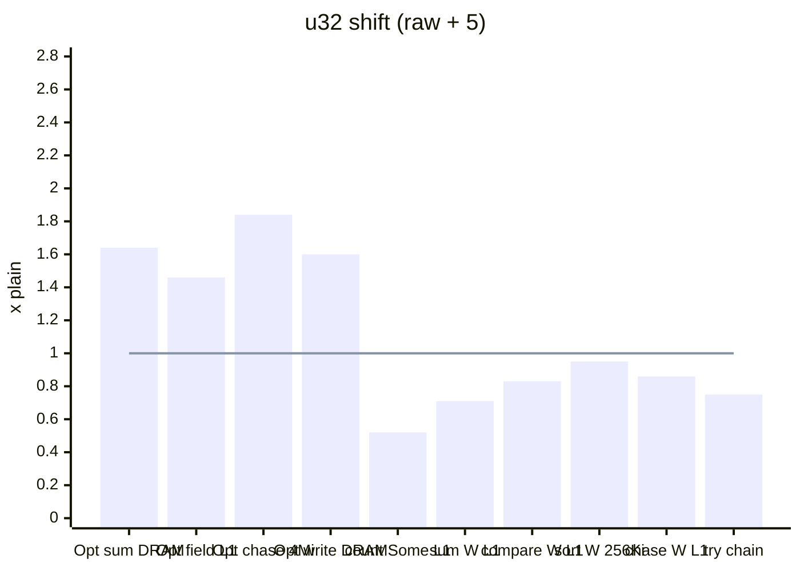

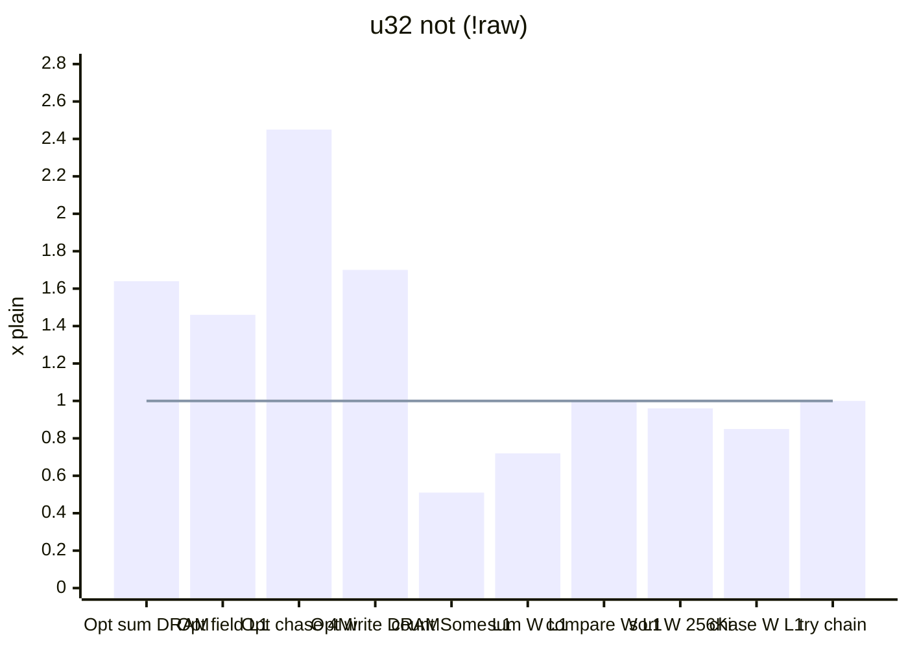

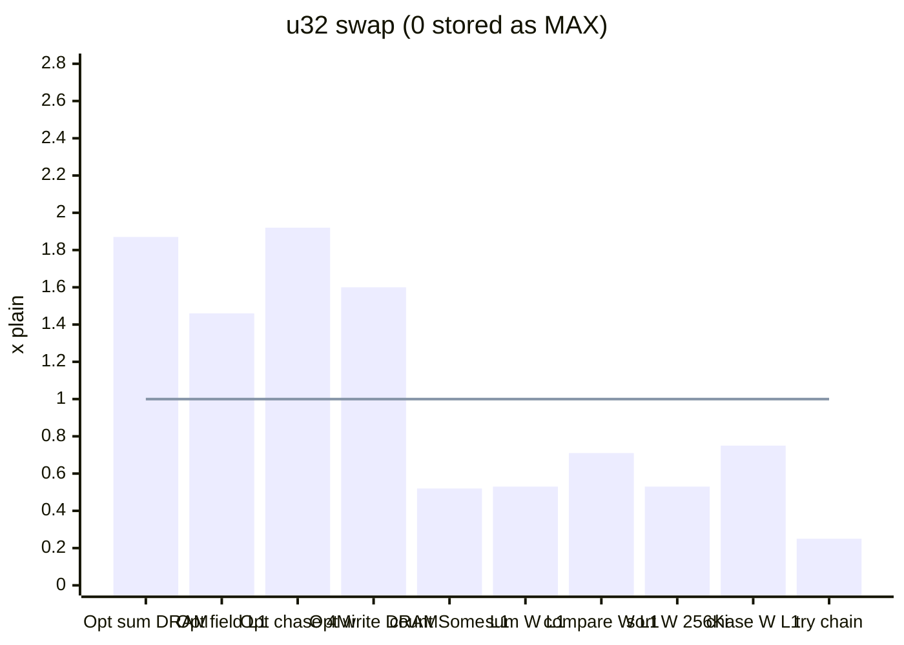

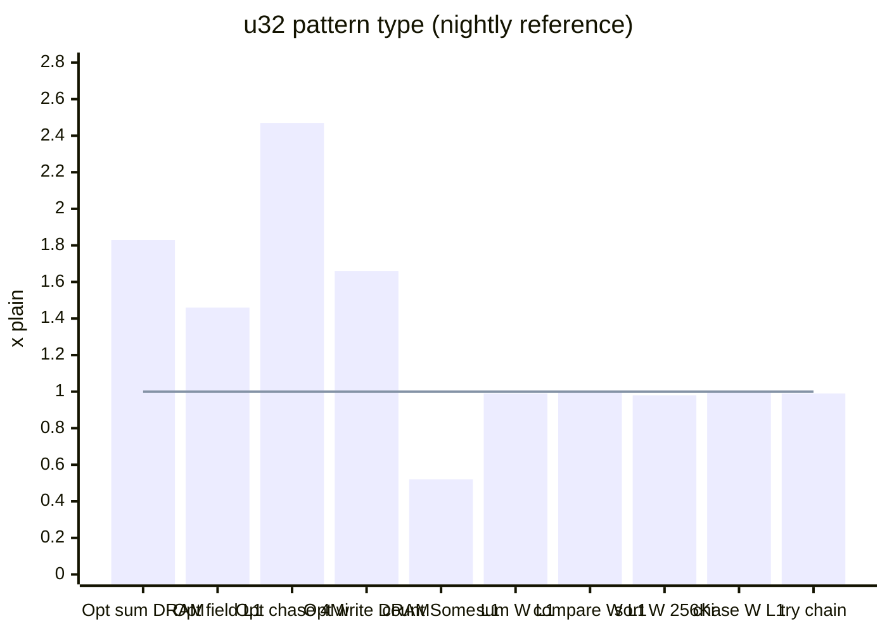

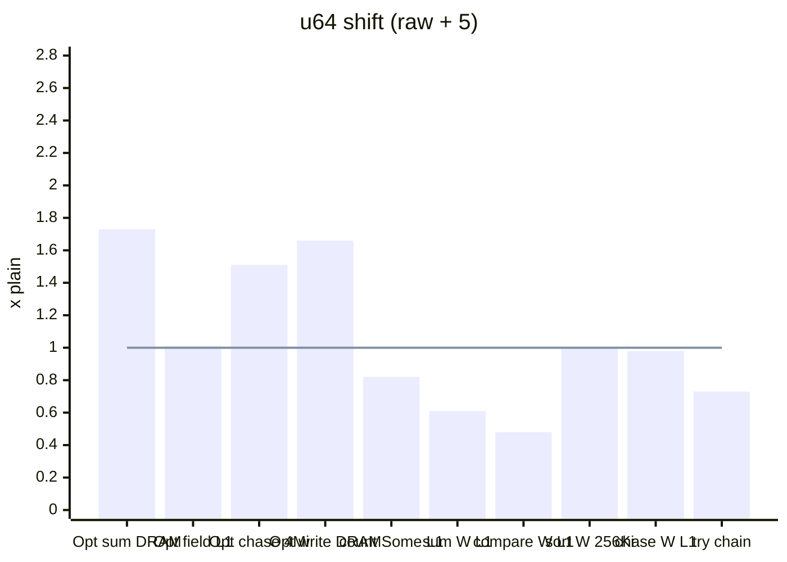

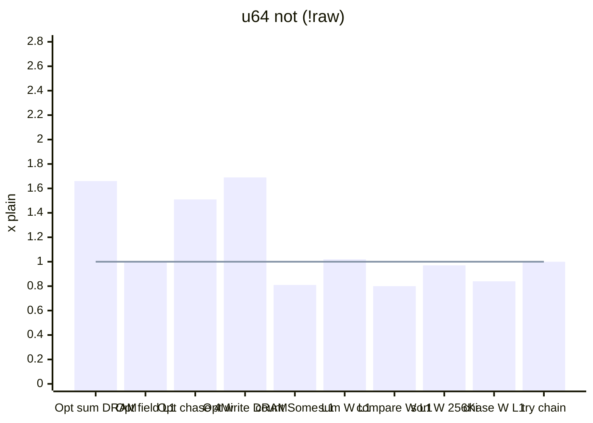

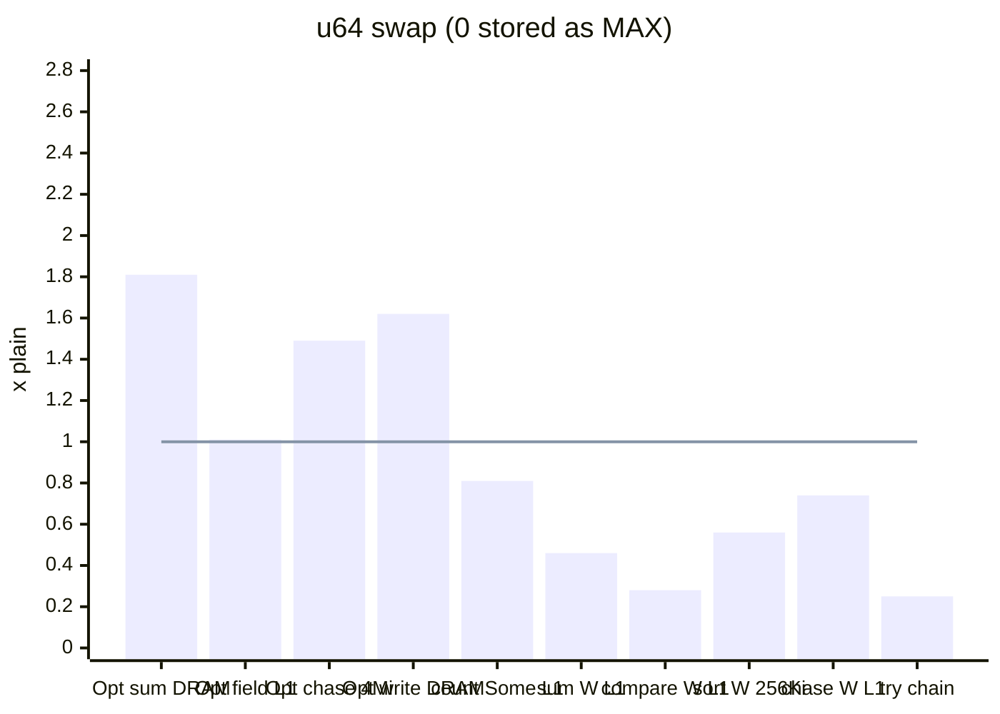

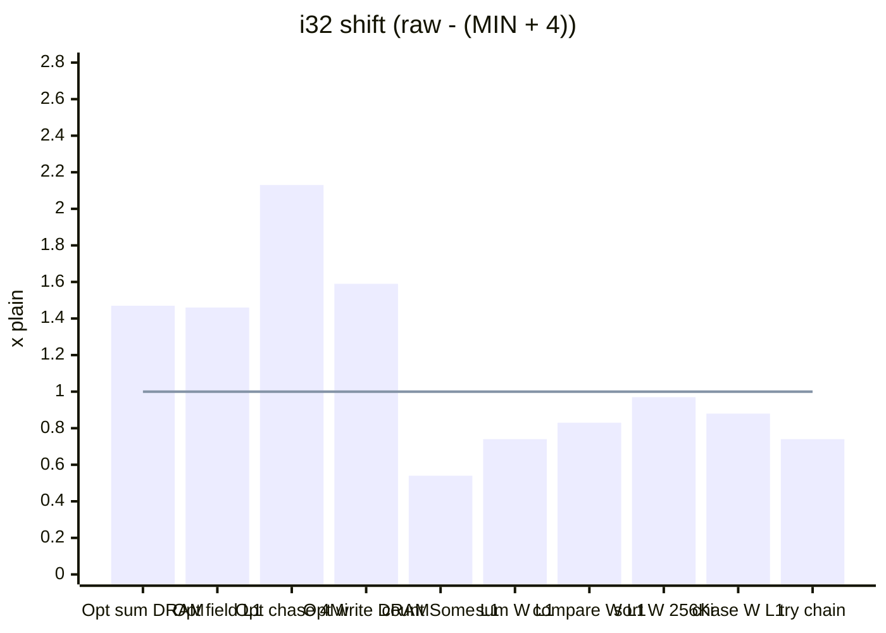

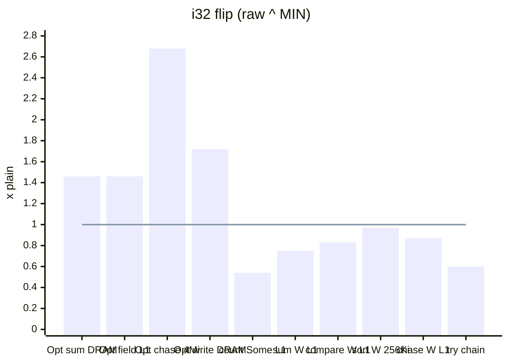

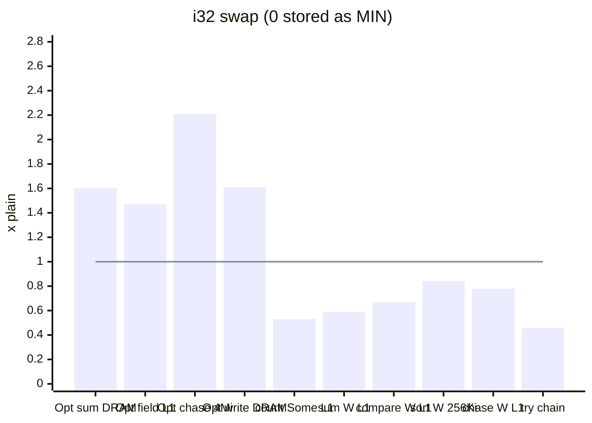

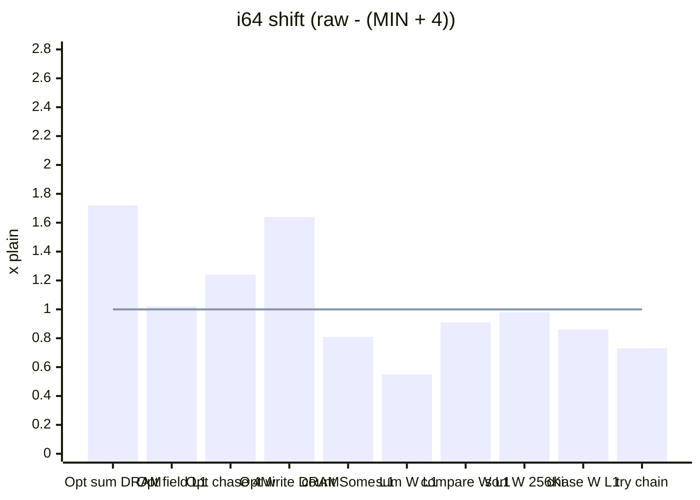

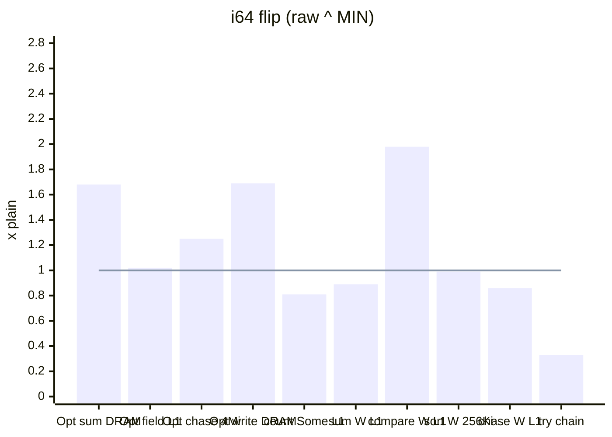

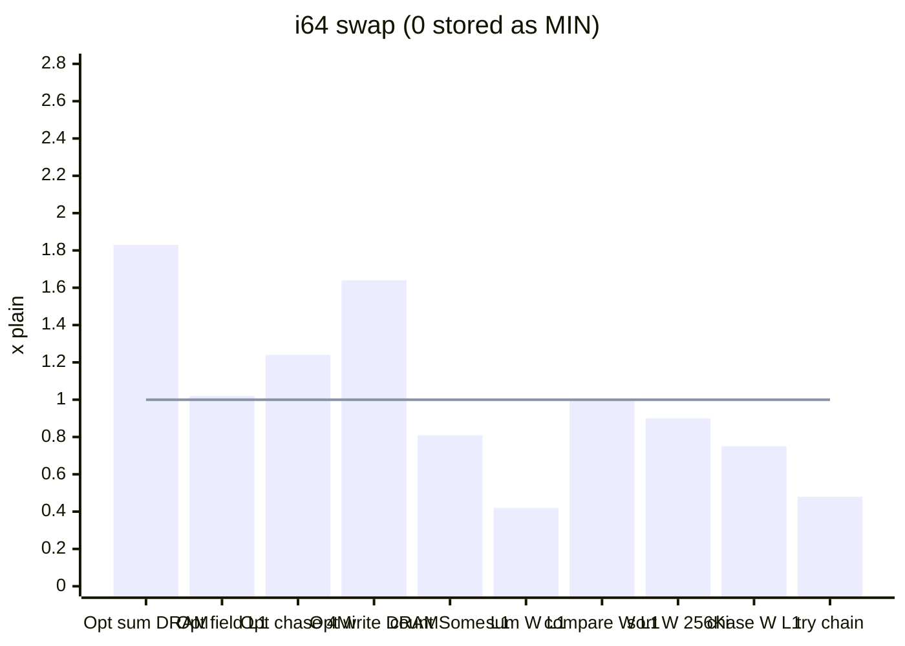

### Findings

- **The gains do not depend on the encoding.** Every niche encoding halves
  `Option<W>`, and every one gains the same where `Option<W>` is stored:
    - memory-bound scans and writes: 1.4-1.9×;
    - working sets that drop below a cache level (`chase_opt` at 256 Ki and
      4 Mi, runs 1-3): 1.8-3.2× for 32-bit types, 1.2-1.6× for 64-bit;
    - a struct with an `Option<W>` field: 1.46× even in L1 for 32-bit types.
- **The `if let` sum is a codegen effect.** `sum_opt` runs 2-3× faster with any
  niche at 4 Ki, where the branch predictor learns the repeating pattern, and
  7-20× faster at larger sizes. LLVM leaves the plain loop scalar, with an
  unpredictable branch per element, and vectorizes most niche loops. Written
  branch-free (`sum_opt_map`), the plain loop compiles to `cmov` (scalar for
  32-bit types, vectorized for `i64`), and the gap in cache shrinks to
  0.77-1.63×.
- **Counting `Some` in L1 is slower with every niche layout**, the pattern
  type included (0.51-0.82×): a layout effect, not an encoding effect.
- **The encoding decides the cost on plain values:**
    - in the single-function probes, complement and sign flip compare at no
      cost. In vectorized loops this holds for `u32` not (`count_lt`
      0.99-1.00) and `i64` flip (1.24-1.98), but not for `i32` flip
      (0.83-0.90) or `u64` not (0.80-0.92). [INFERENCE] The baseline SSE2
      instruction set has only a signed 32-bit vector compare and no 64-bit
      one, so the cost depends on which compare each layout needs;
    - sorting barely separates them: shift, not and flip all sort at
      0.93-1.04×;
    - shift adds an instruction per operand of every comparison (`count_lt`
      0.48-0.93);
    - swap is the slowest on plain values (sorting 0.49-0.92, `count_lt` down
      to 0.28);
    - plain arithmetic reads cost one instruction with every encoding:
      `sum_vals` in L1 at 0.55-0.75 (64-bit `not`/`flip` 0.89-1.02), and a
      dependent `chase` in L1 at 0.75-0.98.
- **Hazard in register-only fallible chains.** In `accum`, sign flip ran at
  0.60 (`i32`) and 0.33 (`i64`), and swap at 0.25-0.48; complement ran at 1.00.
  In the `i64` flip loop LLVM materializes the niche-encoded `Option` result (0
  meaning `None`) and tests it again instead of reusing the validation's
  comparison, with branches on the dependency chain. Plain storage carries a
  separate flag. `PLAN.md`'s `Result<T, ()>` forms use the same niche, so
  implementation must cover this in the assembly tests.
- **The pattern type has the gains without the costs**: `sum_vals` 0.99-1.12,
  `count_lt` 1.00-1.03, `sort` 0.98-1.00, `chase` 0.98-1.15, `accum` 0.99.

### Single-function code (assembly probes)

`u32` probes, x86-64, opt-level 3; instructions excluding `ret`. `add` is
`W::try_make(a.raw().wrapping_add(b.raw()))` returning `Option<W>`; `lt` is
`a.raw() < b.raw()`; `eq7` is `a.raw() == 7`; `or0` is
`o.map_or(0, |w| w.raw())`; `idx` is `table[(a.raw() & 1023) as usize]`. No
probe kept a panic path for the zero test.

| Probe | plain | shift | not | swap | pattern type |
|-------|-------|-------|-----|------|--------------|
| `add` | 4     | 6     | 6   | 12   | 4            |
| `lt`  | 2     | 4     | 2   | 8    | 2            |
| `eq7` | 2     | 2     | 2   | 2    | 2            |
| `or0` | 3     | 3     | 4   | 3    | 3            |
| `idx` | 2     | 3     | 3   | 6    | 2            |

`i32` probes:

| Probe | plain | shift | flip | swap |
|-------|-------|-------|------|------|
| `add` | 4     | 6     | 5    | 12   |
| `lt`  | 2     | 4     | 2    | 9    |
| `eq7` | 2     | 2     | 2    | 2    |
| `or0` | 3     | 3     | 3    | 4    |
| `idx` | 2     | 3     | 2    | 2    |

`lt`, the comparison that separates the encodings:

```asm
; u32 plain, u32 not (seta), i32 flip (setb), u32 pattern type
cmp     edi, esi
setb    al

; u32 shift (raw + 5); i32 shift adds -2147483644 and uses setl
add     edi, -5
add     esi, -5
cmp     edi, esi
setb    al

; u32 swap
cmp     edi, -1
sete    cl
cmp     esi, -1
setne   dl
cmp     edi, esi
setb    al
or      al, cl
and     al, dl
```

Other probes (`raw + 5` storage): `x == 7` folds to `cmp edi, 12`; `x / d`
merges the zero test into `add esi, -5; je`. With `raw + 1`, `lt` is
`dec; dec; cmp` as well: LLVM does not use `stored != 0` to drop the decrement.
Signed `abs` costs two extra instructions under flip. A signed domain
`-1000..=1000` with flip storage compiles `x < y` to `cmp; setb` and `x == -7`
to `cmp edi, 2147483641`.

### Run 3: all encodings (final)

`u32` (nightly run, with the pattern type):

| Workload | Elements | plain ns/op | shift | not | swap | pattern type |
|---|---|---|---|---|---|---|
| `sum_opt` | 4 Ki | 0.409 | 2.41 | 2.44 | 2.96 | 2.87 |
| `sum_opt` | 256 Ki | 2.758 | 15.96 | 16.01 | 19.67 | 19.49 |
| `sum_opt` | 4 Mi | 2.899 | 15.30 | 14.95 | 18.52 | 18.06 |
| `sum_opt` | 32 Mi | 2.870 | 10.81 | 10.59 | 12.35 | 12.32 |
| `sum_opt_map` | 4 Ki | 0.156 | 0.90 | 0.91 | 1.13 | 1.09 |
| `sum_opt_map` | 256 Ki | 0.183 | 1.06 | 1.07 | 1.31 | 1.28 |
| `sum_opt_map` † | 4 Mi | 0.391 | 2.05 | 2.01 | 2.53 | 2.10 |
| `sum_opt_map` | 32 Mi | 0.431 | 1.64 | 1.64 | 1.87 | 1.83 |
| `count_some` | 4 Ki | 0.074 | 0.52 | 0.51 | 0.52 | 0.52 |
| `count_some` | 256 Ki | 0.106 | 0.75 | 0.75 | 0.76 | 0.75 |
| `count_some` † | 4 Mi | 0.274 | 1.75 | 1.77 | 1.73 | 1.78 |
| `count_some` † | 32 Mi | 0.358 | 1.52 | 1.44 | 1.53 | 1.50 |
| `count_roots` | 4 Ki | 0.155 | 1.46 | 1.46 | 1.46 | 1.46 |
| `count_roots` | 256 Ki | 0.180 | 1.48 | 1.49 | 1.47 | 1.57 |
| `count_roots` † | 4 Mi | 0.532 | 1.73 | 1.77 | 1.78 | 1.79 |
| `count_roots` | 32 Mi | 0.558 | 1.51 | 1.53 | 1.52 | 1.52 |
| `sum_vals` | 4 Ki | 0.073 | 0.71 | 0.72 | 0.53 | 0.99 |
| `sum_vals` † | 256 Ki | 0.073 | 0.71 | 0.72 | 0.53 | 1.01 |
| `sum_vals` † | 4 Mi | 0.106 | 0.89 | 0.62 | 0.68 | 1.12 |
| `sum_vals` | 32 Mi | 0.194 | 0.91 | 0.90 | 0.82 | 1.00 |
| `count_lt` | 4 Ki | 0.169 | 0.83 | 1.00 | 0.71 | 1.00 |
| `count_lt` | 256 Ki | 0.169 | 0.82 | 0.99 | 0.71 | 1.00 |
| `count_lt` | 4 Mi | 0.190 | 0.75 | 1.00 | 0.76 | 1.03 |
| `count_lt` | 32 Mi | 0.262 | 0.90 | 1.00 | 0.82 | 1.00 |
| `sort` | 4 Ki | 5.478 | 0.96 | 0.95 | 0.49 | 1.00 |
| `sort` | 256 Ki | 9.870 | 0.95 | 0.96 | 0.53 | 0.98 |
| `sort` † | 4 Mi | 12.029 | 0.97 | 0.97 | 0.53 | 1.00 |
| `add_validated` † | 4 Ki | 0.192 | 1.79 | 1.78 | 1.06 | 1.96 |
| `add_validated` † | 256 Ki | 0.270 | 1.45 | 1.42 | 1.34 | 1.47 |
| `add_validated` | 4 Mi | 0.607 | 0.89 | 0.88 | 0.83 | 0.88 |
| `add_validated` | 32 Mi | 0.640 | 1.45 | 1.42 | 1.46 | 1.47 |
| `make_all` | 4 Ki | 0.157 | 1.64 | 2.22 | 1.68 | 1.99 |
| `make_all` | 256 Ki | 0.213 | 1.70 | 1.75 | 1.47 | 1.23 |
| `make_all` | 4 Mi | 0.478 | 0.82 | 0.88 | 0.86 | 0.83 |
| `make_all` | 32 Mi | 0.551 | 1.60 | 1.70 | 1.60 | 1.66 |
| `chase` | 4 Ki | 1.216 | 0.86 | 0.85 | 0.75 | 1.00 |
| `chase` | 256 Ki | 4.174 | 0.96 | 0.88 | 0.84 | 0.98 |
| `chase` † | 4 Mi | 31.458 | 1.02 | 0.83 | 1.05 | 1.15 |
| `chase` | 32 Mi | 85.131 | 1.00 | 0.99 | 1.00 | 1.01 |
| `chase_opt` | 4 Ki | 1.194 | 0.65 | 0.68 | 0.62 | 0.75 |
| `chase_opt` | 256 Ki | 9.709 | 1.92 | 1.93 | 1.85 | 1.93 |
| `chase_opt` † | 4 Mi | 50.028 | 1.84 | 2.45 | 1.92 | 2.47 |
| `chase_opt` | 32 Mi | 88.810 | 1.06 | 1.06 | 1.06 | 1.05 |
| `accum` | — | 0.201 | 0.75 | 1.00 | 0.25 | 0.99 |

`u64` (stable):

| Workload | Elements | plain ns/op | shift | not | swap |
|---|---|---|---|---|---|
| `sum_opt` | 4 Ki | 0.355 | 1.87 | 1.57 | 2.36 |
| `sum_opt` | 256 Ki | 2.701 | 14.22 | 11.40 | 16.98 |
| `sum_opt` | 4 Mi | 2.967 | 7.74 | 7.46 | 7.90 |
| `sum_opt` | 32 Mi | 2.956 | 7.29 | 6.80 | 7.40 |
| `sum_opt_map` † | 4 Ki | 0.239 | 1.25 | 1.04 | 1.58 |
| `sum_opt_map` | 256 Ki | 0.246 | 1.30 | 1.06 | 1.59 |
| `sum_opt_map` | 4 Mi | 0.708 | 1.96 | 1.74 | 1.91 |
| `sum_opt_map` | 32 Mi | 0.744 | 1.73 | 1.66 | 1.81 |
| `count_some` | 4 Ki | 0.138 | 0.82 | 0.81 | 0.81 |
| `count_some` | 256 Ki | 0.212 | 1.26 | 1.26 | 1.24 |
| `count_some` | 4 Mi | 0.642 | 1.83 | 1.86 | 1.89 |
| `count_some` | 32 Mi | 0.651 | 1.69 | 1.72 | 1.71 |
| `count_roots` | 4 Ki | 0.153 | 1.01 | 1.00 | 1.01 |
| `count_roots` | 256 Ki | 0.308 | 1.39 | 1.42 | 1.38 |
| `count_roots` | 4 Mi | 0.945 | 1.43 | 1.43 | 1.41 |
| `count_roots` | 32 Mi | 0.969 | 1.44 | 1.44 | 1.45 |
| `sum_vals` † | 4 Ki | 0.072 | 0.61 | 1.02 | 0.46 |
| `sum_vals` | 256 Ki | 0.100 | 0.84 | 0.96 | 0.66 |
| `sum_vals` † | 4 Mi | 0.255 | 0.81 | 0.93 | 0.74 |
| `sum_vals` | 32 Mi | 0.332 | 0.91 | 0.99 | 0.84 |
| `count_lt` | 4 Ki | 0.161 | 0.48 | 0.80 | 0.28 |
| `count_lt` | 256 Ki | 0.160 | 0.49 | 0.81 | 0.28 |
| `count_lt` | 4 Mi | 0.348 | 0.74 | 0.92 | 0.52 |
| `count_lt` | 32 Mi | 0.372 | 0.74 | 0.92 | 0.54 |
| `sort` | 4 Ki | 5.476 | 1.04 | 0.93 | 0.50 |
| `sort` | 256 Ki | 10.538 | 1.00 | 0.97 | 0.56 |
| `sort` | 4 Mi | 13.389 | 1.02 | 0.98 | 0.58 |
| `add_validated` | 4 Ki | 0.341 | 0.80 | 0.80 | 0.61 |
| `add_validated` | 256 Ki | 0.507 | 0.31 | 0.31 | 0.21 |
| `add_validated` | 4 Mi | 1.250 | 1.46 | 1.47 | 1.42 |
| `add_validated` | 32 Mi | 1.272 | 1.49 | 1.48 | 1.43 |
| `make_all` | 4 Ki | 0.273 | 0.75 | 0.89 | 0.90 |
| `make_all` | 256 Ki | 0.441 | 0.31 | 0.33 | 0.20 |
| `make_all` | 4 Mi | 1.119 | 1.72 | 1.76 | 1.65 |
| `make_all` | 32 Mi | 1.135 | 1.66 | 1.69 | 1.62 |
| `chase` | 4 Ki | 1.189 | 0.98 | 0.84 | 0.74 |
| `chase` | 256 Ki | 7.564 | 1.04 | 1.04 | 1.01 |
| `chase` † | 4 Mi | 53.234 | 1.00 | 0.98 | 1.05 |
| `chase` | 32 Mi | 90.015 | 1.00 | 1.00 | 1.00 |
| `chase_opt` | 4 Ki | 2.292 | 1.28 | 1.29 | 1.13 |
| `chase_opt` | 256 Ki | 10.955 | 1.40 | 1.42 | 1.36 |
| `chase_opt` † | 4 Mi | 75.715 | 1.51 | 1.51 | 1.49 |
| `chase_opt` | 32 Mi | 90.028 | 1.00 | 1.00 | 1.00 |
| `accum` | — | 0.198 | 0.73 | 1.00 | 0.25 |

`i32` (stable):

| Workload | Elements | plain ns/op | shift | flip | swap |
|---|---|---|---|---|---|
| `sum_opt` | 4 Ki | 0.412 | 2.04 | 2.04 | 2.44 |
| `sum_opt` | 256 Ki | 2.758 | 13.66 | 13.67 | 16.01 |
| `sum_opt` | 4 Mi | 2.855 | 12.97 | 13.18 | 13.80 |
| `sum_opt` | 32 Mi | 2.866 | 10.13 | 10.12 | 10.89 |
| `sum_opt_map` | 4 Ki | 0.152 | 0.77 | 0.77 | 0.91 |
| `sum_opt_map` | 256 Ki | 0.173 | 0.87 | 0.88 | 1.03 |
| `sum_opt_map` | 4 Mi | 0.386 | 1.79 | 1.81 | 2.09 |
| `sum_opt_map` | 32 Mi | 0.412 | 1.47 | 1.46 | 1.60 |
| `count_some` † | 4 Ki | 0.075 | 0.54 | 0.54 | 0.53 |
| `count_some` | 256 Ki | 0.103 | 0.75 | 0.74 | 0.74 |
| `count_some` | 4 Mi | 0.269 | 1.72 | 1.66 | 1.73 |
| `count_some` | 32 Mi | 0.335 | 1.45 | 1.44 | 1.44 |
| `count_roots` | 4 Ki | 0.153 | 1.46 | 1.46 | 1.47 |
| `count_roots` | 256 Ki | 0.184 | 1.53 | 1.51 | 1.53 |
| `count_roots` † | 4 Mi | 0.528 | 1.72 | 1.72 | 1.76 |
| `count_roots` | 32 Mi | 0.558 | 1.54 | 1.51 | 1.55 |
| `sum_vals` | 4 Ki | 0.098 | 0.74 | 0.75 | 0.59 |
| `sum_vals` | 256 Ki | 0.099 | 0.74 | 0.75 | 0.59 |
| `sum_vals` † | 4 Mi | 0.135 | 0.87 | 0.89 | 0.71 |
| `sum_vals` | 32 Mi | 0.211 | 0.91 | 0.92 | 0.79 |
| `count_lt` | 4 Ki | 0.140 | 0.83 | 0.83 | 0.67 |
| `count_lt` | 256 Ki | 0.139 | 0.84 | 0.83 | 0.67 |
| `count_lt` | 4 Mi | 0.154 | 0.79 | 0.84 | 0.70 |
| `count_lt` | 32 Mi | 0.231 | 0.90 | 0.90 | 0.80 |
| `sort` | 4 Ki | 5.162 | 0.96 | 0.96 | 0.77 |
| `sort` | 256 Ki | 9.672 | 0.97 | 0.97 | 0.84 |
| `sort` | 4 Mi | 11.874 | 0.97 | 0.98 | 0.87 |
| `add_validated` | 4 Ki | 0.158 | 1.76 | 1.52 | 0.80 |
| `add_validated` | 256 Ki | 0.250 | 1.45 | 1.43 | 1.24 |
| `add_validated` | 4 Mi | 0.578 | 0.88 | 0.90 | 0.77 |
| `add_validated` | 32 Mi | 0.614 | 1.47 | 1.46 | 1.46 |
| `make_all` † | 4 Ki | 0.121 | 1.42 | 2.00 | 1.16 |
| `make_all` | 256 Ki | 0.211 | 1.76 | 1.74 | 1.74 |
| `make_all` | 4 Mi | 0.452 | 0.81 | 0.87 | 0.79 |
| `make_all` | 32 Mi | 0.539 | 1.59 | 1.72 | 1.61 |
| `chase` | 4 Ki | 1.410 | 0.88 | 0.87 | 0.78 |
| `chase` | 256 Ki | 5.112 | 1.01 | 1.02 | 0.98 |
| `chase` † | 4 Mi | 25.362 | 1.16 | 0.75 | 1.07 |
| `chase` | 32 Mi | 85.170 | 1.00 | 1.01 | 1.00 |
| `chase_opt` | 4 Ki | 1.403 | 0.71 | 0.72 | 0.66 |
| `chase_opt` | 256 Ki | 10.032 | 1.94 | 1.85 | 1.78 |
| `chase_opt` | 4 Mi | 54.078 | 2.13 | 2.68 | 2.21 |
| `chase_opt` | 32 Mi | 89.555 | 1.05 | 1.05 | 1.05 |
| `accum` | — | 0.202 | 0.74 | 0.60 | 0.46 |

`i64` (stable):

| Workload | Elements | plain ns/op | shift | flip | swap |
|---|---|---|---|---|---|
| `sum_opt` | 4 Ki | 0.369 | 1.96 | 1.64 | 2.39 |
| `sum_opt` | 256 Ki | 2.751 | 14.42 | 12.27 | 17.63 |
| `sum_opt` | 4 Mi | 2.995 | 7.86 | 7.71 | 8.48 |
| `sum_opt` | 32 Mi | 2.981 | 7.02 | 6.89 | 7.48 |
| `sum_opt_map` | 4 Ki | 0.247 | 1.32 | 1.11 | 1.61 |
| `sum_opt_map` | 256 Ki | 0.258 | 1.39 | 1.18 | 1.63 |
| `sum_opt_map` † | 4 Mi | 0.701 | 1.86 | 1.72 | 1.86 |
| `sum_opt_map` | 32 Mi | 0.728 | 1.72 | 1.68 | 1.83 |
| `count_some` | 4 Ki | 0.139 | 0.81 | 0.81 | 0.81 |
| `count_some` | 256 Ki | 0.213 | 1.23 | 1.23 | 1.23 |
| `count_some` | 4 Mi | 0.634 | 1.89 | 1.88 | 1.93 |
| `count_some` | 32 Mi | 0.655 | 1.70 | 1.69 | 1.69 |
| `count_roots` | 4 Ki | 0.157 | 1.02 | 1.02 | 1.02 |
| `count_roots` | 256 Ki | 0.301 | 1.39 | 1.39 | 1.36 |
| `count_roots` | 4 Mi | 0.946 | 1.43 | 1.43 | 1.44 |
| `count_roots` | 32 Mi | 0.951 | 1.42 | 1.42 | 1.42 |
| `sum_vals` | 4 Ki | 0.065 | 0.55 | 0.89 | 0.42 |
| `sum_vals` | 256 Ki | 0.106 | 0.84 | 0.95 | 0.68 |
| `sum_vals` | 4 Mi | 0.246 | 0.84 | 0.92 | 0.66 |
| `sum_vals` | 32 Mi | 0.332 | 0.90 | 0.98 | 0.83 |
| `count_lt` | 4 Ki | 0.303 | 0.91 | 1.98 | 1.00 |
| `count_lt` | 256 Ki | 0.307 | 0.90 | 1.94 | 1.00 |
| `count_lt` | 4 Mi | 0.437 | 0.93 | 1.34 | 0.93 |
| `count_lt` | 32 Mi | 0.478 | 0.93 | 1.24 | 0.97 |
| `sort` | 4 Ki | 5.405 | 0.96 | 0.97 | 0.84 |
| `sort` | 256 Ki | 10.539 | 0.98 | 0.99 | 0.90 |
| `sort` | 4 Mi | 13.362 | 0.98 | 1.00 | 0.92 |
| `add_validated` | 4 Ki | 0.355 | 0.84 | 0.79 | 0.65 |
| `add_validated` | 256 Ki | 0.520 | 1.17 | 1.09 | 0.96 |
| `add_validated` | 4 Mi | 1.278 | 1.48 | 1.47 | 1.44 |
| `add_validated` | 32 Mi | 1.284 | 1.44 | 1.48 | 1.42 |
| `make_all` | 4 Ki | 0.289 | 0.69 | 0.85 | 1.06 |
| `make_all` | 256 Ki | 0.450 | 1.06 | 1.32 | 1.54 |
| `make_all` | 4 Mi | 1.129 | 1.68 | 1.75 | 1.68 |
| `make_all` | 32 Mi | 1.152 | 1.64 | 1.69 | 1.64 |
| `chase` | 4 Ki | 1.212 | 0.86 | 0.86 | 0.75 |
| `chase` † | 256 Ki | 8.575 | 0.95 | 0.96 | 0.95 |
| `chase` † | 4 Mi | 65.221 | 1.00 | 1.00 | 0.97 |
| `chase` | 32 Mi | 90.687 | 1.00 | 1.00 | 1.00 |
| `chase_opt` | 4 Ki | 2.346 | 1.23 | 1.32 | 1.17 |
| `chase_opt` | 256 Ki | 12.702 | 1.36 | 1.39 | 1.35 |
| `chase_opt` † | 4 Mi | 85.336 | 1.24 | 1.25 | 1.24 |
| `chase_opt` | 32 Mi | 91.764 | 1.00 | 1.00 | 1.00 |
| `accum` | — | 0.203 | 0.73 | 0.33 | 0.48 |

### Run 2: `raw + 5` and the pattern type

`u32` (nightly):

| Workload | Elements | plain ns/op | `raw + 5` | pattern type |
|---|---|---|---|---|
| `sum_opt` | 4 Ki | 0.354 | 2.15 | 2.65 |
| `sum_opt` | 256 Ki | 2.641 | 16.09 | 19.45 |
| `sum_opt` | 4 Mi | 2.779 | 15.42 | 15.33 |
| `sum_opt` | 32 Mi | 2.724 | 10.83 | 12.11 |
| `sum_opt_map` | 4 Ki | 0.152 | 0.90 | 1.11 |
| `sum_opt_map` | 256 Ki | 0.172 | 1.04 | 1.28 |
| `sum_opt_map` | 4 Mi | 0.361 | 2.02 | 2.40 |
| `sum_opt_map` | 32 Mi | 0.404 | 1.62 | 1.82 |
| `count_some` † | 4 Ki | 0.076 | 0.55 | 0.55 |
| `count_some` | 256 Ki | 0.106 | 0.79 | 0.79 |
| `count_some` | 4 Mi | 0.270 | 1.71 | 1.75 |
| `count_some` | 32 Mi | 0.337 | 1.46 | 1.46 |
| `count_roots` | 4 Ki | 0.148 | 1.46 | 1.48 |
| `count_roots` | 256 Ki | 0.171 | 1.37 | 1.51 |
| `count_roots` | 4 Mi | 0.529 | 1.79 | 1.89 |
| `count_roots` | 32 Mi | 0.532 | 1.51 | 1.45 |
| `sum_vals` | 4 Ki | 0.072 | 0.71 | 1.01 |
| `sum_vals` | 256 Ki | 0.069 | 0.71 | 0.98 |
| `sum_vals` † | 4 Mi | 0.089 | 0.77 | 0.98 |
| `sum_vals` † | 32 Mi | 0.185 | 0.93 | 1.00 |
| `add_validated` | 4 Ki | 0.183 | 1.79 | 1.89 |
| `add_validated` | 256 Ki | 0.247 | 1.50 | 1.47 |
| `add_validated` | 4 Mi | 0.595 | 0.90 | 0.89 |
| `add_validated` | 32 Mi | 0.605 | 1.47 | 1.46 |
| `make_all` | 4 Ki | 0.152 | 1.58 | 1.96 |
| `make_all` | 256 Ki | 0.203 | 1.74 | 1.73 |
| `make_all` | 4 Mi | 0.458 | 0.81 | 0.84 |
| `make_all` | 32 Mi | 0.524 | 1.65 | 1.62 |
| `chase` | 4 Ki | 1.204 | 0.86 | 1.00 |
| `chase` | 256 Ki | 4.471 | 0.98 | 0.97 |
| `chase` † | 4 Mi | 19.888 | 0.98 | 1.02 |
| `chase` | 32 Mi | 83.478 | 1.00 | 1.01 |
| `chase_opt` | 4 Ki | 1.176 | 0.64 | 0.76 |
| `chase_opt` | 256 Ki | 9.607 | 1.83 | 2.00 |
| `chase_opt` † | 4 Mi | 47.639 | 2.08 | 2.30 |
| `chase_opt` | 32 Mi | 88.920 | 1.06 | 1.05 |
| `accum` | — | 0.202 | 0.78 | 1.03 |

`u64` (stable):

| Workload | Elements | plain ns/op | `raw + 5` |
|---|---|---|---|
| `sum_opt` | 4 Ki | 0.385 | 2.08 |
| `sum_opt` | 256 Ki | 2.762 | 14.78 |
| `sum_opt` | 4 Mi | 2.954 | 7.84 |
| `sum_opt` | 32 Mi | 2.996 | 7.21 |
| `sum_opt_map` | 4 Ki | 0.245 | 1.29 |
| `sum_opt_map` | 256 Ki | 0.249 | 1.35 |
| `sum_opt_map` | 4 Mi | 0.707 | 1.88 |
| `sum_opt_map` | 32 Mi | 0.736 | 1.83 |
| `count_some` | 4 Ki | 0.137 | 0.81 |
| `count_some` † | 256 Ki | 0.210 | 1.25 |
| `count_some` | 4 Mi | 0.627 | 1.89 |
| `count_some` † | 32 Mi | 0.652 | 1.70 |
| `count_roots` | 4 Ki | 0.156 | 1.02 |
| `count_roots` | 256 Ki | 0.279 | 1.29 |
| `count_roots` | 4 Mi | 0.931 | 1.40 |
| `count_roots` | 32 Mi | 0.961 | 1.44 |
| `sum_vals` | 4 Ki | 0.063 | 0.54 |
| `sum_vals` | 256 Ki | 0.103 | 0.86 |
| `sum_vals` † | 4 Mi | 0.243 | 0.90 |
| `sum_vals` | 32 Mi | 0.317 | 0.91 |
| `add_validated` | 4 Ki | 0.337 | 0.81 |
| `add_validated` | 256 Ki | 0.502 | 1.18 |
| `add_validated` | 4 Mi | 1.230 | 1.49 |
| `add_validated` | 32 Mi | 1.255 | 1.46 |
| `make_all` | 4 Ki | 0.274 | 0.74 |
| `make_all` | 256 Ki | 0.429 | 1.15 |
| `make_all` | 4 Mi | 1.087 | 1.67 |
| `make_all` | 32 Mi | 1.108 | 1.66 |
| `chase` | 4 Ki | 1.164 | 0.99 |
| `chase` | 256 Ki | 7.941 | 1.10 |
| `chase` † | 4 Mi | 47.947 | 1.00 |
| `chase` | 32 Mi | 88.099 | 1.00 |
| `chase_opt` | 4 Ki | 2.290 | 1.28 |
| `chase_opt` | 256 Ki | 10.844 | 1.27 |
| `chase_opt` | 4 Mi | 75.227 | 1.64 |
| `chase_opt` | 32 Mi | 89.955 | 1.02 |
| `accum` | — | 0.198 | 0.73 |

### Run 1: `raw + 5` against `raw + 1`

`u32` (stable; pointer chases at 64 M steps per sample):

| Workload | Elements | plain ns/op | `raw + 5` | `raw + 1` |
|---|---|---|---|---|
| `sum_opt` | 4 Ki | 0.360 | 2.11 | 1.78 |
| `sum_opt` | 256 Ki | 2.664 | 15.96 | 13.46 |
| `sum_opt` | 4 Mi | 2.810 | 15.19 | 12.95 |
| `sum_opt` † | 32 Mi | 2.833 | 10.42 | 9.67 |
| `count_some` † | 4 Ki | 0.087 | 0.58 | 0.60 |
| `count_some` † | 256 Ki | 0.116 | 0.83 | 0.84 |
| `count_some` | 4 Mi | 0.264 | 1.71 | 1.65 |
| `count_some` | 32 Mi | 0.329 | 1.41 | 1.44 |
| `sum_vals` † | 4 Ki | 0.075 | 0.75 | 0.74 |
| `sum_vals` † | 256 Ki | 0.079 | 0.80 | 0.80 |
| `sum_vals` † | 4 Mi | 0.092 | 0.80 | 0.79 |
| `sum_vals` | 32 Mi | 0.188 | 0.92 | 0.95 |
| `add_validated` | 4 Ki | 0.191 | 1.81 | 1.80 |
| `add_validated` | 256 Ki | 0.247 | 1.48 | 1.47 |
| `add_validated` | 4 Mi | 0.582 | 0.88 | 0.86 |
| `add_validated` | 32 Mi | 0.607 | 1.46 | 1.48 |
| `make_all` | 4 Ki | 0.154 | 1.60 | 1.98 |
| `make_all` † | 256 Ki | 0.231 | 1.83 | 1.83 |
| `make_all` | 4 Mi | 0.469 | 0.83 | 0.87 |
| `make_all` | 32 Mi | 0.527 | 1.64 | 1.65 |
| `chase` | 4 Ki | 1.173 | 0.85 | 0.85 |
| `chase` | 256 Ki | 4.343 | 1.00 | 0.91 |
| `chase` † | 4 Mi | 15.403 | 1.04 | 0.75 |
| `chase` | 32 Mi | 85.432 | 0.99 | 0.99 |
| `chase_opt` | 4 Ki | 1.199 | 0.63 | 0.75 |
| `chase_opt` | 256 Ki | 9.300 | 1.78 | 1.94 |
| `chase_opt` | 4 Mi | 44.849 | 2.90 | 3.21 |
| `chase_opt` | 32 Mi | 88.408 | 1.07 | 1.07 |
| `accum` | — | 0.203 | 0.77 | 0.76 |

### Unexplained results

- `u64` `add_validated` and `make_all` at 256 Ki: run 3 measured every niche
  encoding at 0.20-0.33×, while run 2 measured `raw + 5` at 1.18× and 1.15×
  with the same code and the same plain time (0.507 against 0.502 ns). The
  spreads are small within each run. [INFERENCE] The placement of the three
  arrays in memory (4 KiB aliasing between loads and stores) differs between
  runs. It should be rechecked before relying on this row either way.
- Rows at 4 Mi elements straddle the L3 and carry most † marks; the pointer
  chases there are sensitive to page placement.
- `add_validated` and `make_all` at 4 Mi are slower with a niche (0.77-0.90×)
  for 32-bit types (`u32` in all three runs), although the niche writes half
  the bytes.

## Consequences

- Niche storage pays where `Option<W>` (or `Result<W, ()>`, which uses the same
  niche) sits in memory: collections, struct fields, caches, lookup tables.
  Elsewhere it costs. Users choose it per type; the documentation must state
  both sides and the changed bit pattern.
- `PLAN.md` Q22 recommends `NonZero` holding `raw ^ k` only to remove the signed
  `MIN / -1` test. This ADR generalizes that storage to every domain that
  excludes a value; Q22 should point here when `PLAN.md` is next revised.
- When implemented, the assembly suite (ADR 0019) compares niche storage with
  hand-written encoded code, not with raw code, and keeps a negative control
  without it. It must include a register-only chain of fallible operations
  (the `accum` hazard) for each encoding.
- The e2e suite needs: `size_of::<Option<W>>()`, round trips at both domain
  edges and at the value mapped to 0, the encoding chosen at every pointer
  width, generic wrappers, and the panic of a raw value outside the domain
  through every construction path. Unit tests cover the encoding choice and its
  diagnostics.
- Bitflag value types, enum storage and pattern types interact only through the
  precedence above.

## Sources

- Measurements and assembly from 2026-11-08: the throwaway crate
  `/tmp/typekin_shifted_bench` (results `stable_u32.md`, `nightly_u32.md`,
  `stable_u64.md`, `r3_*.md`), signed and complement probes in
  `/tmp/typekin_shifted_signed`, pattern-type probe in `/tmp/pt_probe`. None of
  them is part of the repository.
- Run commands: `cargo +stable build --release --offline` (pattern type:
  `cargo +nightly build --release --offline --features ranged`), then
  `taskset -c 8 target/release/shifted_bench u32|u64|i32|i64`. Assembly:
  `cargo +stable rustc --release --offline -- --emit asm -C llvm-args=-x86-asm-syntax=intel`.
- `PLAN.md` §4.4 (enum storage probe and compile costs, the `NonZero` encodings
  table), `PLAN_0.md` D0.5 and W10.
